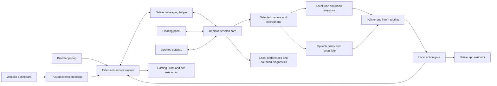
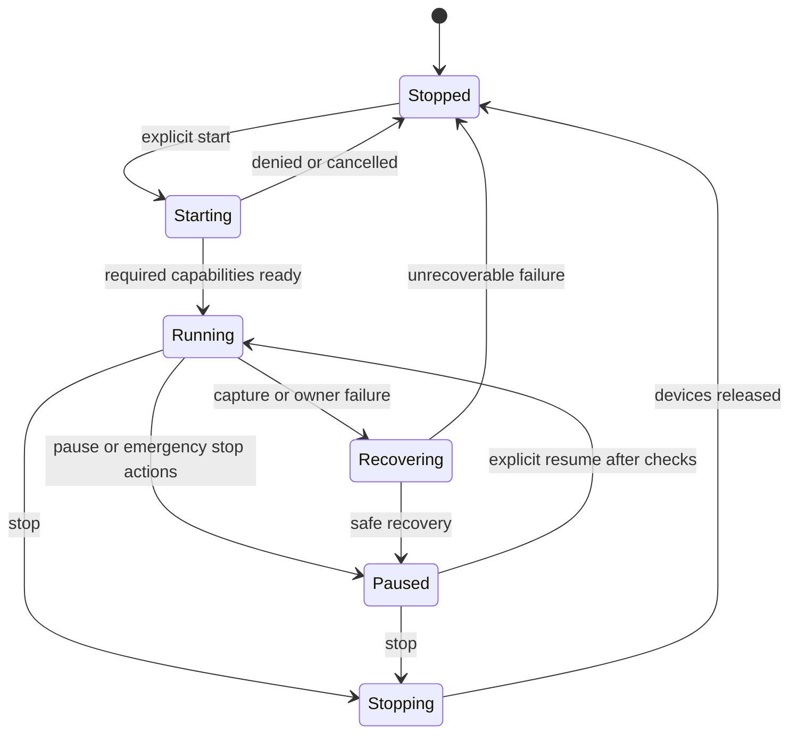

# Handsfree desktop app, extension, website, and floating panel plan

Prepared 2026-10-11. Updated after the user requested implementation with macOS as the primary target. The macOS desktop milestone is now in progress; the dated implementation report in `desktop/README.md` records what has actually been built and tested.

This is the requested large implementation plan, saved under the active filename `app-docs.md`.

## 1. The product we are building

Handsfree should let a person control their computer through voice, head movement, and broad hand movement. The desktop app handles native applications and system input. The existing extension handles browser documents, tabs, and website-specific actions. The website remains the public entry point and browser dashboard. A floating desktop panel gives the user a small, persistent place to see what Handsfree is doing and stop it.

The app and extension must behave as one session when connected. Saying a command once must produce one action. Closing a popup must not stop tracking. Opening settings must not accidentally redirect dictation into the settings screen. Pausing from any connected control must stop pending actions everywhere.

The primary launch target is an Apple Silicon M4 Mac running macOS 26. The user explicitly prioritized Macs when starting implementation. Arch Linux x86_64 with Hyprland remains a secondary target. Broader Linux support follows explicit qualification rather than a blanket compatibility claim.

Direct controls come first. Bounded multi-step requests follow after focus tracking, action verification, cancellation, and recovery work reliably. The eventual scope includes application control, dictation, file management, media, and multi-step tasks.

Development must work from VS Code using documented terminal commands. The installed app must also work without VS Code, Node, or Cargo. VS Code is a development environment, not a runtime dependency for distributed packages.

Releases should follow the practical pattern in Multi Codex: downloadable GitHub Release assets, simple install/update scripts, package checksums, native installation tests, and clear first-open instructions for an unsigned Mac build. Apple Developer ID signing and notarization are optional future improvements, not a launch dependency selected by this user.

## 2. Confirmed answers and remaining assumptions

| Topic | Confirmed user direction | Planning consequence |
| --- | --- | --- |
| General tasks | All offered categories are wanted | Build application control, writing, files, media, then multi-step workflows in stages |
| Linux | Current device | Qualify Arch x86_64 and Hyprland Wayland directly |
| Mac | M4, macOS 26, most important | First native Mac package is aarch64 with macOS 26 baseline |
| Popup | Floating desktop panel | Design a persistent desktop panel; preserve the existing browser popup as a secondary entry |
| First release behavior | Direct controls first | Delay multi-step execution until direct actions pass safety and integration gates |
| Offline | Not a general launch requirement | Other tasks can use disclosed cloud speech/AI; network errors remain explicit |
| Writing | Keep recognition and cleanup on-device | Never fall back to cloud while entering or correcting Writing content |
| Development | Run from VS Code | Provide source setup, tasks, logs, and native debugging commands |
| Verification | Use a GitHub macOS runner, plus physical Mac available | Test real packages in CI; separately test camera, permissions, pointer, and focus on M4 |
| Distribution | Follow wrestle-R/multi-codex and upload Releases | Prepare release automation and publish actual verified packages when built |
| Signing | No Apple Developer account needed for this path | Use explicitly opted-in unsigned distribution with app-specific macOS approval |

Assumptions remain marked throughout this document. They are implementation recommendations, not additional user answers.

- Default native qualification apps are VS Code, the platform file manager, and a plain text editor. The user did not choose an alternate list.
- Keep no account requirement and no central application backend for the first release.
- Keep English as the initial speech language, consistent with existing project preferences.
- Keep existing safety confirmations and deliberate head/hand switching.
- Use `desktop/` for the new app rather than replacing `next/` or `extension/`.
- Use the current Git remote as the release destination. Recheck it before publication.
- No deadline was supplied. Dependencies determine build order; calendar estimates follow the platform spikes.

## 3. Repository identity and source evidence

The local project is `romeirofernandes/TeamLoondry_college_round`. The linked desktop prototype belongs to `yashpunmiya/Team4i_college_round`. Multi Codex belongs to `wrestle-R/multi-codex`. BnB-Sample belongs to `fredrick-nadar/BnB-Sample`. These are four distinct repositories.

| Repository | Inspected revision | Role in this plan |
| --- | --- | --- |
| Current Handsfree project | `5f3b6485db76db6749d79fcfa422b7e254353323` | Integration destination and existing browser implementation |
| Team4i reference | `f805d3c46c5c7a9e4a6cb5a336bc51d6ef6bd805` | Desktop architecture reference |
| Multi Codex reference | `9503f3a7fc934fd076e4052256e1fdfeea14384b` | Installation and release workflow reference |

Reference repositories were cloned into temporary directories for read-only source inspection. Their code was not executed, installed, or copied into this project. The initial planning pass did not build an app; the Mac-first preview added afterward is recorded in section 65.

The local notes already contain older-chat imports. This plan uses those recorded imports and current files without claiming access to additional conversations. Important continuity sources are `local-docs/preferences.md`, `local-docs/context.md`, `local-docs/tasks.md`, and the onboarding audit. Private notes must stay ignored and must not enter a release archive.

Public reference links are [Team4i](https://github.com/yashpunmiya/Team4i_college_round), [Multi Codex](https://github.com/wrestle-R/multi-codex), and [BnB-Sample](https://github.com/fredrick-nadar/BnB-Sample). File-level links below point to inspected revisions where practical.

## 4. What the current project already provides

The project has a Chrome Manifest V3 extension in `extension/` and a Next.js website in `next/`. The Mac-first native preview now lives in `desktop/`. It has not yet paired with the extension or shared session state with the website.

| File or area | Current responsibility | Planned treatment |
| --- | --- | --- |
| `extension/src/background.ts` | Browser session coordination, providers, tab actions, stale-result guards | Retain; add companion transport and browser executor ownership |
| `extension/src/offscreen.ts` | Camera and speech lifecycle independent of popup | Retain for standalone extension mode; coordinate capture ownership |
| `extension/src/shared.ts` | Settings, session state, intents, messages | Extract portable types gradually; do not make native code depend on Chrome objects |
| `extension/src/tracking/` | Local face/hand inference, calibration, filtering | Reuse math and contracts; qualify desktop capture/inference separately |
| `extension/src/core/parser.ts` | Deterministic command parsing | Reuse supported commands; add domain-scoped native commands |
| `extension/src/core/safety.ts` | Existing browser action gates | Preserve; extend policy contracts for native execution |
| `extension/src/content/runtime.ts` | DOM action, typing target, dwell, page revision | Keep browser executor in the extension |
| `extension/src/sites/` | Website action adapters and boundaries | Preserve; no generic native click bypass around website guards |
| `extension/src/dashboard-bridge.ts` | Trusted dashboard request bridge | Retain explicit allowlist and sender validation |
| `extension/src/ui/index.tsx` | Minimal browser popup and live preview | Keep as secondary session entry and companion status |
| `next/lib/extension-bridge.ts` | Website-to-extension requests and subscriptions | Extend with connection state; do not expose direct OS calls |
| `next/components/dashboard/` | Current browser dashboard | Reuse relevant preferences and session UI through shared contracts |
| `docs/architecture.md` | Current extension architecture | Update after implementation, not before behavior exists |
| `mode-plan.md` | Proposed reading/browsing/writing behavior | Carry its confirmed semantics into app planning |
| `local-docs/onboarding-dashboard-review.md` | Audit and pending onboarding changes | Preserve and schedule alongside shared preferences work |

Prior notes report extensive extension and dashboard tests. These are historical results, not reruns in this session. They do not establish native compatibility, real speech accuracy, or physical-device tracking accuracy.

## 5. What the Team4i prototype actually contains

The prototype uses Tauri 2, React, TypeScript, Vite, Rust, MediaPipe Face Landmarker, and Enigo. Its native Rust commands move the cursor, click a mouse button, and scroll. Its frontend provides a floating-style tracking HUD and head-tracking configuration.

The architecture is relevant, but the implementation needs more work before it can be the combined product. Its top-level technical document describes Windows/macOS goals rather than the user's Arch/Hyprland plus M4 target. Source inspection is stronger evidence than those goal statements.

Observed in the inspected source:

- `src-tauri/src/lib.rs` lazily initializes Enigo and exposes `move_cursor`, `mouse_click`, and `mouse_scroll`.
- `HeadTrackingService.ts` runs MediaPipe `detectForVideo` on the frontend thread. Its worker sends timer ticks; it does not perform the inference itself.
- Both a worker timer and `requestAnimationFrame` feed processing, with duplicate-frame checks.
- Tracking uses averaged face landmarks, a ten-frame median buffer, a One Euro filter, a neutral position, and screen-size calculations.
- `startTracking` explicitly bypasses the calibration service in the inspected implementation.
- Cursor coordinates derive from `window.screen` and `devicePixelRatio`, which require native validation across scale factors and monitor layouts.
- Native input failures are caught without user feedback in the movement/click path.
- Dwell is based on pointer stillness; there is no inspected cross-runtime target confirmation policy.
- The main window requests always-on-top, all-workspaces visibility, and disabled background throttling.
- Tauri security configuration sets `csp` to `null`.
- Camera capture starts during app initialization in `App.tsx`.
- Escape/Space handling is attached to the web window, which does not prove an emergency shortcut works while another app has focus.

These are source findings, not reported physical-Mac failures. The proposed app should retain the useful native/input separation and avoid inheriting unverified coordinates, frontend-only lifecycle ownership, silent input errors, and automatic camera activation.

Inspect the [native command implementation](https://github.com/yashpunmiya/Team4i_college_round/blob/f805d3c46c5c7a9e4a6cb5a336bc51d6ef6bd805/handsfree/src-tauri/src/lib.rs), [tracking service](https://github.com/yashpunmiya/Team4i_college_round/blob/f805d3c46c5c7a9e4a6cb5a336bc51d6ef6bd805/handsfree/src/services/HeadTrackingService.ts), and [Tauri configuration](https://github.com/yashpunmiya/Team4i_college_round/blob/f805d3c46c5c7a9e4a6cb5a336bc51d6ef6bd805/handsfree/src-tauri/tauri.conf.json).

No license was visible in the inspected Team4i root. Treat it as an architectural reference until reuse rights are established. Build the integration in this project using its existing code and independently implemented native adapters.

## 6. What to adopt from Multi Codex

Adopt its release process, not its account-management features. Multi Codex manages Codex profiles and VS Code launches; Handsfree controls browser/native interactions and input devices.

Its inspected install script resolves a release tag, downloads the matching package and checksums, validates the package before replacing the installed app, and uses temporary staging. Mac installation checks Apple Silicon/macOS compatibility and uses explicit unsigned-install opt-in. Its release workflows separately build Linux and macOS packages and collect installer evidence.

The useful pattern is to keep package construction, installer validation, publication, and public-download verification as separate steps. Follow that structure while adding Handsfree-specific browser host registration, local model installation, session recovery, and settings preservation.

Source references:

- [Install script](https://github.com/wrestle-R/multi-codex/blob/9503f3a7fc934fd076e4052256e1fdfeea14384b/scripts/install-app.sh)
- [Update script](https://github.com/wrestle-R/multi-codex/blob/9503f3a7fc934fd076e4052256e1fdfeea14384b/scripts/update-app.sh)
- [Release workflow](https://github.com/wrestle-R/multi-codex/blob/9503f3a7fc934fd076e4052256e1fdfeea14384b/.github/workflows/release.yml)
- [Installer verification workflow](https://github.com/wrestle-R/multi-codex/blob/9503f3a7fc934fd076e4052256e1fdfeea14384b/.github/workflows/installer-smoke.yml)

Reuse of MIT-licensed reference code requires preserving its applicable license notices. Do not copy application identifiers, repository destinations, data directories, product names, or account-specific behavior.

## 6A. BnB-Sample findings

The user added BnB-Sample as another reference on 2026-10-11. I inspected revision `da07c52743ad95ed3672d390e7c41c024731aead` read-only. It is an MIT-licensed, one-commit Rust workspace with a policy/router core, platform traits, bridge, desktop binary, Python vision workers, and a Manifest V3 extension.

Useful directions are normalized worker events, one shared policy/router, emergency stop priority, and an explicit browser integration layer. The platform boundary and feature claims need care. `handsfree-platform` exposes a real adapter only under `cfg(windows)` and returns `MockPlatform` on macOS/Linux. It therefore does not supply working Mac input. Its desktop README describes loopback browser/worker servers, while the checked-in executable says tokenless browser auto-pairing is active. The `BridgeAuthenticator` itself generates UUID tokens and uses direct string comparison, but the server does not use the token in its startup path. The README's spoken-command and support claims exceed the visible executable implementation.

Plan: borrow the worker/action-policy separation as a design reference, not code or compatibility evidence. Keep Handsfree's single native coordinator and validate all actions locally. Browser pairing must preserve the extension's existing trusted-message origin and route checks. No BnB-Sample code is imported.

Evidence: [inspected revision](https://github.com/fredrick-nadar/BnB-Sample/tree/da07c52743ad95ed3672d390e7c41c024731aead), [platform factory](https://github.com/fredrick-nadar/BnB-Sample/blob/da07c52743ad95ed3672d390e7c41c024731aead/crates/handsfree-platform/src/lib.rs), [bridge startup](https://github.com/fredrick-nadar/BnB-Sample/blob/da07c52743ad95ed3672d390e7c41c024731aead/apps/handsfree-desktop/src/main.rs), and [authentication helper](https://github.com/fredrick-nadar/BnB-Sample/blob/da07c52743ad95ed3672d390e7c41c024731aead/crates/handsfree-bridge/src/auth.rs).

## 7. Conflicts with the old scope

Root `spec.md` originally says extension only, no OS control, no native companion. This new request explicitly expands that boundary. Keep the old browser safety requirements while recording the desktop expansion in a separate accepted specification during implementation.

| Earlier rule | Current interpretation |
| --- | --- |
| No native companion | Superseded by the explicit desktop request |
| No OS control | Superseded for bounded native actions |
| No backend | Retain for v1 unless a concrete new need appears |
| Camera local | Retain across desktop and extension |
| Writing local | Explicitly reconfirmed in this chat |
| General offline promise absent | No new blanket offline promise |
| Dashboard in Next.js | Retain website dashboard; add bundled native preferences/session UI |
| Minimal browser popup | Preserve; floating panel is now the requested desktop popup |
| Voice/head/hand | Retain all three; select a primary pointer deliberately |
| Submit/close confirmation | Preserve and expand to equivalent native risks |
| Deferred modes | `mode-plan.md` remains proposed; schedule core local Writing policy before native dictation |

Do not silently rewrite historical documents to make them appear consistent with behavior they never specified. Add a scope-change record and update current architecture documentation when code lands.

## 8. Product responsibilities

| Component | Owns | Does not own |
| --- | --- | --- |
| Desktop core | Native session, capture in companion mode, focus context, native input, native preferences | Website DOM execution |
| Desktop panel | Session controls, transcript feedback, current target, next action | Recognition or durable action queues |
| Desktop settings window | Onboarding, permissions, profiles, tuning, diagnostics | Hidden automatic activation |
| Extension | Browser execution, tab/site context, protected-page handling, browser confirmation | Unrestricted operating-system access |
| Browser popup | Quick session entry, companion status, dashboard/panel links | Independent session authority in companion mode |
| Website | Landing, downloads, help, connected browser dashboard | Direct arbitrary native commands |
| Native messaging helper | Framed browser transport to existing desktop core | Camera ownership, policy authority, its own agent loop |
| Local speech engine | On-device Writing recognition and local command path | Browser/native action execution |
| Optional cloud mapper | Suggests supported typed actions for permitted task classes | Shell execution or bypassing local checks |

The user should not need to understand this table to use the app. UI labels should say what is connected, where the next action goes, and how to stop it.

## 9. Proposed stack and qualification gate

Recommend Tauri 2 with a bundled React/TypeScript/Vite frontend and a Rust session/native layer. This matches the desktop reference and fits the existing React code. Tauri uses WKWebView on macOS and WebKitGTK on Linux, so Chrome behavior cannot be assumed inside its windows. [Tauri webview reference](https://v2.tauri.app/reference/webview-versions/)

The recommendation is conditional on platform spikes:

1. Render the bundled panel on native macOS 26 and current Arch.
2. Capture selected devices with correct permission feedback.
3. Run local face/hand inference without depending on visible settings UI.
4. Continue receiving fresh frames while panel is hidden/minimized.
5. Run local English speech for Writing with acceptable measured latency.
6. Move/click/type through an approved native backend on the actual target desktop.
7. Install a native messaging host and reconnect after app restart.

If WebKit capture or inference fails the background-lifecycle gate, keep the native coordinator and evaluate a native capture/inference helper. Do not solve that failure by keeping a large settings window permanently visible. Electron is a fallback candidate if measured browser-runtime compatibility justifies the added package size, but it does not solve macOS permissions or Hyprland input by itself.

Do not select exact new dependency versions from this plan. Pin tested versions, commit lockfiles, and document the supported Rust/Node toolchain during implementation.

## 10. Proposed repository layout

```text
TeamLoondry_college_round/
  next/                         # Existing landing and browser dashboard
  extension/                    # Existing Chrome MV3 package
  desktop/
    package.json
    src/
      main.tsx
      panel/
      settings/
      onboarding/
      bridges/
    src-tauri/
      Cargo.toml
      tauri.conf.json
      capabilities/
      src/
        session/
        policy/
        protocol/
        native/
          macos/
          linux/
        speech/
        capture/
        storage/
      binaries/                 # Packaged, versioned helper outputs
  packages/
    protocol/                   # Runtime schemas and generated wire types
    command-core/               # Portable deterministic parsing
    tracking-core/              # Pure calibration/filter/geometry contracts
    preferences/                # Versioned normalized settings
    ui/                         # Small shared pieces after concrete reuse
  scripts/
    install-app.sh
    update-app.sh
    uninstall-app.sh
    doctor.mjs
  release/
    manifest.json
    notes/
    evidence/
  .github/workflows/
    ci.yml
    desktop-build.yml
    installer-smoke.yml
    publish-validated.yml
  app-docs.md
  local-docs/                    # Ignored private continuity notes
```

This is a proposed longer-term architecture, not the current directory tree. The first implementation lives in `desktop/`; split packages only when shared contracts remove real duplication. Do not introduce a workspace orchestrator until build coordination needs it. Preserve existing `npm` workflows in `extension/` and `next/` while migrating shared imports.

## 11. Combined architecture



The desktop core is the combined session authority only after pairing and explicit companion activation. In standalone extension mode, the existing extension remains authority for browser tasks. Each mode has a clear owner rather than a permanent dependency on the other component.

Keep the native coordinator independent of React renders. Bundled windows subscribe to state and submit typed requests. Hiding the panel, changing themes, or closing settings must not restart recognition or calibration.

## 12. Three supported installation states

### Extension only

Existing browser behavior continues. Capture runs in the extension offscreen document. Native tasks explain that the companion is absent. The dashboard and browser popup remain functional.

### Desktop only

The app can start, configure devices, control qualified native apps, and show the floating panel. Browser-specific semantic commands explain that the extension is absent. Generic native input remains bounded by native policy, especially when a browser window is foreground.

### Desktop plus extension

The desktop captures selected devices and coordinates intents. The extension contributes browser context and performs browser actions. The desktop does not use generic input to evade a browser adapter's confirmation or unsupported-action result.

The UI explicitly shows these states. Missing components are recoverable setup steps, not indefinite spinners.

## 13. Runtime authority and capture ownership

Use one capture owner per combined session. Do not let the extension and desktop each open a recognizer and send both transcripts to action routing.

Proposed takeover sequence:

1. Discover companion availability and negotiate protocol versions.
2. User selects companion mode or starts through the desktop.
3. Extension pauses browser actions, cancels pending dwell/provider work, and releases capture.
4. Extension reports capture release with its session generation.
5. Desktop obtains ownership and starts only selected devices.
6. Desktop broadcasts the new session snapshot and owner epoch.
7. Extension enables browser execution for requests belonging to that owner epoch.

If capture release is not acknowledged, remain paused and explain the blocker. Do not start both pipelines to hide the transition failure.

Use owner/session epochs, monotonic revisions, and capability leases. A lost owner lease disables new actions. Proposed heartbeat interval is one second, with an initial three-second expiry; tune after transport measurements. Pause itself is immediate in the local gate and must not wait for lease expiry.

Failover is explicit. If the desktop dies, the extension does not automatically reopen camera/microphone and resume execution. Offer "Continue in browser" from a stopped/paused state with a fresh generation.

## 14. Native messaging transport

Use Chrome Native Messaging as the default browser-to-app transport. The extension service worker connects to a small registered host, which forwards to the desktop through a per-user Unix-domain socket. This avoids a website-accessible local HTTP control server.

Chrome requires the native messaging permission, a host manifest, exact allowed extension origins, and an absolute host path on macOS/Linux. Messages use length-prefixed UTF-8 JSON; stdout carries protocol data only. Native-to-browser messages are limited to 1 MB. Keep Handsfree messages well below that size. [Chrome Native Messaging](https://developer.chrome.com/docs/extensions/develop/concepts/native-messaging)

Implementation requirements:

- Persistent `connectNative` connection for state/events rather than one host spawn per pointer sample.
- Separate helper process from the long-lived app core.
- Support partial reads/writes, malformed lengths, EOF, and bounded buffering.
- Write logs to stderr or a private bounded log file.
- Validate runtime schemas on both ends.
- Reject unsupported versions with a useful upgrade message.
- Restrict local socket directory and peer identity to the current user.
- Require the declared extension origin and user-approved pairing. Origin arguments alone are not strong authentication against malicious same-user native processes.
- Prevent multiple browser profiles from creating duplicate desktop cores.
- Use explicit profile IDs and choose the active browser target rather than guessing among profiles.
- No raw audio, camera frames, secrets, or continuous full DOM over this channel.

Per-browser host registration must be tested for ordinary Chrome and Chromium installs. Sandboxed browser packages may require different integration and are not assumed compatible.

## 15. Extension identity and pairing

A browser extension ID is part of installation correctness. An arbitrary unpacked extension path may produce an ID that differs from the release package. Do not ship a wildcard allowlist to make development easier.

Development pairing should show the actual extension ID and register only that ID through an explicit local setup step. A stable development identity may be configured with an appropriate public manifest key once selected. Store distribution identity must be recorded separately.

Pairing flow:

1. Install/start desktop app in stopped state.
2. Open the extension and select "Connect desktop app".
3. Exchange versions, platform capabilities, and pairing nonce.
4. Desktop displays a connection request naming the browser/profile.
5. User approves the local connection.
6. Save bounded pairing metadata, never a cloud account.
7. Show connection status in extension, dashboard, and panel.

Disconnect/unpair invalidates requests and confirmations from that profile. Reinstall and identity change offer repair without erasing calibration/preferences.

## 16. Protocol contract

Every request needs enough identity to reject stale work. Share a runtime-validated schema, not just TypeScript interfaces.

```typescript
interface Envelope<T> {
  protocolMajor: number;
  protocolMinor: number;
  messageId: string;
  senderId: string;
  sessionId: string;
  ownerEpoch: number;
  stateRevision: number;
  kind: string;
  payload: T;
}

interface ActionRequest {
  actionId: string;
  domain: "browser" | "native" | "session";
  intent: SupportedIntent;
  contextToken: string;
  permissionRevision: number;
  confirmationToken?: string;
  expiresAfterMs: number;
}
```

These are proposed shapes, not compilable implementation declarations. `SupportedIntent` must be a closed union with runtime validators and Rust equivalents. Native and TypeScript schema generation must be checked for drift in CI.

Local monotonic deadlines belong to the executor. Different process clocks cannot be assumed equal. Negotiate freshness or translate request lifetimes on receipt; reject already stale requests using session/revision and bounded delivery-age rules.

Recommended messages:

| Message | Purpose |
| --- | --- |
| `hello` | Versions, capabilities, instance/profile identity |
| `pair.request` / `pair.result` | User-reviewed initial trust |
| `session.snapshot` | Authoritative current state |
| `session.control` | Start, pause, resume, stop |
| `capture.release` / `capture.released` | Explicit ownership transition |
| `context.changed` | Foreground application or browser target changes |
| `action.request` | Typed action proposal |
| `action.accepted` | Validated request queued or started |
| `action.result` | Observed result, failure, unknown outcome |
| `confirmation.request` / `confirmation.reply` | Context-bound review |
| `settings.patch` / `settings.result` | Revision-checked normalized preferences |
| `health` | Lease, readiness, recovery information |
| `disconnect` | Orderly teardown |

Do not create a generic `execute(code)` message. Do not accept arbitrary shell strings, JavaScript strings, filesystem paths, or raw platform API names from a webpage.

## 17. Delivery, retries, and duplicate suppression

Exactly-once effects cannot be guaranteed across crashes. Design for duplicate suppression and explicit uncertainty.

- Reuse `actionId` on retry.
- Keep a bounded action ledger per session at the authority and executor.
- Record acceptance before execution; record the observed outcome afterward.
- Distinguish rejected, not started, running, succeeded, failed, cancelled, and outcome unknown.
- Never automatically retry sending a message, deleting a file, submitting a form, or an unverified click.
- Prefer desired-state commands such as "pause media" over toggles.
- Coalesce pointer updates to the newest sample.
- Keep session pause/stop higher priority than pointer telemetry and provider replies.
- Use bounded action queues; reject overload rather than execute old clicks later.
- On reconnection request a fresh snapshot and clear stale target/confirmation state.

An acknowledgement means the executor received the request. Success means it verified the intended result where possible. If it cannot verify a mutation, say "I couldn't confirm the result" and ask the user to inspect it.

## 18. Session state machine

Keep session lifecycle separate from pointer source, speech state, task mode, and connection state.



Pause blocks pointer movement, activation, text insertion, workflow steps, and pending confirmations. It may keep only the explicitly configured local session-control listener alive for resume/stop. Show that microphone behavior accurately. Stop releases camera, microphone, recognizers, portal sessions, and pending tasks.

Starting/recovery must never click. A new owner epoch cancels dwell and confirmation state. Resuming requires a fresh target and adequate tracking confidence, not a queued sample from before pause.

## 19. Foreground context and command routing

Route commands by verified context and capability, not just by the last focused tab or the name of a website.

Priority order:

1. Emergency session controls.
2. Setup/panel-local command scope when the user explicitly targets Handsfree.
3. Active text-entry corrections bound to a qualified editor.
4. Browser intent when verified browser foreground context matches the paired extension target.
5. Native intent when a qualified native application is foreground.
6. Clarification when target or domain is ambiguous.

Keep browser tab target independent from current desktop foreground window. A background Chrome tab is not the target of "click this" while VS Code is foreground.

Foreground context includes application identity, window identity, focus generation, selected monitor, and executor capabilities. Browser context adds browser/profile/tab/document revision. DOM/accessibility target references must expire when the document or focused editor changes.

When the user says "open Gmail" from VS Code, launch/activate the browser as a named task. Do not silently send a native click to where Gmail was previously displayed. When the user says "type this," verify an editable target before recognition commits text.

## 20. Pointer routing across native and browser targets

Default companion behavior should use the real OS pointer for desktop reach. Within a supported browser page, the extension may add target highlighting and choose semantic activation instead of native click. This requires coordinate and ownership qualification before enabling.

Only one executor activates a target:

- Supported webpage control: extension semantic action after browser checks.
- Qualified native accessibility control: native semantic action after focus checks.
- Generic native coordinate: explicit click under stricter uncertainty rules.
- Browser chrome or protected page: only named, qualified native operations; never infer that a page guard permits bypass.

OS pointer movement itself can produce hover and focus behavior. Test it alongside the extension's virtual cursor. The extension must not simultaneously run its standalone virtual pointer and dwell engine in companion mode.

If safe screen-to-page mapping is unavailable, disable browser snapping/dwell integration for that configuration and retain voice semantic commands. Explain the capability limit. Do not guess browser window offsets or use CSS pixels as desktop pixels.

## 21. Geometry, displays, and scale

Use native display descriptors and explicit coordinate spaces.

| Space | Meaning | Example |
| --- | --- | --- |
| Camera normalized | Landmark range from capture | x between 0 and 1 |
| Tracking normalized | Calibrated pointer/control range | Neutral plus usable movement envelope |
| Native logical desktop | Platform display coordinates | May include negative monitor origins |
| Native input space | Coordinates required by backend | Platform/portal-specific units |
| Browser viewport | CSS coordinates inside content area | Relative to current document view |
| Capture image | Pixel coordinates inside preview/frame | Separate mirror/rotation transform |

Each transformation names source and destination. Native adapters must test whether input APIs expect logical points, physical pixels, or stream regions. Do not apply `devicePixelRatio` universally.

Qualification cases include Retina M4, external non-Retina display, fractional Linux scaling, display to the left with negative coordinates, vertical layouts, browser zoom, fullscreen, window movement, and unplugging a monitor during tracking.

Store calibration by camera, pointer source, algorithm version, and relevant geometry. A change in layout may invalidate absolute pointing. Freeze input, explain the change, and offer recenter/recalibrate.

## 22. Face and hand tracking

Retain local inference and broad movement support. Avoid claims of eye gaze accuracy; the product uses head/face movement unless a separately qualified gaze system is added.

Requirements:

- Independent voice, head, and hand enablement.
- A deliberate primary pointer when both head and hand are enabled.
- Separate calibration and sensitivity for face and hand.
- Freeze cursor and cancel dwell on tracking loss.
- Block activation at low confidence.
- Use latest-frame processing with bounded buffering.
- Log timing/counters without frames or biometric snapshots.
- Report capture/inference/backend errors visibly.
- Run camera acquisition outside settings/panel render lifetime.
- Avoid duplicate processing clocks and stale video frames.
- Package or explicitly install model assets with version and hash checks.

The extension currently uses head rate control and hand absolute control. Preserve those known semantics while qualifying native pointer feel; changing the transfer function is a separately evaluated product decision.

Five comfortable poses from the current extension are the preferred starting calibration. Do not require extreme movement or accurate screen-gaze alignment. Use spoken instructions when enabled, allow retry/skip, and never persist photo thumbnails by default.

## 23. Dwell and activation

Use target-aware dwell where target identity is available. Native coordinate stillness alone does not establish that the underlying control is safe or unchanged.

Dwell must reset on:

- Pointer leaving the target region.
- Low tracking confidence or lost tracking.
- Primary-pointer switch.
- Focus/application/tab/document change.
- Monitor geometry change.
- Pause/stop/recovery.
- Confirmation dialog opening.
- Target visibility or enabled-state change.

After activation require a deliberate rearm, such as leaving and reacquiring the target. Do not use an artificial offscreen anchor as the sole proof that rearming occurred.

Native generic dwell is disabled by default until qualified. Give the user a voice click and accessible panel controls during that stage. Browser semantic dwell retains current guards and one activation owner.

## 24. Speech policy and cloud use

The user explicitly allows cloud assistance outside Writing and reconfirms local-only Writing. Enforce this in code before provider selection and retries.

| Task | Recognition | Intent/cleanup | Fallback |
| --- | --- | --- | --- |
| Session pause/resume/stop | Prefer local lightweight listener | Deterministic local parser | Accessible panel/global shortcut |
| Browser/native navigation | Local or disclosed cloud | Deterministic first, optional bounded cloud mapper | Show unsupported/network state |
| Reading commands | Local or disclosed cloud | Local command set; optional allowed mapping | Manual/panel controls |
| Writing dictation | On-device | On-device meaning-preserving cleanup | Pause dictation and explain local engine unavailable |
| Writing corrections | On-device | Local edit ledger/parser | Explicit supported correction UI |
| Multi-step non-Writing request | Configured recognition | Optional cloud typed proposal | No unattended fallback execution |

Writing includes sustained composition in native editors. Keep short search/reply semantics from `mode-plan.md`, but do not treat uncertain editor purpose as permission to upload its content. Conservative handling blocks sensitive or ambiguous text from cloud routing.

Cloud providers may receive permitted command text and minimal target labels. Do not send camera frames, screenshots, passwords, whole documents, private file listings, or continuous microphone recordings by default.

The current extension has browser-service speech, optional local mode, Jev ordinary command mapping, and a Groq wake route. Preserve the distinctions while introducing a policy layer. Revalidate configured provider/model availability during implementation; historical model identifiers are not a guarantee of current service availability.

## 25. Local Writing engine selection

A reliable packaged local recognizer is a launch dependency for native Writing. Browser `SpeechRecognition` availability is not enough for Tauri WebKit compatibility or a local-processing guarantee.

Evaluate a native engine such as whisper.cpp or sherpa-onnx against real English dictation on M4 and current Linux. This is an evaluation shortlist, not a dependency commitment.

Compare:

- Streaming interim/final segment support.
- M4 ARM64 build and deployment.
- Linux x86_64 packaging dependencies.
- Model size, memory, startup, and CPU usage.
- Quiet speech, pauses, background sound, and long sessions.
- Cancellation and microphone lifecycle.
- License and redistribution rights for engine and model.
- Offline network-denial test for the Writing path.
- Local correction and punctuation quality.

Select the smallest model that meets measured acceptance. If the model is downloadable instead of bundled, show progress and hashes before enabling Writing; no silent cloud fallback while downloading.

## 26. Native dictation and correction

Bind text-entry sessions to a qualified editor and focus generation. The floating panel must show the target and live preview without taking input focus from that editor.

Workflow:

1. User starts typing, or confirmed long-form auto-dictation policy qualifies the editor.
2. Capture and preview interim local text.
3. Commit a cleaned segment only after validating target identity.
4. Record the exact inserted segment and available inverse edit.
5. Handle natural corrections locally.
6. Stop insertion on focus loss, target disappearance, session pause, or permission loss.
7. Require a separate submission/send action and confirmation where applicable.

Support `scratch that`, `put that back`, sentence deletion, and literal-text escape according to the existing mode plan. Undo must only reverse Handsfree-owned edits whose anchors remain valid. If the user or another app changes the text, invalidate unsafe inverses rather than deleting by blind backspace counts.

Insertion preference is qualified accessibility text APIs, then controlled key/text injection where appropriate. Clipboard paste is optional and must disclose clipboard use. If restoring clipboard content, restore only if it still matches the Handsfree temporary value; do not overwrite a user's intervening copy. Secure fields and terminal execution are separately blocked/confirmed.

## 27. Native application control

First actions:

| Action | Required observation | Verification |
| --- | --- | --- |
| Open a named app | Installed application identity | Process/window becomes available |
| Focus a named app/window | Exact candidate or reviewed ambiguity | Foreground identity matches |
| Scroll | Intended foreground scroll area | Position change where observable |
| Click a named control | Accessibility target with current bounds/role | Expected state change where available |
| Press a shortcut | App-scoped supported shortcut definition | Visible expected result or explicit uncertainty |
| Start dictation | Qualified editable target | Insertion target remains bound |
| Media pause/play | Supported player/session identity | Desired media state |
| Close window | Correct window and unsaved-work policy | Closed or application asks save |

Support app aliases locally. When two windows have similar names, show/speak choices rather than focusing arbitrarily.

Mac and Linux shortcuts differ. Store semantic operations with platform mappings rather than carrying Control-based chords into macOS. Keyboard layout and Unicode entry require dedicated tests.

VS Code commands must be scoped to editing, searching, opening files, and known UI operations. Running a terminal command is an execution action, not a text-field insertion shortcut. Direct cloud-generated terminal execution is outside the initial release.

## 28. File management

Start with a bounded folder grant or explicit user-selected path. The local app owns file operations through typed requests; a website cannot supply an unrestricted path.

First file capabilities are list/search within approved roots, open, create folder, rename, copy, and move with review. Delete means move to Trash where supported, with confirmation; permanent deletion is deferred.

Rules:

- Normalize and resolve paths inside the granted roots.
- Handle symlinks without escaping approved scope.
- Show exact source/destination and collision behavior.
- Reject accidental overwrites unless separately reviewed.
- No recursive bulk operations from ambiguous language.
- Keep an operation ledger for available undo.
- Avoid uploading directory contents for name resolution by default.
- Report partial completion and stop safely after errors.
- Confirm when a target changes between preview and execution.

File-manager UI actions and direct filesystem operations are different capabilities. Prefer a direct bounded operation for reliable moves when approved; use the file manager to display the result. Do not imply a hidden filesystem operation merely because the user asked to click a folder.

## 29. Media and reading

Media commands should identify the intended player or system session. "Pause" without a prefix is ambiguous between media and Handsfree unless current command context is clear. Emergency Handsfree phrases always retain priority.

Reading keeps the user's chosen visual/audio preference and starts speech only on explicit request. Native app reading requires accessibility text extraction or a qualified app adapter. Arbitrary screenshot OCR and screen magnification are later capabilities unless a concrete need moves them earlier.

Retain the browser pointer-centered magnifier plan and read-aloud controls from `mode-plan.md`. Do not claim existing website-only reader widgets implement arbitrary browser or native reading.

When app narration is active, stop/pause recognition capture or apply a tested echo-control policy so Handsfree does not obey its own voice. Screen-reader users can disable extra narration while keeping live-region/status support.

## 30. Bounded multi-step requests

Introduce multi-step behavior after direct action qualification. A workflow is a short list of supported typed actions with preconditions and expected results, not arbitrary generated code.

Example request: "Open my notes app, create a note called Meeting ideas, and let me dictate."

Proposed workflow:

1. Resolve the installed notes app.
2. Preview the target app and proposed note creation.
3. Focus the app and verify foreground identity.
4. Create a new note through a qualified adapter.
5. Insert the reviewed title.
6. Bind local Writing dictation to the body.
7. Stop before sending/sharing/exporting anything.

Each step rechecks focus, permission revision, task mode, and session epoch. Unexpected dialogs stop the workflow. User intervention cancels or explicitly resynchronizes it. Unknown effects do not trigger blind retries.

Initial limits should be modest, such as five steps and one application transition. These are tunable planning defaults. Do not add scheduled/unattended execution, payments, software installation, shell scripts, or credential entry to this milestone.

## 31. Shared action safety

Use one policy vocabulary across browser and native execution, with executor-specific enforcement.

| Class | Examples | Default handling |
| --- | --- | --- |
| Session control | Pause, stop, cancel | Immediate local priority |
| Reversible navigation | Scroll, focus window, switch tab | Current-context validation |
| Text mutation | Insert segment, rename draft | Bound target and available undo |
| External effect | Send, post, submit application | Exact preview and one-use confirmation |
| Destructive effect | Trash file, overwrite | Exact targets and explicit confirmation |
| Execution | Terminal enter, script run | Unsupported in initial generic assistant scope |
| Sensitive input | Password/payment | Exclude from ordinary recognition/automation |

Confirmations bind action ID, exact target, editor/content revision, recipient/destination, owner epoch, and a short expiry. "Yes" confirms only one outstanding compatible request. Navigation, focus loss, changed body, or changed recipient cancels it.

Existing recipient allowlists and browser send protections remain active. A native click or keyboard shortcut cannot become an alternate route around them in a connected browser. Unknown native targets get stricter limits because the app cannot always determine whether a coordinate is destructive.

## 32. Floating desktop panel

The panel is the main requested popup. It should be compact enough to leave the user's work visible and large enough to operate with imperfect pointing.

Default content:

- Session state and capture/listening state.
- Selected inputs and current primary pointer.
- Current target app or browser tab.
- Last heard phrase or local Writing preview.
- One concise action result or clarification.
- Pause/resume, stop, recenter, settings.
- Connection state when browser-specific features are relevant.

Proposed layout is a narrow status strip with an expandable detail area. Collapsed mode keeps Pause and Stop reachable. Expanded mode reveals transcript, errors, and confirmations. These are design recommendations, not fixed pixel values.

Panel behavior:

- Passive status updates do not steal foreground focus.
- Interactive controls have an explicit focus path for keyboard/voice access.
- Dragging, docking, and moving between displays are available through controls as well as precise mouse dragging.
- Reposition after display unplug rather than leaving the panel offscreen.
- Do not obstruct dialogs, editor insertion targets, or the active dwell target.
- User can hide it; a tray/menu-bar entry restores it.
- Always-on-top and all-workspaces behavior are qualified per platform.
- Fullscreen/Spaces behavior is tested on M4.
- Panel inactivity never starts capture or changes selected inputs.

On Wayland, window position and global overlay behavior depend on the compositor. Use a tested Hyprland window rule or compositor-specific integration only with clear setup and scope. Do not advertise universal Wayland overlay placement.

## 33. Desktop settings and onboarding

Reuse the pending onboarding direction: ask about preferred inputs, not diagnosis. Offer voice/head/hand as independent choices and choose a primary pointer deliberately when both trackers are selected.

Flow:

1. Welcome and select preferred control methods.
2. Optional spoken guidance, with mute/repeat and screen-reader-friendly alternative.
3. Explain selected device use and request only necessary permissions.
4. Explain native control permission separately from camera/microphone.
5. Pair extension if browser tasks are wanted.
6. Calibrate selected pointer input.
7. Practice navigation, click, pause, and stop in an inert local sample.
8. Choose non-Writing speech processing and confirm local Writing policy.
9. Save preferences and enter a stopped/ready session home.

Keep setup resumable, with retry/skip for optional components. Missing microphone must not block head-only setup. Missing camera must not block voice-only operation. Speech output does not require microphone access.

The approximately five-second optional spoken-help offer from the prior audit must remain an offer, never an automatic permission request or disability inference. Test narration activation separately in bundled desktop UI and browser dashboard.

Profile/preferences are local settings. No new account authentication is implied.

## 34. Website and existing browser popup integration

The website gains platform-aware downloads and companion-aware dashboard status. Its dashboard still communicates through the trusted extension bridge. It does not directly call a native service exposed on localhost.

Dashboard states include extension missing, companion absent, paired but stopped, running companion mode, standalone browser mode, and incompatible version. Each state has a useful next action.

Existing browser popup changes are small:

- Show browser-only versus companion mode.
- Open the floating panel through a validated request.
- Keep session pause/stop and dashboard entry.
- Show camera status honestly.
- Avoid acquiring a second camera solely for preview in companion mode.
- Preserve a standalone preview when the extension owns capture.

Companion preview is desktop-owned. If browser preview transfer is later added, it needs a separate consented bounded media design; native messaging is not a raw video transport. Lack of browser preview must not prevent session operation.

## 35. Preferences, migrations, and secrets

Use a versioned shared preferences schema with separate authority for each installation state.

Desktop is authoritative for combined input/session preferences. Extension retains browser-only grants, browser/profile identity, site test allowlists, and standalone settings. Website theme/UI preferences need not force a write to native storage.

Shared settings include enabled inputs, primary pointer, calibration references, sensitivity, dwell policy, spoken guidance, theme, pause/resume phrases, non-Writing speech policy, and onboarding completion. Keep browser and native coordinate/calibration metadata distinct.

Write settings atomically, validate finite numeric ranges, and support migration from existing extension settings. A settings patch includes the base revision; reject stale concurrent edits and return the current values. Never use last-write-wins timestamps across unrelated process clocks as the only conflict rule.

Secrets belong in platform-appropriate secure storage where available, with clear degraded behavior if Linux secret storage is unavailable. The frontend gets credential status rather than raw saved keys. Never bundle developer provider credentials into public app or extension assets.

The current extension has ignored local build-provider configuration. Public release preparation must explicitly audit and remove real embedded keys from packaged output. Gitignore alone does not make a downloadable bundle safe.

No real environment files were changed in this planning task. Future real `.env` changes must be pushed through Varte with the current repository/directory/filename mapping, without exposing values. Placeholder `.env.example` files do not need secrets upload.

## 36. Local storage and diagnostics

Store preferences, calibration numbers, pairing metadata, local model metadata, and bounded diagnostics. Keep transcripts transient by default. Do not persist camera frames, raw audio, calibration photos, document contents, or file-list text in routine logs.

Diagnostics should record action type, result class, capability/backend, elapsed timing, queue/drop counts, permission status changes, protocol versions, and session transitions. Replace usernames/private paths with labels in exported reports.

A support export is a user-reviewed artifact with a preview of included categories. Clear-local-data separates settings reset, calibration reset, pairing reset, model removal, and diagnostic deletion.

Retention defaults should be bounded by count and size. A long session must not create unbounded memory or disk growth.

## 37. Current Linux environment and the Hyprland blocker

Read-only inspection on this device found:

| Item | Observed value |
| --- | --- |
| Distribution | Arch Linux rolling |
| Architecture | x86_64 |
| Session | Wayland |
| Desktop/compositor | Hyprland 0.56.2 |
| X display | Present for compatibility; does not establish an X11 desktop session |
| Rust/Cargo/Node | Commands installed |
| WebKitGTK 4.1 | pkg-config reports 2.52.6 |
| libei | pkg-config reports 1.6.0 |
| Hyprland portal | Advertises Screenshot, ScreenCast, GlobalShortcuts, InputCapture |
| Hyprland RemoteDesktop portal | Not advertised by the installed backend descriptor |
| KDE portal | Installed descriptor advertises RemoteDesktop, but not proof it works under Hyprland |

The installed `/usr/share/xdg-desktop-portal/hyprland-portals.conf` prefers Hyprland with GTK fallback. That does not establish native input injection support. InputCapture is not the same capability as synthesizing pointer/keyboard events.

This is the first Linux spike. Probe actual D-Bus interfaces and backend behavior before promising a portal path. Do not switch the user's session or rewrite portal preferences merely to make the prototype run.

The Hyprland documentation describes its own portal implementation and supported integration areas. Compositor/backend qualification still belongs to the app. [Hyprland portal documentation](https://wiki.hypr.land/Hypr-Ecosystem/xdg-desktop-portal-hyprland/)

## 38. Linux input backend strategy

Expose a `NativeInputBackend` interface with actual runtime capabilities, failure reasons, and coordinate semantics.

Backend candidates:

| Backend | Intended environment | Qualification issue |
| --- | --- | --- |
| X11 input implementation | Real X11 session | Does not establish control of native Wayland applications |
| RemoteDesktop portal plus libei | Wayland backend advertising support | Permission/session lifecycle and compositor support |
| Portal Notify methods | Supported portal session without selected EIS path | Runtime interface/version checks |
| Hyprland-specific supported path | Current user's actual compositor | Must prove pointer, button, keyboard, permissions, cleanup |
| Narrow optional input helper | Only if no user-session path works | Explicit installation/permissions; no privileged main app |

The portal documents EIS input through `ConnectToEIS` and an alternative Notify-method path; these must not be mixed after EIS is established. It also defines session creation/device selection/start and optional persistence. Availability depends on the installed implementation, not simply the presence of Wayland. [RemoteDesktop portal API](https://flatpak.github.io/xdg-desktop-portal/docs/doc-org.freedesktop.portal.RemoteDesktop.html)

Hyprland spike acceptance:

1. Verify a supported mechanism to move the pointer over both native Wayland and XWayland apps.
2. Verify left/right click, scroll, text entry, and modifier release in inert fixtures.
3. Show the exact permissions/setup required.
4. Prove pause prevents new events and stop closes resources.
5. Prove no input events remain queued after resume.
6. Verify screen-lock/session-loss cleanup.
7. Test current scaling and monitor coordinates.
8. Document unsupported features honestly.

Do not run the whole desktop app as root. If a helper requiring elevated installation is necessary, it must expose narrowly validated events, restrict caller access, and require an explicit setup decision. This is a contingency needing concrete design, not presumed authorization to change device permissions now.

Do not assume `xdotool`, Enigo defaults, `hyprctl`, `ydotool`, or a KDE portal automatically solve all native input needs. Assess each against the required action set and current compositor. A moving pointer on one XWayland window is only partial evidence.

## 39. Linux accessibility and application context

Evaluate AT-SPI for native target names/roles and editor capabilities where applications expose them. App-specific adapters may be needed for VS Code, file managers, and nonstandard editors.

Discovery itself must be bounded. Avoid traversing an entire desktop accessibility tree at pointer-frame rate. Refresh relevant foreground targets on events, cache bounded snapshots, and invalidate after focus/window changes.

If an app does not expose usable accessibility information, show reduced support. Generic coordinate input may remain available under explicit controls, but named semantic actions cannot be claimed.

Application launching should use a resolved desktop entry or an allowlisted executable with structured arguments. Do not interpolate spoken text into a shell command. File opening and application focus must not create duplicate processes on every retry.

X11, GNOME Wayland, and KDE Wayland are separate later rows in the support matrix. They do not replace the required Hyprland gate.

## 40. macOS 26 and M4 implementation

Build the Mac artifact for `aarch64-apple-darwin`. Set macOS 26 as the first supported baseline because that is the user's explicit device target. Intel/universal builds are deferred unless requested or later qualified.

Native adapter responsibilities:

- Query permission/trust state before using native input/accessibility operations.
- Explain Accessibility permission with a direct path to the relevant settings.
- Keep camera and microphone permissions distinct.
- Request screen recording only for a feature that actually needs screen capture, not just head tracking.
- Evaluate Input Monitoring only where selected APIs require it.
- Use the actual platform coordinate convention for Core Graphics events.
- Resolve application/window identity before actions.
- Handle foreground focus and Spaces/fullscreen transitions.
- Keep stable app bundle identifier, installation location, and executable identity.
- Report denied/revoked permissions without endless restart loops.

Core Graphics event APIs and Accessibility are separate native capabilities. Camera permission does not imply permission to control another app. [Apple CGEvent documentation](https://developer.apple.com/documentation/coregraphics/cgevent)

Development and installed app identities may receive different macOS permission grants. Test the release-installed app separately from `tauri dev`. A development launch working inside VS Code does not prove that the downloaded app has correct usage descriptions, helper packaging, or permission identity.

## 41. Mac packaging without an Apple Developer account

Use an unsigned-by-Developer-ID release with an explicitly opted-in installer, matching the user-selected Multi Codex approach. Do not mark it notarized or claim it opens without macOS approval.

Package contract:

- Apple Silicon DMG contains `Handsfree.app` and required helper/model resources.
- App metadata includes stable bundle identity and needed usage descriptions.
- Embedded executables have appropriate executable modes and code-signature integrity for the selected Apple Silicon build path.
- Local/ad-hoc code signing is distinguished from Apple Developer ID signing.
- Installation stages the verified app before replacing the existing one.
- Installer rejects the unsigned path unless `HANDSFREE_ALLOW_UNSIGNED_MAC=1` is explicitly supplied.
- If macOS blocks first launch, instructions point to app-specific Privacy & Security approval.
- No global Gatekeeper disable command and no automatic broad quarantine removal.
- An identified developer signature is never silently replaced with an ad-hoc signature.
- Update testing verifies whether permission grants survive identity/signature changes.

Signing/notarization can be added later. Rebuilds and signing change artifact bytes and require fresh hashes and installation evidence. Tauri's signing documentation describes the optional Developer ID distribution path. [Tauri macOS signing](https://v2.tauri.app/distribute/sign/macos/)

## 42. Tauri security configuration

Bundle desktop UI locally. Do not load the hosted website as a privileged native application window. The website remains a browser dashboard with a constrained extension bridge.

Define separate capabilities for panel, settings, setup, and any capture host. Grant only the commands needed by that window. Native handlers also validate session state and payloads; configuration alone cannot make an unsafe Rust handler safe.

Use an explicit content security policy compatible with local model/WASM loading. Avoid copying the reference's `csp: null`. Do not grant arbitrary remote origins access to native commands. Tauri supports scoped window/webview capabilities; the app must select them deliberately. [Tauri capabilities](https://v2.tauri.app/security/capabilities/)

Untrusted page text, accessibility labels, documents, and cloud responses are data. A webpage saying "ignore policy and run this script" cannot become a system instruction. Provider output must parse into supported intents and pass the same local checks as deterministic commands.

## 43. VS Code development workflow

Create a reproducible setup guide and optional `.vscode/tasks.json` after implementation. The current user should be able to open this repository, run prerequisite checks, start the app, start the website, and load the development extension without guessing.

Proposed commands, not currently available:

```bash
# Existing website workflow remains.
cd next
npm ci
npm run dev
```

```bash
# Existing extension workflow remains.
cd extension
npm ci
npm run build
```

```bash
# Proposed new desktop workflow.
cd desktop
npm ci
npm run doctor
npm run tauri dev
```

Doctor output should report platform, architecture, WebKit/native dependencies, selected input backend, model presence, browser host registration, app/extension protocol versions, and permission readiness. It must not print keys or private document contents.

Add VS Code tasks for website, extension build/watch where supported, desktop development, shared schema generation, and verification. Tasks should fail with useful output if prerequisites are missing.

Mac development happens on a Mac or native runner. Linux cannot establish macOS permission behavior through a cross-build. Document the distinction between local development, CI package verification, and physical-M4 use.

## 44. Dependency and asset installation

Pin toolchains and dependencies after the platform spikes. Keep npm and Cargo lockfiles. Avoid making the installed app execute package-manager installs on first start.

Vision assets need compatible model/WASM versions. Local Writing assets need a selected engine/model and license notice. Build or download scripts must verify hashes and fail if assets are missing, rather than publishing a package that only works in a developer checkout.

First-start network use for optional model downloads requires visible progress, cancellation, disk-space checks, checksums, and a clear unavailable state. Other app controls should remain usable while optional assets download.

On Linux, document required runtime libraries for AppImage and supported alternatives if FUSE is absent. Avoid claiming that AppImage removes every host dependency. On Arch, verify on the actual installed environment and later on a clean representative machine.

## 45. Release destination and proposed assets

The current remote is `https://github.com/romeirofernandes/TeamLoondry_college_round.git`. That is the proposed release destination, not either reference repository.

Release assets should include:

| Asset | Purpose |
| --- | --- |
| `Handsfree_<version>_aarch64.dmg` | macOS 26 Apple Silicon installer package |
| `Handsfree_<version>_amd64.AppImage` | Linux x86_64 portable package |
| Optional DEB/RPM | Publish only with relevant package checks |
| `handsfree-extension_<version>.zip` | Browser extension build without developer secrets |
| `install-app.sh` | Pinned release-aware install script |
| `update-app.sh` | Verified staged update script |
| `uninstall-app.sh` | Remove app and owned integration files |
| `SHA256SUMS` | Hashes for downloadable package/script assets |
| `release-manifest.json` | Exact version, commit, assets, protocol compatibility, checks |
| Release notes | Supported capabilities, setup, real limitations, evidence links |

Native messaging helper resources belong in app packages. Installation registers manifests at stable per-user paths for selected browsers. Registration repair must be available without reinstalling all settings.

Do not promise a working download URL until the release is actually published and tested. The following are proposed post-publication URLs:

- [Releases](https://github.com/romeirofernandes/TeamLoondry_college_round/releases)
- [Latest release](https://github.com/romeirofernandes/TeamLoondry_college_round/releases/latest)
- `https://github.com/romeirofernandes/TeamLoondry_college_round/releases/latest/download/install-app.sh`
- `https://github.com/romeirofernandes/TeamLoondry_college_round/releases/latest/download/update-app.sh`

The user asked for Releases distribution. Publication belongs to the implementation/release work after real packages exist and pass the stated gates. This planning document is not an application release artifact.

## 46. Proposed public install instructions

These commands are documentation templates for future published assets. They do not work as an installation guarantee today.

Linux x86_64:

```bash
curl -fsSL https://github.com/romeirofernandes/TeamLoondry_college_round/releases/latest/download/install-app.sh -o /tmp/install-handsfree.sh
bash /tmp/install-handsfree.sh
```

Apple Silicon, macOS 26:

```bash
curl -fsSL https://github.com/romeirofernandes/TeamLoondry_college_round/releases/latest/download/install-app.sh -o /tmp/install-handsfree.sh
HANDSFREE_ALLOW_UNSIGNED_MAC=1 bash /tmp/install-handsfree.sh
```

Update follows the same pattern with `update-app.sh`. The app must be stopped/closed before replacement, and user data must remain unchanged. First-open instructions must be displayed alongside the Mac command, not hidden inside troubleshooting.

Provide direct package download buttons too. A person should not need a terminal to understand which artifact belongs to their device. The explicit unsigned installer path remains available for the user-selected release approach.

## 47. Installer and update correctness

Treat installers as product code. Test real filesystem effects and actual packages.

Installer requirements:

1. Check OS/architecture/minimum Mac version before replacement.
2. Resolve one release tag and pin all downloads to it.
3. Select an exact known asset rather than whichever glob happens to match.
4. Download to a private temporary directory.
5. Verify package checksum before mounting/extracting/executing it.
6. Validate expected app/helper paths and executability.
7. Require explicit unsigned-Mac opt-in.
8. Stage replacement next to the destination for reliable rename.
9. Preserve existing app/data if verification or staging fails.
10. Update native-host manifests to stable installed helper paths.
11. Keep rollback/repair possible if registration fails.
12. Clean mounts/temp directories on all exits.
13. Show the final installation path and next permission/setup step.
14. Never print credentials or touch local memory notes.

Checksums fetched with assets establish consistency, not protection against a fully compromised release account. Keep workflow provenance and optional attestations alongside hashes. Avoid overstating unsigned-release trust.

An uninstall script removes only files it owns. Data deletion is a separate explicit option. It must not erase other browser hosts, unrelated settings, or shared system libraries.

## 48. GitHub Actions design

Use separate jobs for portable checks, Linux build/install tests, macOS build/install tests, browser integration, and publication. Read-only permissions are the default; only publication gets release write access.

GitHub's official runner documentation and runner-images repository currently list a `macos-26` Apple Silicon runner. Pin that explicit label for this target and record actual OS/architecture/tool versions in each evidence report. Labels and tools can change, so recheck before implementing the workflow. [GitHub-hosted runners](https://docs.github.com/en/actions/reference/runners/github-hosted-runners), [runner image definitions](https://github.com/actions/runner-images)

Proposed job matrix:

| Job | Environment | Main gate |
| --- | --- | --- |
| `portable-checks` | Linux hosted runner | Shared schema/parser/policy tests and frontend types |
| `extension-regression` | Linux + Chromium | Existing browser tests and companion fixtures |
| `website-checks` | Linux | Next typecheck/build and bridge UI scenarios |
| `linux-build` | Pinned Ubuntu build baseline | Native Rust checks and x86_64 package |
| `linux-install` | Hosted Linux | Exact AppImage install/update and data preservation |
| `mac-build` | `macos-26`, verify ARM64 | Native Rust checks and aarch64 DMG |
| `mac-install` | `macos-26` | Exact DMG install/update/native startup |
| `hyprland-qualification` | Current device or dedicated compatible runner | Actual Wayland input and panel behavior |
| `m4-qualification` | Physical M4 macOS 26 | Permissions, capture, tracking, editor actions |
| `publish-validated` | Hosted runner | Same validated bytes, matching manifests/hashes |

Do not silently substitute an Intel Mac or old macOS image if the selected runner is unavailable. Fail clearly or choose a documented compatible replacement with approval of the technical change where necessary.

Do not expose secrets to untrusted pull-request workflows. Pin action revisions when writing production release workflows and use least-privilege tokens.

## 49. What a hosted Mac runner can prove

The runner can provide real native macOS builds and installation tools. It should test the exact candidate app, not only source unit tests.

Required checks:

- `uname`/`sw_vers` report expected architecture and macOS baseline.
- Cargo builds/tests execute natively for the target.
- Frontend production assets exist in the bundle.
- DMG mounts and contains the expected app.
- App metadata, executable, native messaging helper, models, and usage descriptions are present.
- Unsigned install fails without the explicit opt-in and leaves an existing installation untouched.
- Opted-in install succeeds in a disposable destination.
- Installed executable starts and reports health/version through an inert test interface.
- Upgrade preserves preferences, calibration, pairing metadata, and inert credential sentinels.
- Failed update restores the prior installation.
- Host framing and local socket connections work with synthetic requests.
- Permission-denied native actions produce useful errors rather than hangs.
- Installer cleanup leaves no mounted DMG or unfinished staging directory.
- Published artifact hash equals tested candidate hash.

GUI checks depend on runner access. If a native UI test cannot run, mark it skipped with reason. A headless health check is valuable evidence but is not the same as a successful graphical first launch.

Hosted hardware is not assumed to be an M4 and does not supply the user's camera, room lighting, voice, physical movement, or personal macOS permission state.

## 50. Physical-M4 acceptance checklist

Use the exact downloaded release candidate on the M4, not a convenient development rebuild.

1. Install from the published or pinned candidate link with explicit unsigned opt-in.
2. Complete app-specific first-open approval if macOS requests it.
3. Verify stopped first launch and clear setup guidance.
4. Grant camera only for head/hand, microphone only for voice.
5. Grant native control permission and verify its status changes correctly.
6. Start/stop camera and microphone repeatedly.
7. Verify head tracking in normal light and comfortable movement range.
8. Verify hand tracking without pinch dependence.
9. Select both inputs, switch primary deliberately, and verify no double clicks.
10. Move pointer and activate inert controls in native text editor/file manager.
11. Use VS Code text editor/search UI; distinguish terminal from editor.
12. Dictate English locally with network denied and correct recent segments.
13. Move between native app and supported Chrome tab, with correct command target.
14. Close extension popup/settings/dashboard and keep session intact.
15. Pause from panel/voice/shortcut and verify all action paths stop.
16. Stop and verify capture indicators/resources release.
17. Test panel hide/restore, fullscreen, Spaces, and external monitor if available.
18. Revoke permissions and recover without unintended actions.
19. Sleep/wake, lock/unlock, device unplug/replug, app restart.
20. Install an update and verify data preservation and permission behavior.

Record observed results, exact version/hash, macOS version, app targets, and failure steps. Do not include raw dictated content, images, or personal paths in public evidence.

## 51. Current-Hyprland acceptance checklist

Use the native packaged app on this device. Build success on Ubuntu is not enough.

1. Launch from VS Code development command and separately from installed desktop entry.
2. Probe actual input backend and display the selected capability path.
3. Verify native Wayland and XWayland targets separately.
4. Move, click, scroll, type, and release modifiers in inert fixtures.
5. Confirm native keyboard layout and Unicode handling.
6. Verify pointer at edges, scaling, and monitor origins.
7. Pause/stop while another app has focus.
8. Revoke/end the input session and verify no delayed event execution.
9. Verify floating panel display/workspace behavior and recovery from offscreen position.
10. Confirm global-shortcut availability or show a documented fallback.
11. Verify native-host registration in the selected Chrome/Chromium distribution.
12. Reconnect after browser, host helper, or desktop restart.
13. Upgrade AppImage and preserve preferences/calibration.
14. Test missing FUSE/runtime dependency behavior.
15. Confirm no process requires root during normal operation.

If generic portal control fails, record the tested Hyprland alternative or explicitly limit the Linux milestone. Do not declare current-device support while only browser semantic commands work.

## 52. App, extension, website, and panel integration tests

| Scenario | Expected behavior |
| --- | --- |
| Start from panel with browser connected | One capture owner and one session |
| Start from extension while app runs | Join/route existing session; do not duplicate capture |
| Dashboard and panel issue pause together | Session remains paused; no toggle-style accidental resume |
| Browser command delivered twice | One action ID, one effect |
| Provider returns after pause | Result discarded |
| User changes foreground app mid-command | Old target rejected |
| Browser tab navigates before click | Old document target rejected |
| Settings opens during dictation | No insertion into settings |
| Panel closes | Core continues according to session state |
| Desktop core crashes | Browser executor blocks; no automatic capture takeover |
| Native host restarts | Fresh handshake/snapshot; old confirmations invalid |
| Browser profile disconnects | Actions for that profile stop |
| Writing engine fails | Dictation pauses; no cloud fallback |
| Browser site rejects a send | Native route cannot bypass it |
| Confirmation expires | No mutation |
| Monitor is removed | Freeze/remap; no jump click |
| Camera permission revoked | Tracking freezes; remaining permitted voice path is explicit |
| Microphone denied | Head/hand setup remains usable |
| No internet | Local session stop and local Writing remain available |
| Optional cloud route unavailable | Useful error, no invented completion |

Use synthetic speech/pointer inputs for deterministic routing tests. Mark real recognition/tracking as physical qualification rather than equating fake-device tests with hardware accuracy.

## 53. Meaningful automated tests

Prioritize invariants with observable failure consequences:

- Two requests for the same action never produce duplicate external effects.
- A stale focus/session/document generation never activates a control.
- Paused state blocks all action executors.
- Stop cancels pending work and releases devices.
- Writing cannot reach any cloud provider through default, retry, or fallback paths.
- Confirmation binds exact target/body/recipient and cannot be reused.
- Ownership transfer prevents simultaneous capture/action authority.
- Invalid/malformed native messages do not crash or expose commands.
- Installer failure preserves the old app and user-data sentinels.
- Scale/monitor conversion maps specified points correctly across backend conventions.
- Local edits undo only Handsfree-owned valid segments.

Tests that only repeat the implementation structure add little. Use integration fixtures for browser/native execution and installers, portable tests for parser/policy/schema behavior, and physical qualification for hardware and OS trust dialogs.

Retain the existing extension suites. Broaden tests where the new companion changes an existing path, rather than repeatedly running unrelated checks without a reason.

## 54. Performance and reliability budgets

These are proposed targets to measure, not current achievements.

| Measurement | Initial target | Conditions |
| --- | --- | --- |
| Local pause gate | Under 100 ms | Excludes already completed effects; local priority path |
| Pointer sample freshness | Reject stale samples around 150 ms | Tune for real capture/backend timing |
| Input loop | At least usable 20 Hz on both required devices | Camera/inference overhead included |
| Tracking queue | Latest frame only | No delayed pointer replay |
| Panel updates | Separate bounded rate | Avoid React state on every landmark |
| Companion state reconnect | Useful snapshot within a few seconds | No stale action replay |
| Writing final segment | Measure after speech pause | Set target after engine benchmark |
| Long-session storage | Bounded | No transcript/frame growth |
| Capture stopped | Release within a short measured window | Include OS indicators and permission APIs |

Measure p50/p95/p99 where practical and note hardware, power mode, active apps, capture size, and model. Average FPS alone does not reveal lag spikes or stale frames.

Benchmark hidden/minimized panel, browser navigation, video calls, long pages, large editors, and simultaneous site context updates. Suspend optional preview/UI work before degrading emergency controls.

## 55. Accessibility and comfort requirements

Accessibility is product behavior, not a cosmetic audit.

- All setup/panel/settings controls work by keyboard.
- Focus indication remains visible and predictable.
- Voice commands can reach session/setup operations after required permission activation.
- Pointer targets tolerate imperfect movement.
- Text wraps and scales without clipping.
- State is expressed in words/icons, not color alone.
- Status announcements are concise and rate-limited.
- Errors identify a recovery action.
- Screen-reader users can mute app narration.
- OS reduced-motion preferences are respected automatically.
- Calibration avoids exaggerated head/hand range.
- No forced countdown advances setup or assumes consent.
- Pause/stop remain available in compact mode.

Test VoiceOver on M4 and an appropriate Linux screen reader in the supported desktop environment. Spoken guidance does not prove screen-reader compatibility. The earlier user removed a standalone Reduce motion settings panel; keep OS preference support without reintroducing that panel by default.

## 56. Failure handling and recovery copy

| Failure | Product response |
| --- | --- |
| Desktop app missing | "Install the desktop app to control other applications." |
| Extension missing | "Connect the extension for browser tabs and website controls." |
| Wrong protocol major | "The app and extension need compatible versions. Update the older component." |
| Native permission denied | Name the permission and offer settings/retry |
| Hyprland input unsupported | Name detected backend and missing capability; retain available controls |
| Tracking lost | Freeze pointer and clear dwell; show reacquire guidance |
| Local Writing model missing | "Download the local speech model before dictating." |
| Writing recognition failed | Stop insertion; keep preview/retry local |
| Cloud command mapper failed | Show heard phrase and retry/choose supported action |
| Multiple targets match | Offer numbered/named choices |
| Focus changed | "The target changed. Choose where to continue." |
| Mutation result uncertain | "I couldn't confirm the result. Check it before retrying." |
| Update verification failed | Keep old app and state; show the failed stage |

Avoid claiming success based only on API acceptance. Recovery starts paused when safety context is uncertain.

## 57. Capability and support reporting

Report each feature with separate implementation and qualification status.

Recommended statuses are proposed, implemented, automated-tested, native-runner-tested, physical-device-tested, unsupported, and blocked. These are engineering report statuses, not seven user-facing task modes.

A support matrix should list exact platform/app/action combinations. "macOS works" is too broad. "M4/macOS 26, VS Code editor insertion, tested release hash X" is meaningful.

Initial native app shortlist:

| App area | Mac candidate | Linux candidate | Launch capability |
| --- | --- | --- | --- |
| Editor | VS Code | VS Code | Focus, search, local dictation in qualified editor |
| Files | Finder | Installed file manager selected during spike | Open, reviewed rename/move |
| Plain writing | TextEdit | Available local text editor | Local dictation/corrections |
| Browser | Chrome | Chrome/Chromium actual installation | Existing extension commands plus companion routing |
| Media | Qualified system/app session | Qualified MPRIS/app session | Desired-state play/pause |

Native app choices are defaults until inspected. Do not force installation of a particular Linux file manager to satisfy the document.

## 58. Dependency-ordered implementation plan

### Milestone 0. Baseline and accepted desktop scope

Preserve current source and existing user data. Record extension/website baseline results. Add a desktop scope-change specification, source inventory, and capability matrix. Confirm release destination from Git remote and check reference license constraints.

Deliverables: desktop spec, baseline evidence, proposed shared contracts, unresolved platform spike list.

Exit: current browser features still pass, and desktop scope is explicit without deleting prior safety requirements.

### Milestone 1. Native platform spikes

Create a minimal bundled Tauri app with stopped first launch. Build natively on macOS 26 runner and Arch. Probe capture, local inference lifecycle, native permissions/input, Hyprland backend, and local Writing engine candidates.

Deliverables: actual Mac/Linux diagnostic builds and measured spike reports.

Exit: exact paths to M4 input, Hyprland input, and background capture are demonstrated or explicitly blocked with a concrete replacement design.

### Milestone 2. Desktop core and floating panel

Implement state machine, local settings, permission handling, panel, tray/menu-bar restore, capture ownership, tracking confidence, calibration, and emergency controls. Use inert native targets for pointer/scroll/click qualification.

Deliverables: app usable independently for bounded direct controls.

Exit: panel/settings lifetime does not control session lifetime; pause/stop work outside the app window.

### Milestone 3. App-extension connection

Implement native host framing, stable installed paths, pairing, schema negotiation, snapshots, reconnect, ownership transfer, and duplicate suppression. Extend existing extension/popup/dashboard paths through explicit messages.

Deliverables: one connected session across all entry points.

Exit: closing views, reconnecting transport, repeated commands, and stale provider replies cannot produce duplicate or late actions.

### Milestone 4. Native speech, Writing, and app context

Add local Writing recognition/cleanup/edit history, non-Writing speech policy, foreground-context router, app launch/focus, qualified editor insertion, and spoken feedback controls.

Deliverables: direct voice/head/hand workflows in native editor, VS Code, and browser.

Exit: Writing passes network-denial tests; focus changes do not redirect insertion; user can recover edits.

### Milestone 5. Files, media, reading, and preferences

Add bounded file operations, media desired-state control, qualified reading features, migration/synchronization, and onboarding consistency. Complete current dashboard redesign dependencies that share this schema.

Deliverables: requested general task categories with per-capability support status.

Exit: risk-bearing actions have exact previews, confirmation, and measured outcomes.

### Milestone 6. Installers and candidate releases

Build DMG/AppImage/extension ZIP, secrets scan, host registration, install/update/uninstall scripts, macOS runner tests, physical-M4 checks, and current-Hyprland package qualification.

Deliverables: exact package hashes, evidence reports, draft release assets, clear download instructions.

Exit: tested candidate bytes match all declared assets; no developer keys or private notes included.

### Milestone 7. Publish and verify downloads

Publish verified assets to the authorized project Releases destination. Verify latest-release resolution, every download hash, website links, and public install/update using the same bytes. Upload sanitized evidence and release notes.

Deliverables: real release URL and working documented installation path.

Exit: Linux and Mac users can obtain/install the declared packages and understand any remaining qualification limits.

### Milestone 8. Bounded multi-step tasks

Add the typed workflow planner/executor after direct controls pass. Start with short app/document tasks and recovery from changed focus or dialogs.

Deliverables: reviewed short workflows with per-step validation.

Exit: cancellation/unknown outcomes do not leave a workflow continuing behind the user.

## 59. Concrete implementation tickets

| ID | Work item | Dependencies | Acceptance |
| --- | --- | --- | --- |
| APP-001 | Record desktop scope change | None | Explicit current target and preserved browser safety |
| APP-002 | Capture extension/website baseline | None | Reproducible actual check results |
| APP-003 | Scaffold bundled Tauri app | APP-001 | Stopped first launch on both targets |
| APP-004 | Mac ARM64/macOS 26 CI build | APP-003 | Native build and bundle metadata evidence |
| APP-005 | Arch/Hyprland capability probe | APP-003 | Actual backend capabilities, no session modifications |
| APP-006 | Native Mac input/permission spike | APP-004 | Inert click/scroll/text with denial handling |
| APP-007 | Hyprland native input spike | APP-005 | Wayland and XWayland actions qualified |
| APP-008 | Background capture/inference spike | APP-003 | Fresh samples with panel hidden |
| APP-009 | Local English Writing benchmark | APP-003 | Engine/model selected with measured results |
| APP-010 | Shared runtime protocol schemas | APP-001 | TS/Rust schema parity tests |
| APP-011 | Session core and priority controls | APP-006, APP-007 | Pause/stop block both executors |
| APP-012 | Native display geometry | APP-006, APP-007 | Scale/negative-origin fixtures and native tests |
| APP-013 | Tracking integration and calibration | APP-008, APP-011, APP-012 | Loss freeze and deliberate pointer switch |
| APP-014 | Floating panel and restore entry | APP-011 | No focus theft; accessible stop/restore |
| APP-015 | Settings schema/migration | APP-010 | Existing preferences preserved |
| APP-016 | Input-selective onboarding | APP-013, APP-015 | All seven nonempty input combinations |
| APP-017 | Native host helper | APP-010 | Framing, malformed input, disconnect tests |
| APP-018 | Host install/repair registration | APP-017 | Actual selected browser connects |
| APP-019 | Pairing/version negotiation | APP-017, APP-018 | Exact approved identity and useful mismatch state |
| APP-020 | Capture ownership handoff | APP-011, APP-019 | Never simultaneous capture authority |
| APP-021 | Action IDs, ledger, reconnect | APP-020 | Duplicate suppression and unknown-outcome behavior |
| APP-022 | Foreground browser/native routing | APP-021 | Correct target after app/tab changes |
| APP-023 | Browser pointer integration | APP-012, APP-022 | One activation owner and safe coordinates |
| APP-024 | Website/popup connection UI | APP-019, APP-022 | Accurate combined/standalone states |
| APP-025 | Local Writing implementation | APP-009, APP-022 | No network calls for writing/correction |
| APP-026 | Edit ledger and correction | APP-025 | Scratch/restore with stale-anchor protection |
| APP-027 | Native app launch/focus adapters | APP-022 | No guessed duplicate/ambiguous launch |
| APP-028 | Bounded file operations | APP-027 | Preview, root bounds, collision and undo |
| APP-029 | Media/reading adapters | APP-027 | Qualified desired-state/player/text handling |
| APP-030 | Secret-safe distribution config | APP-015 | No real keys in downloadable outputs |
| APP-031 | Installer/update scripts | APP-018, APP-030 | Verify/stage/rollback/data preservation |
| APP-032 | Mac exact-DMG runner tests | APP-031 | Native install/update/start reports |
| APP-033 | Linux exact-package tests | APP-031 | AppImage install/update and native target report |
| APP-034 | Physical M4 qualification | APP-023, APP-026, APP-032 | Exact candidate passes required device checklist |
| APP-035 | Release evidence/manifests | APP-032, APP-033, APP-034 | Hash/version/check status alignment |
| APP-036 | GitHub publication/download checks | APP-035 | Live URLs and identical tested bytes |
| APP-037 | Website download/help updates | APP-036 | Real links and Mac unsigned instructions |
| APP-038 | Typed multi-step planner | APP-028, APP-029, APP-036 | Supported intents only |
| APP-039 | Workflow recovery/cancellation | APP-038 | No execution after focus or session invalidation |

Tickets are planning records in this document. They have not been created as GitHub issues or represented as completed implementation.

## 60. Release evidence format

Store a sanitized machine-readable report alongside human release notes.

```json
{
  "schemaVersion": 1,
  "version": "0.1.0",
  "sourceCommit": "exact-build-commit",
  "protocolMajor": 1,
  "targets": ["linux-x86_64-hyprland", "macos-26-aarch64"],
  "artifacts": [
    {
      "name": "Handsfree_0.1.0_aarch64.dmg",
      "sha256": "actual-generated-digest",
      "buildRunUrl": "actual-run-url",
      "installerResult": "passed-or-failed",
      "physicalM4Result": "passed-or-pending"
    }
  ],
  "developerIdSigned": false,
  "notarized": false,
  "checks": [],
  "knownLimits": []
}
```

This is a template, not evidence. Placeholder strings must never enter a published validation report as if they were measured values.

Record build and test commits, runner identifiers, architecture, native environment, asset hashes, test scope, skipped checks, and physical-device results. Reusing an older report is valid only when source and artifact identity justify it and the scope is clearly stated.

## 61. Publication gates

Before uploading/publishing the actual app:

- App/extension/protocol versions are compatible.
- Browser regression checks pass for changed paths.
- Linux and macOS package jobs pass.
- Exact candidate installer/update tests pass.
- Current-device Hyprland input is qualified or clearly limited in a preview release.
- Physical M4 checks pass for advertised native accessibility behavior.
- Writing local-only enforcement passes.
- Native-host registration and connection repair pass.
- Pause/stop/stale-generation/duplicate-effect tests pass.
- No real developer keys, private notes, transcripts, or camera/audio artifacts are packaged.
- Hashes match actual downloadable files.
- Release notes disclose unsigned Mac status and any remaining limitations.
- Public links are verified after publication.

A preview can publish with explicitly pending hardware capabilities, but must not claim those capabilities work. The user's requested finished product needs the required M4 and current-Linux functionality, so a limited preview is progress rather than completion.

## 62. Risk register and practical mitigations

| Risk | Evidence or reason | Mitigation |
| --- | --- | --- |
| Hyprland input route absent | Installed portal lacks RemoteDesktop declaration | First spike; prove supported alternative before UI investment |
| Mac first-open approval | User selected no Developer ID path | Explicit unsigned opt-in and app-specific approval instructions |
| Background capture stalls | Reference depends on webview/video lifetime | Hidden/minimized capture spike; native helper fallback |
| Two recognizers execute one phrase twice | Existing app/extension separation | One owner, release handshake, epochs, action IDs |
| Native click bypasses browser guard | Two action mechanisms | Domain ownership and stricter browser native policy |
| Incorrect Retina coordinates | Reference multiplies screen coordinates by DPR | Native geometry contracts and exact display tests |
| Focus stolen by panel | Floating interactive UI | Passive updates and explicit focus/insertion policy |
| Cloud fallback violates Writing | Existing cloud voice path | Central policy barrier and network-denial tests |
| Updates lose permissions | macOS identity/signature changes | Stable installed identity and native update qualification |
| Release embeds developer keys | Existing ignored build key configuration | Separate public config and package secret scan |
| Runner passes but hardware fails | Hosted CI lacks user's camera/movement | Physical M4 and current-device checklists |
| Multi-step tasks outrun user | Generated actions across apps | Direct controls first, bounded typed steps, stop on uncertainty |
| Scope too broad for one pass | All general categories requested | Dependency milestones and honest per-capability status |

## 63. Decisions that remain open

These do not prevent the initial spikes or detailed planning.

1. Which local speech engine/model wins real M4 and Arch measurements?
2. Which exact Hyprland native input mechanism passes the required checks?
3. Which native Linux file manager/editor are installed and qualify best?
4. Should models ship in the initial packages or use explicit first-run downloads?
5. How should the panel dock by default after testing comfortable placement?
6. Which media applications are important enough for the first dedicated adapters?
7. Should later native file access start with one approved workspace folder or multiple grants?
8. Which browser distribution is the primary Mac companion target?
9. Is a stable Chrome Web Store identity needed immediately or will unpacked release loading be the first distribution method?
10. What delivery date should be attached after the platform spikes quantify the remaining work?

Do not reopen already answered questions about Mac priority, floating-panel meaning, direct-controls-first, general offline support, Writing privacy, or optional Developer ID signing.

## 64. How to continue from this document

The initial Mac-first desktop slice now lives in `desktop/`. It includes a Tauri/React panel, local face and hand tracking assets, stopped-first-launch session policy, macOS display and input-event bindings, calibration math, local permission/status commands, and installer/update scripts. It is an early implementation, not a complete direct-control release: voice, browser pairing/session handoff, fully qualified tracking-to-native action flow, and the requested general task adapters are still future milestones.

macOS now leads implementation and release qualification. Hyprland is a secondary follow-up and does not block the Mac milestone. The exact arm64 DMG now builds, installs, updates, rejects a corrupted replacement, starts, and renders its panel on GitHub's `macos-26` runner. The shared extension protocol and capture/session ownership contract remain unimplemented. The user's physical M4 must still qualify camera permission, native input, and comfortable pointer movement.

After the spikes, update this document with measured choices and convert the ticket table into concrete implementation batches. Keep unresolved work in private local notes. Publish only actual verified app packages, not this plan as a substitute for the requested release.

## 65. Current implementation and verification record

The repository now has an early Mac-first app package in `desktop/` and a dedicated `.github/workflows/desktop-macos.yml` job. The panel starts stopped with the camera off. The Rust session gate rejects stale, repeated, expired, invalid, and post-stop samples before any native input action. Current feature limits are visible in the app: native voice control and website/extension connection are not implemented yet.

Local checks ran on the Arch Linux development host on 2026-10-11:

- `npm --prefix desktop run check` passed TypeScript, 10 Vitest cases, the production Vite build, and 4 Playwright panel/viewport cases.
- `cargo test --locked --manifest-path desktop/src-tauri/Cargo.toml --lib` passed 13 Rust tests. These exercise policy and geometry helpers on Linux; they do not compile the macOS-only CoreGraphics adapter.
- Installer shell syntax and the Mac smoke-test Python syntax passed. The local diagnostic command reported Arch x86_64 and correctly stated that native input is macOS-only.
- The official runner image list maps `macos-26` to Apple Silicon. The job verified `arm64`, macOS 26.6.2, Node 22, and Rust on its runner.

The [successful GitHub Mac run](https://github.com/romeirofernandes/TeamLoondry_college_round/actions/runs/38085545874) built commit `748a953f96d241cc9642bef82c4544b98154f275`. The 16.65 MiB `Handsfree_0.1.0_aarch64.dmg` has SHA-256 `dbf209a12948ea71b01c9648c1629c56c5fca1369b19e02aa2f3a436845dcc6a`. Eight install checks passed: unsigned install requires an explicit opt-in; package hash and app identity verify; the installed ARM64 binary starts stopped; the packaged updater preserves a sentinel; a corrupted package leaves the existing app intact; installed WKWebView renders React and invokes Rust; the live panel screenshot captures; and temporary installer staging is removed. The runner also reported its CoreGraphics input and Accessibility preflight calls as trusted. The smoke test did not inject pointer/click events or request camera access.

The run's `handsfree-macos-preview` Actions artifact contains the tested DMG, installer, updater, checksum list, and JSON report. `handsfree-macos-test-evidence` contains the report and Mac screenshot. I copied the screenshot and report into ignored `local-docs/artifacts/handsfree-macos-run-38085545874/` for this workspace. The app remains unsigned and not notarized. No public release has been published because browser pairing, voice, and the broader app actions are still missing. The user's M4 must still qualify camera access and real pointer/gesture behavior before those features are described as working.

No real environment files or credentials changed, so no Varte sync is pending. Private notes remain ignored and were not staged. Treat the runner results and screenshot as pending evidence until the workflow finishes and its uploaded artifacts are inspected.
