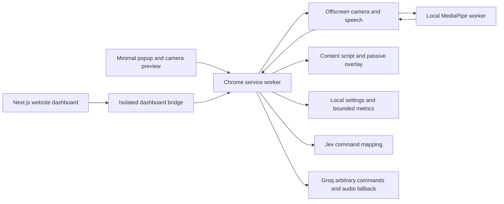

# Architecture

The Next.js website owns the dashboard. Chrome's MV3 extension owns device capture, browser actions, providers, settings, and logs. There is no backend or authentication.

The popup starts, pauses, resumes, stops, and links to the website. Its preview has a separate video-only stream that closes with the popup. The offscreen document owns tracking and recognition, so closing the popup or switching tabs does not end the session. Permission prompts run on a visible extension page.

The dashboard bridge is injected only into the configured origin and path. The background validates both the sender URL and current tab URL on every request and allows an explicit dashboard message list. Provider keys can be replaced through the dashboard but are never returned to it. Local build keys are kept in ignored configuration and output. Ordinary content scripts cannot issue privileged commands.

Tracking reads raw MediaStreamTrackProcessor frames where supported, with a compatibility video path. A one-frame buffer drains stale frames while paused or busy. Local MediaPipe inference runs in a classic worker with bounded CPU fallback. Frames and models remain local. Separate face/hand calibrations, confidence gating, dead zones, filtering, tracking-loss freeze, and dwell selection remain in place.

Page target snapping indexes visible controls with IntersectionObserver and performs nearby hit tests. Pointer updates avoid scanning thousands of offscreen rectangles. State telemetry is throttled separately from pointer delivery. Final and interim transcripts appear in the passive webpage overlay.

Voice starts independently of camera model loading. Browser speech is the default; local-only mode never uses the cloud fallback. Groq transcription can recover browser-service failures in cloud mode. Ordinary command text maps through Jev; the hey handsfree prefix routes arbitrary text and target labels to Groq. Dictation bypasses both command mappers. Form submission still requires confirmation. Closing a tab acts immediately; delayed tab operations are cancelled if the session or target changes.

Generation and page-revision checks reject stale startup, recognition, transcription, and provider results. Exact emergency commands interrupt pending provider work. Local metrics are bounded to 500 events and omit transcripts, keys, audio, and camera frames. Chrome session state is transient and includes the latest transcript for the interface.
