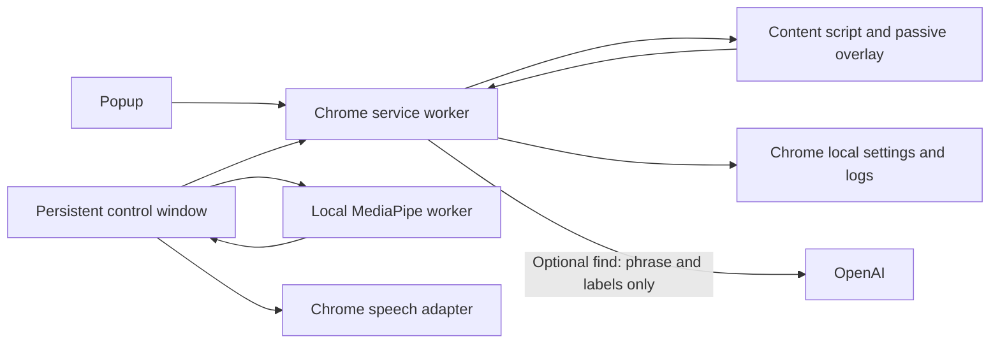

# Architecture

The extension has no server. The Next.js site is separate and is not needed to run it.

The popup opens controls and exposes stop/pause. Controls owns the preview stream and recognizer, calibration, tuning, permissions, local key, and run-log inspection. It matches the landing's fonts, theme colors, and logo.

The service worker owns session coordination, the deterministic command parser, tab access/actions, provider fetch, and bounded local logs. State is also kept in Chrome session storage so a worker restart does not lose the current target. Pending confirmations are deliberately not restored after restart. Storage is restricted to trusted extension contexts; content scripts never receive the LLM key.

A content script is injected into the selected webpage when a session starts. It finds interactive targets, performs hit tests and snapping, draws a passive shadow-DOM overlay, checks safety, scrolls/focuses/inserts text, and confirms form submissions. It accepts messages from the extension runtime only. The service worker rejects privileged requests from page content scripts and ignores inactive tabs.

Pure modules define parser behavior, activation timing/confidence gates, target/tab ranking, and local metric summaries. Tests call those boundaries. Content tests observe DOM effects and actual built-extension tests cross service worker, page script, and control UI.

Camera tracking uses packaged MediaPipe models and WASM in a classic worker. MediaPipe's loader requires importScripts for WASM glue. A worker error/timeout freezes selection, then attempts a measured CPU fallback on the control window's main thread. Main-thread fallback is capped at a lower frame rate. Every frame carries measured latency/FPS and a confidence proxy. No frames are sent to the provider.

Face neutral/range and hand neutral/range are saved separately. One Euro filtering, a dead zone, and slow neutral drift handle small movement and gradual posture changes. Loss/pause cancels holds and stale frames. Calibration blocks pointer selection for the whole sampling period.

Speech uses one adapter. On-device mode never silently falls back. Browser mode is explicit opt-in. Fixed commands normalize and match deterministically. Dictation bypasses navigation parsing except the reserved stop phrase. Optional find uses provider JSON constrained to current target IDs, validates responses, expands duplicate labels into choices, and only highlights.
