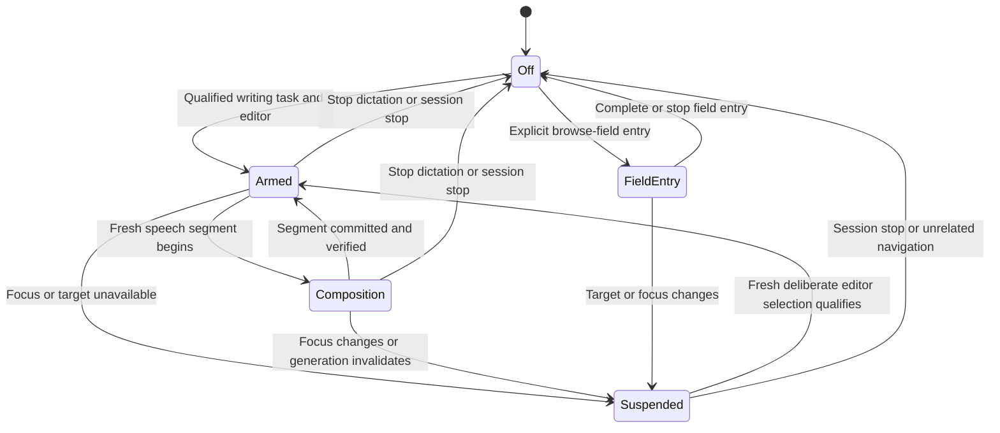
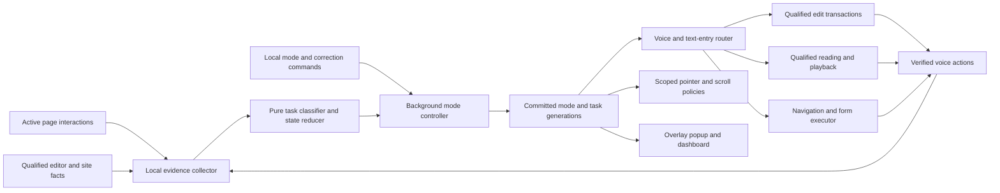

# Reading, browsing, and writing mode plan

Prepared 2026-10-10; implementation and verification updated 2026-10-11. This file now lives in `docs/`. The website's `/docs#activity-modes` is the user guide.

## Current implementation

The latest implementation request supersedes the earlier planning-only status and all-local Writing requirement. Chrome now supports Browsing, Reading and Writing task modes, conservative interaction-based switching, voice selection and a live popup mode indicator. Search fields and short replies retain Browsing semantics.

Writing cleans the current segment with Groq unless verbatim/literal dictation is selected. Requests account for message framing and reserve output within a conservative 7,000-token ceiling; oversized or ambiguous segments are refused. Whole documents are excluded from cleanup requests. Explicit revisions use only the unchanged most recent segment and require `apply revision`. Google Docs uses trusted native input, editor accessibility annotations, verified insertion and guarded undo/redo. Reload the updated extension and document; the document must be editable. The browser displays its native debugging banner during Docs input. Chrome permissions include `debugger` for this adapter.

Reading supports Wikipedia's accessible article text, pointer-centered paragraph magnification, separate browser page zoom with guarded restoration, read-aloud controls, headings, paragraph movement, selected-passage speech and a simplified text view. Presentation, voice and playback-speed preferences are remembered. Reading never starts audio automatically.

Highlighting supports face/head pointer start/finish selection, word and sentence numbers, unique quoted phrase ranges, and partial sentence ranges such as `highlight the last three words of sentence two`. Complex requests send only the current paragraph and its local numbered catalogue to Groq. Ambiguity requires clarification or numbered choices; a changed article invalidates the range. Native text selection spans inline formatting. Sentence numbering uses English sentence segmentation, so decimal numbers stay in their sentence.

Live checks passed on the supplied editable Google Doc for insertion, phrase replacement, scratch, restore, paragraph breaks/undo, Groq cleanup and last-only removal/restoration across two segments. Grouped native undo recovers only preceding Handsfree-owned segments against their verified baselines. Temporary test text was removed and the original document restored. Live Wikipedia checks passed for numbered word selection, magnification and zoom/restore. Packaged tests cover head-pointer selection, native ranges, focus guards and stale-edit rejection. This does not qualify physical camera gestures, microphone accuracy, every rich editor or the separate Firefox package.

The design material below records the earlier plan. Its all-local policy and planning-only claims are historical; use this section and the website guide for current browser behavior. Native desktop policy remains separate.

## Feature brief before implementation

This brief explains what the person gets in each mode. Sections 1-26 contain the implementation contracts. The 2026-10-11 request adds detail about Rambler-like writing and easier reading, including zoom. Keep the confirmed pointer-centered magnifier; add explicit page-zoom controls to the plan. Text layout, focus aids, and an optional extracted reading view below are recommendations, not newly confirmed preferences.

### How the three modes work together

| Mode | Main job | What Handsfree emphasizes | Example |
| --- | --- | --- | --- |
| Browsing | Find and operate things | Navigation, result choices, tabs, media, guided forms, explicit short dictation | Search YouTube, choose a video, fill an application |
| Reading | Follow substantial text comfortably | Paragraph magnification, page zoom, headings, read-aloud, position and optional focus aids | Read a Wikipedia section or a long log |
| Writing | Create or revise sustained content | Local speech recognition, live preview, conservative cleanup, precise corrections and recovery | Dictate and revise a report |

Voice, face and hand are input methods. Browsing, Reading and Writing are tasks. A person can use voice alone in every task mode. A mode change never requires enabling a camera.

The same Notion tab can support all three. Searching its workspace is Browsing, consuming a long note is Reading, and deliberately editing its body is Writing. A search query or short reply stays Browsing. A small edit in an established document task stays Writing. Automatic inference needs strong interaction evidence and holds the current mode when uncertain. "Reading mode", "Browsing mode", "Writing mode" and "use automatic modes" provide direct control.

### Browsing features in detail

| Feature group | What the person can do | Expected behavior and limit |
| --- | --- | --- |
| Navigation and tabs | Say "go back", "next tab", "switch to the Wikipedia tab", or "open a new tab with climate papers" | Resolve the controlled window and current tab list. Preserve the latest immediate current-tab close behavior. Ambiguous tab names need a choice. |
| Page controls | Say "open reviews", "show the menu", or "click this" | Resolve visible named controls or the current qualified pointer position. Hidden/stale controls cannot receive an action. |
| Search and results | Dictate a query, ask for current results, choose a numbered item | Search entry is explicit. Result numbering belongs to the current announced list and expires when the list changes. |
| Scrolling | Move up/down, go to the top/bottom, or scroll a named region | Use the selected page/panel. Preserve deliberate pointer and edge-scroll settings. |
| Forms | Ask for fields, fill one, move to the next, change a value, hear missing/invalid fields | Use labels and field types. Spell identifiers; clarify dates and amounts. Verify actual field values after insertion. |
| Multi-field forms | Speak several supplied values and review the field mapping | Apply the reviewed batch sequentially; report partial completion. Submit through the separate current confirmation policy. |
| Short replies | Explicitly dictate a comment or short message; scratch or replace a bounded part | Stay Browsing and bind edits to that composer. Sending is a separate command and follows the existing action policy. |
| Media | Pause/play, seek, change volume, choose a track or current listed video where supported | Use the qualified player/site capabilities. "Play the newest upload" requires verified newest-upload selection; visible result order alone is insufficient. |
| Help and recovery | Ask "what can I do here?", cancel a pending choice, undo an eligible field edit | Explain available actions in the current context; retain manual page interaction. |

The current project already has navigation, site adapters, explicit dictation and form machinery. Implementation should audit and reuse those contracts. The new work is task-aware coordination and the additional qualified features, rather than a promise that every catalogue item already works on every site.

### Writing features in detail

The intended experience is: choose a supported long-form editor, receive a readiness cue, speak naturally, see the current transcript preview, then receive cleaned text in that editor at a speech boundary. The preview remains transient. After "stop dictation", merely keeping editor focus must not restart it.

| Feature group | What the person gets | Example or constraint |
| --- | --- | --- |
| Local recognition | Speech becomes English text without sending Writing audio to a provider | Requires a qualified local recognizer and installed language pack. If unavailable, show the blocker and leave dictation off. |
| Live preview and segment insertion | See the unfinished segment while speaking; commit the cleaned segment once | A thinking pause does not switch modes. Late recognition results cannot land in a newly focused field. |
| Filler cleanup | Remove clear hesitations and accidental starts | "Um, we should submit tomorrow" becomes "We should submit tomorrow." Preserve meaningful "like", "well", negation and emphasis. |
| Punctuation and capitalization | Turn spoken sentences into readable text | Use recognition output and conservative local rules. Difficult sentence boundaries may still need review. |
| Clear self-correction | Resolve a bounded spoken repair | "Meet Tuesday, no, Wednesday" becomes "Meet Wednesday." Ask if two dates or several amounts make the scope unclear. |
| Scratch and restore | Remove the last verified Handsfree segment and restore that removal | "Scratch that", then "put that back". Check the same editor and unchanged text before either edit. |
| Exact corrections | Replace a named occurrence; remove a qualified last sentence | "Replace the last Tuesday with Wednesday". Several matches require a choice. |
| Structure and formatting | New paragraph, supported lists, and formatting of a qualified selection | Plain editors and rich editors have different capabilities. Do not simulate a native list by claiming typed bullet characters are editor list formatting. |
| Literal text | Keep fillers, identifiers, quotations or command phrases as text | "Use verbatim dictation" and a literal-text escape prevent accidental interpretation of quoted commands. |
| Review and vocabulary | Read back a recent segment with a verified local voice; save an explicitly supplied term locally | No automatic transcript collection. No draft readback through an online voice. |
| Optional advanced revisions | Propose a shorter version, a tone change, or a structure for selected thoughts | Needs an independently benchmarked local language model and a review step. Keep W-16/W-17/W-19 as later work. |

Cleanup preserves the person's wording and meaning. "I might attend" cannot become "I will attend". A requested tone rewrite is a separate operation. Ordinary prose containing "send this" cannot send the document or message.

### How close can we get to Google's Rambler?

The reference here is Gboard's Rambler. Google's current help describes filler removal, grammar/punctuation, conversational edits, style rewrites and multilingual speech. It distinguishes basic offline cleanup from advanced rewrites and complex edits that need connectivity. [Google's Rambler help, checked 2026-10-11](https://support.google.com/pixelphone/answer/17468539?hl=en)

The assessment below is an engineering judgment about this project. It is not a measured accuracy score or a claim of access to Google's implementation. "Good first-release candidate" means the operation can be scoped and verified in supported contexts. It does not mean every spoken request will succeed.

| Rambler-like behavior | Assessment under all-local Writing | Practical first-release scope |
| --- | --- | --- |
| Clear English speech to text | Feasible, device/recognizer dependent | Check local capability and test the person's speech, accent and microphone. Names and numbers need particular review. |
| Remove obvious hesitation | Good first-release candidate | Restricted rules with literal escape; preserve uncertain cases. Rules alone cannot reliably identify every contextual filler. |
| Punctuation/capitalization | Feasible, with recognition-dependent quality | Handle clear boundaries. Do not promise automatic grammar repair for arbitrary spoken prose. |
| "Tuesday, no, Wednesday" | Good first-release candidate for bounded patterns | Resolve the current segment or a unique qualified recent span. |
| Scratch, restore, precise replacement | Good first-release candidate in plain editors | Verify spans and inverses. Rich-editor support requires separate qualification. |
| Arbitrary conversational corrections | Partial initial coverage | Support a documented local grammar. Several competing targets or vague instructions need clarification. |
| Long messy ramble to coherent prose | Research and benchmarking required | A local language model must recover structure without dropping facts. Rules cannot reproduce that general behavior. |
| "Make it professional" or "shorten this" | Later local-model feature | Propose changes to a selection and review before replacement. Check meaning preservation separately from fluency. |
| Mixed Hindi/English | Outside the current English-only release | Do not treat the user's conversational Hinglish as a change to the confirmed product-language scope. |
| Works in every editor | No universal promise | Start with textarea/simple contenteditable; qualify Notion and Google Docs individually. Editor insertion can fail even when recognition is excellent. |

We can aim for a useful Rambler-like core: speak, preview, clean clear hesitations, correct precise spans and recover an accidental edit. Full equivalence, including open-ended restructuring and free-form revision on arbitrary websites, is not a credible first-release commitment with the current local-only design.

Recognition, interpretation and insertion are separate sources of failure. Correctly hearing "Wednesday" is not enough if the correction deletes the wrong sentence. The editing engine must verify actual document state and stop when a target is ambiguous or changed. Any reliability report must state which layer and editor it measured.

### Reading features in detail

Offer a compact reading control surface with magnify, zoom, read aloud and a small comfort disclosure. All controls have direct voice equivalents. Detection alone starts no audio and applies no new visual setting unless the person enabled that preference.

| Feature | Proposed user experience | Initial scope and limit |
| --- | --- | --- |
| Pointer-centered paragraph lens | Hold on eligible text for roughly 1.2 seconds; a lens opens near 2x. Say "magnify more/less", "freeze the magnifier", or "close the magnifier" | Preserve the confirmed 1.5-3x proposed adjustment range. Initial lens renders sanitized text, not exact page pixels. Exclude control hit areas and stop on tracking/context loss. |
| Page zoom | Say "zoom this page to 150 percent", "zoom in", "zoom out", or "restore previous page zoom" | Use browser tab zoom separately from lens scale. Proposed steps: 100%, 125%, 150%, 175%, 200%. Store the pre-change value and verify the resulting factor. |
| Larger reading text | Say "make the reading text larger" | P1 option in the lens or a qualified extracted reading view. Proposed 20/24/28/32px sizes, adjusted for viewport. Avoid overriding all fonts on an arbitrary webpage. |
| Comfortable spacing and width | Choose relaxed spacing and a narrower reading column | P1 presentation options. Proposed prose line-height 1.6-1.8 and column width around 60-75 characters. Preserve code/log whitespace and table structure. |
| Reading colors | Choose light, dark or a warm paper presentation | P1 option within Handsfree-owned reading presentation. Check contrast and preserve the page's original styles. |
| Focus aid | Highlight the current paragraph and optionally dim surrounding content | P1 opt-in aid with explicit off control. Do not dim navigation needed for recovery or rely on color alone to show position. |
| Read aloud | Say "read this section aloud", "read the selected passage", or "read from Methods" | Speak qualified text only after a request. Stop/pause/resume and voice/rate controls are core. Actual voice availability and speaker interruption need testing. |
| Reading navigation | Say "next paragraph", "previous heading", "list sections", or "find sample size here" | Use actual content structure. Headings/paragraphs can be dependable on semantic HTML; unstructured text needs narrower claims. |
| Follow and continue | Optional paragraph highlighting/follow-scroll; "continue where I stopped" | Preserve a same-session anchor tied to content revision. No persistent reading-history feature implied. Word-level highlighting depends on reliable speech boundary events. |
| Optional reading view | Show a local copy of a qualified article with larger text and reduced clutter | P2 proposal requiring extraction qualification. Preserve headings, links, lists and available captions. Do not bypass paywalls or invent missing content. |
| Exit and restore | Say "close the reading view" or "restore previous page zoom" | Remove Handsfree-owned presentation and restore a still-valid saved zoom value. Do not overwrite a later manual change. |

Use distinct commands for distinct changes. "Magnify more" changes the lens. "Zoom this page to 150 percent" changes browser zoom. "Make the reading text larger" changes text within the owned presentation. If "make this bigger" lacks a clear target, ask which one instead of changing several settings.

Chrome supplies tab-zoom APIs and zoom scope settings. The implementation should use per-tab scope, bind the request to the intended tab/document, and account for zoom settings resetting on navigation. Recompute pointer geometry and reading anchors after layout changes. [Chrome Tabs API](https://developer.chrome.com/docs/extensions/reference/api/tabs#method-setZoom)

### Reading reliability by content type

| Content | Expected initial feasibility | What needs qualification |
| --- | --- | --- |
| Semantic HTML articles/Wikipedia | Strong candidate for text lens, headings and paragraph playback | Correct article selection, hidden text exclusion, links, reflow and dynamic changes |
| Plain logs/source text | Strong candidate for visual text enlargement | Preserve indentation, line breaks and repeated errors; spoken code pronunciation is a separate limit |
| Notion/Docs content | Adapter-dependent | Whether current visible text, selection and reading order are accessible; the domain itself proves no capability |
| PDF rendered with a usable text layer | Conditional | Text access, page order, columns, headings and the viewer's own restrictions |
| Scanned PDF/image | Outside initial text reading | Requires OCR. Page/viewer zoom may enlarge the image but does not make its text available for narration. |
| Equations/charts/tables | Limited initial support | A text lens cannot reproduce their visual layout or supply mathematical/chart interpretation |
| Protected browser pages/cross-origin frames | Permission- and browser-dependent | Check each capability; unavailable text access cannot be replaced by guessed content |

The lens is practical for ordinary webpage text. Page zoom is a relatively direct browser operation, although the site's layout may still become awkward. Article extraction and word-level speech highlighting have more variability, so they should not block the core lens, paragraph navigation and playback work.

### Browser and device implications

The source review on 2026-10-11 found the Chrome local-recognition checks in `extension/src/speech.ts`, but no activity-mode controller or magnifier implementation in `extension/src`. The website's existing comfort toggle and read-aloud player apply to the Handsfree website. They do not establish reading support on third-party tabs.

Local Web Speech requires a supported browser and installed language pack. Feature detection is necessary before starting Writing. [MDN on-device speech recognition](https://developer.mozilla.org/en-US/docs/Web/API/Web_Speech_API/Using_the_Web_Speech_API#on-device_speech_recognition)

The isolated Firefox source at `firefix/src/speech.ts` currently reports on-device dictation unavailable when its browser recognition path is missing. Chrome Writing qualification cannot be carried over to Firefox. A separately packaged local recognizer or qualified desktop bridge would be additional work. Preserve the separate Firefox folder and never fall back to its cloud command path for Writing.

### How we establish reliability before calling it supported

Do not attach an invented percentage to features that have not been implemented and measured. Section 21 specifies the test programme. Record recognition error, cleanup meaning changes, correction scope, insertion success, latency and false mode switches separately.

1. Validate one complete workflow in a plain editor with network access blocked during Writing: recognition, preview, cleaned insertion, scratch, restore, stop and task change.
2. Use English speech with hesitations, accents, names, amounts, negation, quoted commands and thinking pauses. Compare intended text with actual inserted text, rather than checking only status messages.
3. Test corrections after manual/collaborative edits, focus changes and repeated recognizer results. A refused unsafe correction is safer than a silent unrelated deletion; report refusals separately from successful completion.
4. Qualify Notion and Google Docs independently with real disposable documents. List insertion, selection, replacement, formatting and undo as separate capabilities.
5. Test reading with physical face/hand jitter and voice alone, viewport edges, 200% page zoom, dark/light presentation, long logs, repeated headings and page changes.
6. Test read-aloud with speakers and headphones. Read article text containing actual command phrases and verify it cannot trigger actions. Measure whether spoken pause/stop works during playback.
7. Publish supported-browser/editor/content combinations with verification dates and observed failure cases. Controlled fixture success does not establish universal website or physical-user performance.

### Recommended implementation order

Build the local capability check, manual modes and conservative detector first. Then qualify cleaned dictation with scratch/restore in a plain editor, followed by the pointer-centered text lens, explicit page zoom, paragraph navigation and controlled read-aloud. Reuse current browsing/form infrastructure and add task-aware routing. Qualify Notion/Docs and physical input before claiming those workflows work. Add comfort presentation options and advanced local-model revisions only after their own evidence exists.

## 1. Intended result

Handsfree should adapt to the person's current task, offer useful controls for that task, and let the person correct the mode entirely by voice.

The three task modes are **Reading**, **Browsing**, and **Writing**. They describe purpose, not a website, an input device, or whether an input happens to contain text.

- Searching YouTube is browsing, including speaking or typing the search query.
- Sustained creation or revision of a Google Docs document is writing. Opening a long document to read it is reading. Searching Drive for that document is browsing.
- Notion can support all three within one tab. Navigating a workspace is browsing, consuming a page is reading, and composing its content is writing.
- An editable field is evidence about possible actions. Its existence does not prove a writing task.
- A person can dictate a search query while remaining in browsing mode. Conversely, a person can be in writing mode with dictation off.

Task inference is approximate. Handsfree can observe actions and page structure, but it cannot know that a person is reading just because they stopped moving. The design must be useful when evidence is incomplete.

### Confirmed requirements from this request

| ID | Requirement | Consequence |
| --- | --- | --- |
| REQ-01 | Exactly three task modes: reading, browsing, writing | Do not introduce a fourth user-facing mode for uncertainty or forms |
| REQ-02 | The task determines the mode | Domain names cannot directly select a mode |
| REQ-03 | Typing a YouTube search remains browsing | Text insertion and writing classification are separate |
| REQ-04 | Document composition is writing | Recognize actual composition, including nonstandard editors where qualified |
| REQ-05 | Ambiguous applications such as Notion must support task changes | Reevaluate within a document and after meaningful interaction changes |
| REQ-06 | Prefer automatic detection | Use current interaction evidence and task continuity |
| REQ-07 | Allow mode selection by voice | All three modes and returning to automatic detection need direct commands |
| REQ-08 | Produce a detailed `mode-plan.md` and ask clarifying questions | Record pending decisions rather than present assumptions as user instructions |
| REQ-09 | Auto-start dictation in a confidently identified editor | Qualify editor, foreground task, permissions, and insertion support before arming |
| REQ-10 | Keep the mode unless there is exceptionally strong evidence of a task change | Conservative automatic transitions; no claims of mathematical certainty |
| REQ-11 | A voice-selected mode lasts until automatic detection sees a clear new task | Use a manual hold with a strong evidence release rule |
| REQ-12 | Reading concerns long text such as articles, Wikipedia, logs, and research papers | Content length/structure supports reading; short UI text alone does not |
| REQ-13 | English only for now | Latest answer supersedes the earlier English/Hindi selection |
| REQ-14 | Writing needs Rambler-like cleanup and spoken correction/deletion | Plan filler handling, repair, edit history, and accidental-edit recovery |
| REQ-15 | Reading offers a hover magnifier and read-aloud option | User corrected "zoomed out" to zooming in on an area after hovering |
| REQ-16 | Form filling should be thorough and reliable | Plan field resolution, structured values, review, corrections, and verified submission |
| REQ-17 | Cleanup preserves meaning | Remove hesitation/punctuate/resolve clear repairs; do not silently rewrite tone or substance |
| REQ-18 | "Scratch that" removes the last Handsfree segment | Sentence/correction deletion has separate commands; support "put that back" |
| REQ-19 | Short replies stay browsing; sustained drafting is writing | A small insertion within an established document task remains writing |
| REQ-20 | Auto-dictation applies only to long-form writing editors | Short replies/search/form fields require voice entry instructions |
| REQ-21 | Show live preview, then insert cleaned segments | Final/cleaned segment commit is separate from interim recognition |
| REQ-22 | Natural correction commands work without a prefix | Provide a literal-text escape and verbatim option |
| REQ-23 | All writing processing, including recognition, runs on-device only | No online speech, cloud classification/cleanup/rewrite, or fallback in Writing |
| REQ-24 | Remember reading preference; audio starts only on request | Remember visual/read-aloud choice without autoplay |
| REQ-25 | Include all offered core read-aloud controls | Pause/resume, speed, paragraphs, headings/selection, optional follow-highlighting |
| REQ-26 | Magnifier is a lens centered around the pointer | Keep hit testing on the underlying page, not the lens |
| REQ-27 | Magnifier uses roughly 1.2-second hover plus voice control | Close on moving away; exclude controls to avoid dwell-click conflicts |
| REQ-28 | Explain easier reading, including zoom, before implementation | Detail the magnifier and propose explicit page zoom; separate optional comfort additions and unmeasured feasibility |

The user explicitly confirmed that short replies/comments stay in Browsing, while sustained drafting is Writing. The user was unsure about form interaction and asked for a clear design; the recommended guided-plus-reviewed-batch workflow below is a planning choice, not an explicit selection of one form interaction style.

### Confirmed choices and remaining planning defaults

Rows marked confirmed follow explicit answers. Other rows are proposed defaults. Section 24 separates the remaining questions from resolved decisions.

| Decision | Recommended default | Reason |
| --- | --- | --- |
| What modes change | Command interpretation, dictation assistance, and carefully bounded pointer/scroll policies | The mode should make completing the task easier |
| Authored short content | Short replies/comments stay browsing; sustained drafts are writing | Confirmed |
| Search and form entries | Browsing, with temporary field-entry state | Filling a query or filter is navigation toward another result |
| Manual selection | Hold until clear new-task evidence or an explicit automatic-mode request | Confirmed user selection; exact release rules specified below |
| Dictation activation | Automatic in a confidently identified, supported composition editor | Confirmed user selection; focus alone is insufficient |
| Media consumption | Browsing with media context | Confirmed reading scope is long textual content |
| Read aloud | Remember choice; start audio only on explicit request | Confirmed |
| Visual reading option | Pointer-centered lens after roughly 1.2-second readable-text hold, plus voice activation | Confirmed |
| Ambiguous evidence | Retain the previous mode with unavailable/uncertain status; default only a cold session to browsing | Confirmed conservative detection preference |
| Initial command language | English only for now | Confirmed latest correction |
| Writing processing | All on-device, including recognition and conservative meaning-preserving cleanup | Confirmed; no cloud fallback |
| Text preview | Live preview, cleaned segment insertion after a brief pause | Confirmed |
| Form interaction | Guided single-field entry by default; explicit multi-field request with review | Assistant recommendation within the requested clear form design |

## 2. Relationship to existing work

The mode system is a shared layer for all permitted webpages. It complements the Group A and Group B website-support plans in `docs/`; it does not depend on completing their site adapters.

The website plans describe actions such as searching, selecting a result, drafting, and sending. This plan describes how those actions and their current targets establish task context and change assistance. An adapter can report that a field is a search box or a document editor; the shared mode rules decide what that means.

### Source inspection on 2026-10-10

| Existing component | Observed behavior | Integration implication |
| --- | --- | --- |
| `extension/src/shared.ts` | `pointerMode` is face or hand; `speechMode` is local or browser; session state has `dictating` | Add a distinct `activityMode`; do not overload existing mode names |
| `extension/src/core/parser.ts` | General intents include start/stop typing, navigation, search, media, and session controls | Add local mode intents without breaking existing fixed commands |
| `extension/src/background.ts` | Queues transcripts, routes dictation separately, rejects stale provider results with revisions, validates the dashboard | Centralize committed mode state and extend routing/context checks |
| `extension/src/content/runtime.ts` | Owns a typing target, stops dictation when focus changes or the field disappears, and guards form submission | Observe task evidence and keep insertion independently bound to a valid editor |
| `extension/src/content/dom.ts` | Discovers controls, excludes editable text from public page context, blocks sensitive fields | Reuse validation without collecting editor text for mode detection |
| `extension/src/offscreen.ts` | Owns recognition/capture; pause restarts control listening while stopped capture releases recognition | Mode commands work only in the allowed listening state |
| `extension/src/dashboard-bridge.ts` | Isolated bridge forwards requests from the configured dashboard | Extend the explicit allowed message list; do not expose privileged mode mutation to arbitrary pages |
| `next/components/dashboard/dashboard.tsx` | Shows session/dictation controls and live feedback | Add current task, automatic/manual state, and a small explanation |
| `next/components/reading-comfort-toggle.tsx` | Changes the Handsfree website's own visual preference | This is not an extension-wide reader implementation |
| `next/components/read-aloud-player.tsx` | Speaks blocks from the Handsfree website | This is not verified read-aloud support for arbitrary third-party pages |
| `extension/src/sites/` | Untracked adapter work is present, including catalogue/types/resolver and some site modules | Preserve this work; audit integration before implementation and avoid conflicting contracts |

No task-mode detector was found in the inspected core/session contracts. No source implementation is included in this planning change. Earlier documents may describe an older pause lifecycle or an earlier lack of adapters; the inspected source above is the planning baseline, and unfinished files are not a support claim.

## 3. Definitions and independent states

| Term | Meaning | Example |
| --- | --- | --- |
| Activity mode | Current task purpose: reading, browsing, writing | Writing a paragraph |
| Detection policy | Automatic inference or a manual override | Automatic detection on |
| Foreground task | The task receiving current deliberate interaction | Editing the current note |
| Supporting action | A bounded action performed to continue the foreground task | Opening a formatting menu |
| Field role | Why an editable/control field exists | Search, document body, title, message composer, filter |
| Text-entry session | Speech insertion bound to a particular target | Dictating a YouTube query |
| Command context | The object and region a command should affect | A draft, article section, video, or result list |
| Capability | A tested action available for the current target | Plain-text insertion, next heading, media pause |
| Evidence | A current observation relevant to task inference | A verified edit in the selected document body |
| Confidence | Strength of a decision under the tested rule system | Sufficient evidence to commit writing |
| Mode epoch | A counter incremented when committed task/routing state changes | Rejecting an old result from before a switch |

Keep these states independent:

1. Session running, paused, or stopped.
2. Camera/pointer input: face or hand.
3. Voice processing: configured path plus effective task policy; Writing always requires local-only processing.
4. Activity mode: reading, browsing, writing.
5. Automatic detection or a manual hold until a clearly different task.
6. Text entry: off, armed, field entry, composition dictation, or suspended.
7. Optional read-aloud playback: off, playing, or paused.
8. Pending clarification or action confirmation.

Only the activity-mode selector presents the three named modes. Uncertainty, unsupported pages, and text-entry sessions appear as status information, not extra activity modes.

### Core invariants

- Mode detection never inserts, submits, sends, publishes, deletes, or opens a destination by itself.
- A mode does not create an editor capability. Unsupported editor insertion stays unavailable even in manually selected writing mode.
- Ordinary dictated text is never routed through the browsing-command classifier. Explicit correction/formatting commands use the dedicated, bounded writing router.
- An inferred transition never redirects an already recognized utterance into a different field.
- Session stop/pause, cancellation, and required confirmations retain their meaning across all modes.
- No cloud service is required for mode inference or exact mode commands.
- A manual hold can be released only by verified clear new-task evidence or an explicit user command; report its release.
- No inactive tab can supply the foreground task.
- Pointer calibration and the person's saved sensitivity are independent of task mode.

## 4. What each mode does

### Browsing

Purpose: find, navigate, compare, choose, filter, operate media, and perform bounded field entry toward another task.

Typical evidence includes deliberate search/filter actions, result selection, tab/history navigation, menu exploration, list/grid traversal, and form-step interaction. A search box remains browsing even if its text is long, it uses `contenteditable`, or the person dictates for a minute.

Suggested command emphasis: open/find/choose, next result, filter, back/forward, switch tab, scroll, media control, and explicit fill/type requests. Use grounded current entities; do not interpret every "next" as browser navigation.

Pointer and scroll behavior initially uses the saved settings. A field-entry session can temporarily suppress accidental dwell activation while that field is receiving text, without changing the activity mode.

### Reading

Purpose: consume or inspect a long body of text, such as an article, document, research paper, log, substantial thread/email, product description, or source file. Short labels, result snippets, and ordinary looking around remain browsing.

Require evidence that the person has moved from choosing items to interacting with a specific readable region. Suitable evidence includes an explicit reading action, selecting a section, navigating headings, or content-directed scrolling combined with a stable readable region. A page containing many paragraphs is only a candidate.

Suggested command emphasis: next/previous heading or section, read selection, read this section, stop reading aloud, find within this content, links/references, and bounded scrolling. A source file can be reading even in an application that also contains an editor.

Do not start continuous scrolling, TTS, font changes, article extraction, or a summary merely because reading was detected. Each requires an explicit action or an independently enabled preference. Summarization is optional future work and uses existing provider consent/routing if added.

### Writing

Purpose: sustained creation or revision of authored content, including a document, substantial note, long email/post, or supported code editor. A short chat reply/comment is browsing with text-entry assistance under the confirmed short-content rule. A short insertion into an ongoing document task stays writing; do not impose a character-count switch.

Strong evidence includes an explicit sustained-composition request bound to an editor, a verified edit in an established document task, or an adapter-confirmed compose/edit transition accompanied by deliberate local interaction. Editor focus alone is weaker evidence when the page focuses fields automatically. Never wait for the person to type first if a verified voice-selected editor already qualifies automatic dictation.

Suggested command emphasis: cleaned dictation, choose editor, scratch that, cut the last part/sentence, replace a qualified span, restore an accidental deletion, new paragraph, and supported formatting. Dictation automatically arms in a qualified editor under the confirmed preference. Each editing action has its own capability check; entering writing mode is not a promise that every editor operation works.

Recommended pointer policy: suppress passive dwell activation inside an active composition editor, reset existing dwell progress when the policy changes, and suppress edge-triggered scrolling during literal insertion. Keep explicit navigation and scrolling available. Formatting controls remain deliberately accessible. Do not globally disable pointing just because writing mode is active.

### Shared behavior table

| Behavior | Browsing | Reading | Writing |
| --- | --- | --- | --- |
| Search/query insertion | Field entry, stays browsing | Search subtask or transition according to scope | Search subtask or transition according to scope |
| Literal dictation | Explicit, target-bound field entry; no automatic short-field activation | A qualified switch into composition establishes writing first | Auto-arms in qualified editor; always target-bound |
| Bare "next" | Clarify or use an established result/media context | Use a qualified reading structure, else clarify | Use an established editing dialogue, else clarify |
| Scrolling | Bounded, current grounded region | Bounded readable region | Bounded editor/page action, never inferred from silence |
| Read aloud | Available only when qualified and explicitly requested | Same activation rule, reading context helps target selection | Explicit selected-text/draft playback only when qualified |
| Dwell | Saved settings; field-entry guard | Saved settings; no automatic threshold change | Scoped editor guard; explicit controls remain usable |
| Send/submit | Existing action-specific confirmation contract | Same contract | Same contract |
| Close current tab | Immediate under the latest explicit tab policy | Same policy | Same policy; invalidate pending editor work |
| Camera requirement | None for voice-only operation | None for voice-only operation | None for voice-only operation |
| Cloud requirement for detection | None | None | None |

## 5. Distinguishing authored content from incidental typing

Classify the field's purpose before using input activity as writing evidence.

| Field role | Examples | Default task implication | Text-entry behavior |
| --- | --- | --- | --- |
| Search | YouTube search, Notion workspace search, Gmail search | Browsing | Explicit bounded field entry |
| Filter/query | Table filter, product keyword, job filter | Browsing | Explicit bounded field entry |
| Navigation | Address-like destination field, "go to page" | Browsing | Explicit bounded field entry |
| Transaction/form | Station, date, account setup, contact field | Browsing | Supported entry with existing restrictions |
| Authored title | A note/document title, a draft subject | Writing when tied to sustained composition | Qualified target-bound insertion |
| Authored body | Document, substantial note/email/post; short message/comment | Writing for sustained composition; browsing for short replies | Auto-arm only qualified long-form editor |
| Code body | Qualified browser code editor | Writing | Capability-specific insertion/editing; cleanup preserves code |
| Read-only content | Article, rendered note, email, disabled editor | Reading candidate | No insertion |
| Sensitive field | Password, payment, one-time code | Does not establish writing | Preserve existing insertion block |
| Unknown editor | Unclassified editable region | Uncertain; retain valid prior mode | Ask for task/target if insertion would otherwise be ambiguous |

Signals for field role include semantics, form purpose, nearby control roles, adapter-provided structural facts, and the action that selected the field. Role inference must not require the field's current value.

An `input[type=search]`, search landmark, or qualified search interaction is strong browsing evidence. `textarea`, `contenteditable`, multiline ARIA, large dimensions, and long input duration are insufficient on their own. A search box can be multiline; a message composer can be one line.

Apply evidence in this order: sensitive-field exclusion, verified field semantics, explicit current task/target, supported adapter facts, then generic structural clues. If strong facts conflict, produce an uncertain result instead of forcing a mode.

## 6. Scenario catalogue

These are target outcomes for implementation tests, not claims about live support.

| ID | Situation | Expected mode | Important distinction |
| --- | --- | --- | --- |
| SC-01 | Type or dictate into YouTube search | Browsing | Search text does not imply authorship |
| SC-02 | Browse YouTube results or control a video | Browsing | Media context stays separate under proposed default |
| SC-03 | Read a particular video's transcript | Reading | Readable transcript region, same domain |
| SC-04 | Compose a short YouTube comment | Browsing plus explicit field entry | Confirmed short-content rule |
| SC-05 | Search Drive for a document | Browsing | Finding a document precedes authoring |
| SC-06 | Open Google Docs without interacting | Retain previous mode, or Browsing in a cold session | Domain/editor presence alone is insufficient |
| SC-07 | Explicitly start editing a supported Google Docs document | Writing | Require a qualified editor/action; capability may still be limited |
| SC-08 | Open the same document in view-only mode and navigate content | Reading | A document application can host a reading task |
| SC-09 | Pause to think while editing | Writing | Inactivity does not end authorship |
| SC-10 | Use bold/menu/format controls while drafting | Writing | Supporting controls preserve task continuity |
| SC-11 | Search within the current draft, then return to its body | Writing with document-search subtask | Bounded support action keeps parent task |
| SC-12 | Leave the draft and search the workspace for a different document | Browsing | Navigation creates a different foreground task |
| SC-13 | Navigate Notion sidebar, databases, and workspace search | Browsing | No domain-to-mode mapping |
| SC-14 | Read a particular Notion page or block | Reading | Focused content interaction |
| SC-15 | Insert/revise a Notion document block | Writing | Known authored block, verified editing evidence |
| SC-16 | Enter a Notion database filter | Browsing | Filter text has navigational purpose |
| SC-17 | Rename a Notion authored page title | Writing | Short text can belong to composition |
| SC-18 | Read Gmail inbox list, choose a thread | Browsing | List selection versus content consumption |
| SC-19 | Inspect a chosen email body | Reading | Read-target evidence |
| SC-20 | Compose a long email; enter its recipient | Writing | Recipient fields support established sustained composition |
| SC-21 | Read substantial WhatsApp history, then compose a short reply | Reading, then Browsing plus explicit field entry | Same tab, different tasks; confirmed short-content rule |
| SC-22 | Search WhatsApp contacts | Browsing | Contact lookup is navigation |
| SC-23 | Inspect a GitHub file | Reading | Code can be consumed rather than edited |
| SC-24 | Search GitHub repositories/issues | Browsing | Search/navigation context |
| SC-25 | Edit a qualified GitHub file or issue body | Writing | Editor capability must be tested separately |
| SC-26 | Read a substantial Reddit thread, then draft a long post | Reading, then Writing | Short reply remains browsing under confirmed rule |
| SC-27 | Browse Amazon results, then inspect a long product description | Browsing, then Reading when evidence supports it | Product pages contain mixed regions |
| SC-28 | Enter IRCTC stations or Maps destinations | Browsing | Structured task input is not authored content |
| SC-29 | Inspect an accessible text PDF | Reading when a readable target is qualified | Viewer access is a separate capability |
| SC-30 | Open an inaccessible PDF/canvas editor | Retained mode, or cold-session Browsing, with limited support | Do not infer capability from a manual mode |
| SC-31 | Split view has a source article and an editor | Mode follows deliberate foreground interaction | Keep both task contexts; no silent insertion retargeting |
| SC-32 | Collaborator edits a document remotely | Retain local mode | DOM mutation is not local writing evidence |
| SC-33 | A page autofocuses a comment box during load | No automatic writing from autofocus alone | Require intent or verified editing evidence |
| SC-34 | A toolbar takes focus during formatting | Writing | Known support action, editor continuity preserved |
| SC-35 | A save/send confirmation appears | Retain task; suspend uncertain transitions | Confirmations are not a separate activity mode |
| SC-36 | Read-only field briefly becomes editable during hydration | Retain mode until grounded interaction | Ignore transient rendering noise |
| SC-37 | Edit a local fixture on an unknown domain | Writing if generic facts qualify it | Baseline must work without site identity |
| SC-38 | Start dictating a long search query | Browsing plus field entry | Duration and character count cannot override search semantics |
| SC-39 | Manually select Reading on an editor page | Reading, manual | Override controls assistance; editor capability still exists separately |
| SC-40 | Browser permissions/native chrome take focus | Suspend page actions | No claim that page scripts control browser-owned UI |

## 7. Automatic detection inputs

Use a small local collector bound to the active permitted document. Send structural summaries, not page dumps.

| Observation | What to retain | What it supports | What it cannot prove |
| --- | --- | --- | --- |
| Focus interaction | Field/region role, visibility, read-only/sensitive state, local target token | Current likely action scope | That autofocus is a deliberate task choice |
| Input activity | Event category, composition state, actor/provenance where known, timing | Non-search authored editing | That every synthetic event is genuine user editing |
| Selection activity | Region identity and selection existence/extent category | Editor/reading-region interaction | The selected text's meaning or actual attention |
| Verified voice action | Bounded action class and verified outcome | Search, compose, navigate, read | Success when an executor has not checked the outcome |
| Pointer/keyboard action | Activated region/control role where observable | Task/target change | That voice-only users must provide these signals |
| Scroll | Container identity, direction, bounded amount category | Reading-region traversal or result exploration | Reading from scrolling alone |
| Page structure | Visible region types, readable-content availability, editor/search roles | Candidate tasks | That a visible editor is being used |
| Navigation | Trusted document identity and app revision | Context invalidation/task reset | Which task the user intends next |
| Adapter facts | Editor body/title/filter/search role, view/edit state, capabilities | Nonstandard applications | A fixed mode based on hostname |
| Existing task state | Recent foreground task and supporting action | Continuity across thinking/formatting | A permanent task for the whole tab |

Do not retain input values, draft text, clipboard data, raw keystrokes, selected text, screenshots, camera-derived gaze, or page text as detector features. Reading-region heuristics may count visible public text locally under a strict budget, but must not store or send its contents. Do not count editable or sensitive content.

Exclude Handsfree's overlay, dashboard, popup, extension pages, hidden/disabled targets, and inactive documents from task evidence. A dashboard visit should not classify the user as writing because its command input is focused. Device input remains optional; voice-only actions provide equally valid task evidence.

## 8. Detection rules and confidence

Start with explainable rules and a pure state reducer. Add learned classification only if measured failures justify it. Do not make an LLM guess from a screenshot or whole page on every change.

### Evidence tiers

| Tier | Examples | Treatment |
| --- | --- | --- |
| Explicit user choice | "Switch to writing mode" | Immediate manual commitment |
| Verified task action | Search executed, qualified composition started, read-section action verified | Strong automatic evidence, with current target binding |
| Qualified local interaction | Deliberate body-editor activation, observed authored edit, content-directed navigation | Strong or medium according to provenance/capability |
| Structural candidate | Article/editor exists, field has multiline semantics | Supporting evidence only |
| Uninformative | Silence, raw time on page, unrelated mutations, background updates | No transition |

A score is an ordinal decision score until it is calibrated on held-out data. Do not display "90% certain" merely because a rule added up to 0.9. Prefer status explanations such as "Editing this note" or "Automatic detection is unsure".

### Candidate computation

1. Validate session, active document, frame, and current revision.
2. Apply hard exclusions and determine the current field/region role.
3. If a manual hold exists, record suggestions; only a verified clear new foreground task can release it automatically.
4. Resolve whether the interaction is a supporting action within the existing task or a new foreground task.
5. Generate reading/browsing/writing candidates from current evidence, with positive and conflicting evidence recorded separately.
6. Require strong evidence before switching. A combination of independent qualified local interactions can establish strong evidence only under tested rules; moderate candidates alone never commit a change. Repeated copies of the same event are not independent evidence.
7. Apply stability timing and transition guards.
8. Commit the winning mode, or retain/default with uncertainty status.
9. Update effective assistance policies without executing an action.
10. Publish the explanation and a bounded diagnostic event.

### Initial rule examples

- Verified search/filter action on a qualified target produces browsing evidence regardless of text length.
- An authored edit in a qualified sustained-composition body produces writing evidence, unless its provenance is remote or unknown and there is no local action context. Short reply fields remain browsing under the confirmed rule.
- A verified "read this section" request on readable content produces reading evidence without requiring a pointer.
- A stable readable region plus content-directed navigation can establish reading. Time on page alone cannot.
- A formatting menu within an active writing task preserves writing and changes only the command target.
- Opening an app-wide workspace search leaves the previous foreground task and establishes browsing.
- Unknown field focus does not produce a writing transition; an attempted insertion requires target clarification/capability validation.

## 9. Stability, continuity, and uncertain cases

Use hysteresis: entering a new task requires stronger evidence than maintaining a valid current task. A brief interruption does not immediately erase the prior task. The user's "1000% sure" means an exceptionally strict evidence gate, not a realizable certainty percentage. Measure false switches and acknowledge ambiguity; never claim perfect inference.

| Parameter | Proposed starting value | Validation needed |
| --- | --- | --- |
| Local evidence batching | 100-200 ms after relevant events | Keep explicit controls immediate |
| Strong automatic action transition | By next state update; target <=500 ms after verified action | Measure separately from provider/transcription time |
| Moderate-evidence persistence | About 1.5 seconds before showing an internal candidate | Candidate timing never authorizes a switch by itself |
| Reading candidate persistence | About 2.5 seconds with two qualified, independent positive evidence categories | Commit only if the combination passes the strong-evidence rule; neither timer nor idle is sufficient |
| Automatic transition cooldown | About 2 seconds | Strong verified task changes can bypass it |
| Brief support-control continuity | At least 5 seconds, extended by qualified support interaction | Returning to editor must remain smooth |
| Thinking pause | No idle-only mode exit | A long pause should not turn writing into reading |
| Lost document/permission | Immediate unavailable state and insertion stop | Do not wait for a confidence timer |

These values are tunable starting points, not measured performance or user requirements. Hard exclusions and target invalidation always bypass cooldowns. Manual switches are immediate.

### New page versus current page

For a cold session without evidence, use Browsing as the initial mode. For a running session that reaches a different document without enough evidence, retain the previous activity-mode label with "Awaiting task detection" or limited-support status, while invalidating all old targets, dictation, read queues, and actions. A deliberate verified search/navigation workflow can establish Browsing, but tab/document change alone need not prove the new foreground task. Do not restore Writing from a hostname, page title, saved URL, or an old draft identifier.

Within the same valid document, retain the established mode when evidence temporarily disappears. Show uncertainty internally or in details; do not continuously interrupt the person. Ask when a requested action has different consequential meanings or lacks a grounded target.

For SPA transitions, document identity may stay the same while the app's task changes. Maintain a separate app/task revision based on verified navigation/entity changes. A result-list rerender does not reset every task; opening a different page/editor does invalidate bound targets and choices.

### Supporting actions

Treat formatting, spelling controls, document find, and a document-local outline as bounded support for writing when they were entered from a known writing task and remain in that document. Their field entry is still a search subtask, not authored dictation.

Treat workspace search, selecting a different document, and leaving a thread for a global search as foreground browsing. Treat deliberate interaction with a reference pane as reading even if an editor stays visible. Preserve the prior draft's context for returning, while stopping its text-entry session.

If the user prefers every search to switch the visible mode, including document-local search, change this recommendation explicitly and test the resulting transition frequency. Do not hide that product choice inside an implementation heuristic.

## 10. Voice mode selection and automatic return

Mode commands run locally, without waiting for Jev, Groq, or network availability. A spoken mode selection establishes a **manual hold**, not a permanent lock. This follows the user's answer that detection should regain control after a clear new task.

| Intent | English examples | Expected behavior |
| --- | --- | --- |
| Select reading | "Switch to reading mode", "reading mode" | Immediately select reading and establish a hold |
| Select browsing | "Switch to browsing mode", "browsing mode" | Immediately select browsing and establish a hold |
| Select writing | "Switch to writing mode", "writing mode" | Immediately select writing; arm only a qualified editor |
| Return to automatic | "Use automatic mode", "detect my mode automatically" | Clear hold and recompute from fresh evidence |
| Inspect mode | "What mode am I in?" | State task, automatic/held state, and dictation status |
| Explain choice | "Why did you choose this mode?" | Give a short explanation based on current evidence |
| Correct last switch | "That mode is wrong" | Offer the three choices; do not reverse a consequential action |
| Stop text entry | "Stop dictation", legacy "stop typing" | Stop insertion without necessarily changing task mode |

Qualify English phrases first. Hindi/mixed-language commands and output are deferred under the latest instruction. Keep language configuration extensible, but do not claim unsupported multilingual mode/cleanup behavior.

### Manual hold release

1. Record the chosen mode and current task/context generation.
2. Require fresh evidence after the selection; evidence that caused the mistaken automatic mode cannot immediately undo the correction.
3. Ignore silence, autofocus, transient DOM changes, and weak candidates while held.
4. Release on a verified different foreground task, such as a named workspace search, deliberate selection of a different content task, or an explicit edit/read action in a different region.
5. A tab/navigation change invalidates the old task/targets. Classify the new task from verified actions/regions rather than hostname. With insufficient task evidence, retain the selected mode/hold but mark its old task unavailable; never keep its insertion target alive.
6. Announce a concise change, for example "Browsing mode. You started a workspace search."
7. Never restore an old insertion binding after returning to a tab.

The strict release criterion matters. Otherwise automatic detection could fight a voice correction repeatedly. Offer an optional future persistent lock only if requested; it is not the default the user selected.

### What happens during dictation

Unprefixed mode names can appear inside authored content. Do not intercept "writing mode is useful" or a dictated quotation of "switch to browsing mode" as an instruction.

Recommended dedicated mode-control phrase during text entry: "Handsfree, switch to browsing mode" and corresponding reading/writing commands. Treat it as a whole utterance or an explicitly bounded command segment, not a substring search. Natural unprefixed correction commands such as "scratch that" are explicitly selected by the user and use the separate writing grammar.

Keep the existing `hey handsfree` broader-request route distinct. This plan proposes the non-wake `Handsfree, ...` control grammar for local editing/mode controls; review parser interactions and obtain agreement on the grammar before implementing it. Do not silently send active document dictation through the broad-request provider.

One-shot insertion such as "type the words 'switch to reading mode'" treats the quoted payload as text. Provide a literal/verbatim option for people writing instructions, code, dialogue, or descriptions of Handsfree itself.

While paused, limit recognition to the established session-control contract. Do not switch modes or insert text from general speech. Hard stop releases capture and cannot hear a restart command. Current source already implements paused control listening; verify it remains correct after mode integration.

## 11. Utterance routing and race prevention

The mode changes which actions are relevant; it must never change the interpretation of an utterance halfway through processing.

At the start of an utterance, capture an immutable context: active tab/document/frame, mode epoch, insertion generation, target identity, literal/command state, pending dialogue, and session generation. Recognition-start notification or equivalent segmented-audio metadata is needed for this. Capturing context only when a final transcript arrives is insufficient if focus changed during speech.

Recommended routing order:

1. Validate session generation and originating utterance context. Discard duplicates and stale audio/transcripts.
2. Handle explicit emergency/session controls under the existing contract, independent of provider queues.
3. Handle reserved local mode/control phrases, when permitted by the current literal/command grammar.
4. Resolve an explicit, current clarification or confirmation. Do not treat incidental "yes" in document text as confirmation.
5. In text entry, parse only qualified editing controls/self-repairs; route the remaining content to the text pipeline, not browsing commands.
6. Outside text entry, parse deterministic browser/reading/editing commands and grounded site actions.
7. Outside Writing, use finite Jev choices only for unresolved ordinary command intents. Add mode context as a bounded hint, not an instruction to invent actions. In Writing, use the local grammar/qualified local model or ask for clarification; no cloud classification.
8. Preserve `hey handsfree` broader requests outside Writing under their existing explicit route. In Writing, report that cloud requests are unavailable under the selected all-local policy rather than invoke the provider.
9. Validate capability, target identity, permissions, values, confirmation, and all generations immediately before execution.
10. Execute once, verify the result, and emit task evidence from the verified outcome.

Automatic candidate updates can continue while recognition or providers run, but defer a committed routing-policy transition that would reclassify the in-flight utterance. Target disappearance, pause, stop, permission loss, or a deliberate task change immediately suspends insertion and invalidates unsafe work.

Interim recognition text appears in the overlay as preview only. Never insert every interim revision into the webpage. A final segment has one deduplication key and at most one committed insertion transaction. Finality does not prove transcription correctness; correction/undo handles recognized mistakes.

Existing bare "pause"/"resume" aliases currently run as session controls even during dictation. Decide whether to preserve these aliases or move to explicit "pause Handsfree"/"resume Handsfree" in writing. Do not change them without a documented migration and literal-text tests.

## 12. Automatic dictation activation

The user explicitly selected automatic insertion readiness in a confidently identified editor. The plan must implement this outcome, while distinguishing a document body from every focused input.

### All-local writing boundary

The final answer requires **all Writing processing to stay on-device**, including speech recognition, command interpretation, cleanup, corrections, and any draft readback. This overrides the existing browser/provider speech setting while Writing is active. It does not rewrite the saved settings for Browsing/Reading.

Current `speech.ts` already has a local branch that checks language availability and sets `processLocally`; `offscreen.ts` gates Groq fallback to the browser branch. Build on that path, but verify it in the user's actual Chrome build. Available APIs in source are not proof that the English pack is installed or reliable on the device.

Entering Writing requires a recognizer-policy barrier:

1. Commit the required local-only policy and stop/invalidate any old browser recognizer, Groq recorder, transcription request, or queued remote-classifier work.
2. Increment recognition/insertion generations. Discard late results from the prior online path, including speech that began before local readiness.
3. Check that supported English local recognition is available. Language-pack download can be an explicit setup step before use; offline runtime must not upload speech.
4. If the pack/API is unavailable, retain Writing with "Local dictation unavailable" and do not arm insertion. Offer the supported installation/setup action; do not fall back online or imply a simple mode switch solved the limitation.
5. Start qualified local recognition, verify readiness, bind the editor, and announce auto-dictation. Only fresh local speech can become draft text.
6. Run deterministic mode/edit/session commands and supported cleanup locally. Unresolved speech asks for clarification; it never goes to Jev/Groq to recover accuracy.
7. Draft readback uses a verified local voice or reports unavailable. An online TTS voice is not allowed for Writing content.
8. When leaving Writing for a clearly new nonwriting task, release the editor/text history and deliberately transition back to the saved recognition policy with a fresh generation. No unfinished draft segment or old control command transfers into that route.

Local-only requirements apply during Writing even when dictation is temporarily suspended for a toolbar, review, pause control, or error. A detector timer cannot reenable online capture while the committed task remains Writing. No background voice recording may continue through the policy barrier.

### Qualification gate

Auto-arm only when all of these are true:

- Handsfree is running, unpaused, and its existing microphone permission/listening configuration is active.
- The effective Writing recognizer is verified local-only and ready; all old online capture/results are invalidated.
- Foreground task evidence qualifies writing under the sustained-composition definition.
- A deliberate local interaction or a verified voice request selected exactly one editor. Passive page autofocus does not satisfy this condition.
- The target is visible, connected, enabled, non-sensitive, writable, and bound to the active permitted document/frame.
- The generic insertion path or qualified editor adapter declares verified insertion support.
- No unresolved destructive action, choice of editors, native prompt, or conflicting text-entry target remains.
- A fresh insertion generation has been created and announced. Speech that began before this generation cannot be inserted after arming.

No additional "start dictation" is needed after qualification. Give a short cue such as "Writing mode. Dictation is on in your note." A quiet cue plus visible status is configurable; readiness must be understandable without a camera or pointer.

### Text-entry lifecycle



Choosing Writing manually does not invent a target. If there are several editors, ask "Which editor should I write in?" and offer voice-resolvable choices. If none supports insertion, select writing assistance with an honest "Dictation unavailable in this editor" status and offer a separately selected scratchpad if implemented.

### "Stop dictation" must stay stopped

An automatic detector must not immediately rearm the same editor after the person asks it to stop. Record a suppression token for that task/editor generation. Clear it only after an explicit "start dictation" request or a clearly new deliberate composition task, with a new readiness cue.

Pause, stop, loss of focus, target replacement, or leaving the document stops/suspends insertion immediately. Returning to the editor requires fresh qualification. Formatting can preserve Writing mode while suspending insertion if focus leaves the body. Do not weaken the current focus validation merely to keep dictation on.

Field entry during browsing remains available independently and requires an explicit voice instruction. Do not auto-arm short replies, searches, or form fields; the user explicitly limited auto-dictation to long-form writing editors.

## 13. Writing feature catalogue

Priority P0 means essential for the first qualified writing workflow, P1 means the next useful capability, and P2 means optional after the base works. A feature's presence in this table is a proposal; pending questions can change priorities.

Google describes Rambler as cleaning natural speech and supporting voice edits; that is the requested experience reference, not a dependency or a claim that Handsfree can reuse Google's implementation. Use comparable behavior only after testing it in this extension. [Google's Rambler help](https://support.google.com/pixelphone/answer/17468539?hl=en)

| ID | Feature | Example | Expected behavior | Priority |
| --- | --- | --- | --- | --- |
| W-01 | Automatic qualified dictation | Select a supported document body by voice | Announce readiness, capture only subsequent speech | P0 |
| W-02 | Remove nonsemantic fillers | "Um, the meeting is tomorrow" | Remove the hesitation, preserve meaning | P0 |
| W-03 | Punctuation and capitalization | "we meet tomorrow at three" | Produce a readable sentence; preserve names/numbers | P0 |
| W-04 | Spoken self-repair | "Tuesday, no, Wednesday" | Keep the resolved intended value when scope is clear | P0 |
| W-05 | Remove accidental repetition | "we should, we should submit tomorrow" | Remove only clearly accidental repetition | P0 |
| W-06 | Scratch last segment | "Scratch that" | Remove the last verified eligible Handsfree segment | P0 |
| W-07 | Restore a removed segment | "Put that back" | Restore the corresponding verified removal once | P0 |
| W-08 | Cut last sentence/part | "Cut the last sentence" | Resolve a bounded span; ask when "part" is ambiguous | P0 |
| W-09 | Literal dictation option | "Use verbatim dictation" | Preserve fillers/code/quoted command words | P0 |
| W-10 | New paragraph/list | "New paragraph", "start a bullet list" | Use supported editor semantics; no fake list claims | P0/P1 |
| W-11 | Stop/start dictation | "Stop dictation", "start dictation" | Honor suppression/rearm lifecycle | P0 |
| W-12 | Review last insertion | "Read back what I just wrote" | Read only the selected bounded segment | P0 |
| W-13 | Replace a named span | "Replace the last 'Tuesday' with 'Wednesday'" | Resolve unique eligible occurrence and verify | P1 |
| W-14 | Select by sentence/paragraph | "Select the previous sentence" | Ground the range in a capable editor | P1 |
| W-15 | Formatting | "Make the selected heading bold" | Apply a verified supported format, preserve selection | P1 |
| W-16 | Rewrite a selection | "Make this paragraph clearer" | Future explicit local-model proposal if separately selected and qualified | P2 |
| W-17 | Shorten/expand/tone | "Shorten this", "make this more formal" | Future explicit local transformation; no implicit invented facts | P2 |
| W-18 | Personal vocabulary | "Remember the spelling of this project name" | Explicit local vocabulary entry, no transcript mining | P1 |
| W-19 | Outline/ramble to structure | "Turn these thoughts into three points" | Explicit composition transformation with review | P2 |
| W-20 | Draft checkpoint | "Keep this version" | Save only under a separately designed opt-in persistence policy | P2 |
| W-21 | Supported code writing | "Insert this code literally" | No prose cleanup or automatic punctuation in code | P2 |
| W-22 | Read/research while drafting | "Read the reference pane" | Shift foreground context, suspend old insertion binding | P1 |

### Cleanup policy

Cleanup is not a global list of words to delete. "Like" can be a verb; "well" can carry meaning; "not" must never disappear as a filler. Preserve emphasis, negation, uncertainty, quotations, numbers, dates, units, names, acronyms, and intentional repetition. Literal mode bypasses cleanup. Do not perform unsolicited grammatical/style rewriting; the user chose cleanup that preserves meaning.

Use a pipeline with separate recognition, control/self-repair interpretation, cleanup, preview/commit, verification, and edit history. Keep raw and cleaned versions in bounded transient memory only while needed to resolve the current segment; clear them when the text-entry context ends. Do not add persistent transcript history by default.

Use on-device processing only for cleanup and corrections, as selected by the user. Begin with restricted, tested local cleanup/repair rules and a transactional correction grammar. If advanced revisions later need an on-device language model, benchmark its English quality, resource cost, packaging, and latency before qualifying those features. If local processing cannot confidently resolve a repair, ask or preserve the original rather than use a cloud fallback.

The existing finite-choice Jev mapper cannot generate cleaned prose and must not receive dictation for this purpose. Do not overload command classification or repurpose the reserved Groq wake route. Cloud rewriting/cleanup and cloud recognition/classification in Writing are excluded from this plan. Local cleanup alone is not sufficient; the entire Writing path must obey the all-local barrier above.

### Examples and meaning constraints

| Raw speech/control | Intended result | Guard |
| --- | --- | --- |
| "Um we will meet on Tuesday, no Wednesday" | "We will meet on Wednesday." | Resolve only the clear correction |
| "I like the design" | Preserve "like" | It is semantic, not filler |
| "Do not send this yet" | Preserve negation as draft text | No send action from dictation |
| "It might cost five hundred, actually five thousand rupees" | Use corrected amount only with clear repair scope; review if ambiguous | Financial values are not guessed |
| "The variable is um_count" | Preserve the identifier | Literal/code semantics, not a hesitation |
| "Very, very important" | Preserve intentional emphasis | No blind repetition stripping |
| "The phrase is 'scratch that'" | Insert the quoted phrase | Quote/literal control handling |
| "Scratch that" after a verified insertion | Remove last eligible segment | Dedicated command, target/history validation |
| "Cut that last part" after several paragraphs and a manual edit | Ask which part | No guessed broad deletion |

### Streaming versus segment commit

The user selected a live transcript preview followed by cleaned segment insertion at a qualified speech boundary. This preserves self-repairs before page commitment. Raw live insertion and a full-draft holding panel are not the selected default.

Keep thinking pauses configurable and do not equate them with task changes. A short silence may delimit a segment, but a later correction can still target the previous segment through the edit ledger. If cleanup times out, offer the recognized raw segment or retry the same segment; do not insert both.

## 14. Reversible corrections and accidental edits

The user specifically asked about accidents and "scratch that". Implement correction as an auditable text transaction, not as blind Backspace presses or an unqualified native Undo.

### Transient edit ledger

For each verified Handsfree edit, keep a bounded session entry containing transaction ID, target/document/frame generation, operation type, before/after span, local range anchor, adapter revision, timestamp, and inverse operation if supported. Store actual text only in transient memory needed for undo; do not put it into Chrome local/session storage, generic metrics, or dashboard logs. This is a deliberate exception to the detector's no-text policy: the editing engine needs bounded text to reverse its own edit, while the mode detector does not.

Proposed limit: up to 20 recent transactions and a 32 KB total text budget for the current editor, clearing on task/document exit or session stop. Tune this with actual memory and usability testing. If old history expires, say so rather than claim a complete document undo stack.

### Scratch/undo rules

1. Resolve the requested unit: last segment, sentence, selection, correction, or paragraph. "Last part" is not automatically a paragraph.
2. Locate the last eligible edit in the same current editor/task generation.
3. Verify the anchored text still matches the expected after-state. Selection, cursor, and collaboration may have changed it.
4. If the eligible span is intact, perform the bounded inverse and verify the result.
5. Retain a corresponding restore transaction for "put that back".
6. If native/manual/collaborative edits changed the span, ask or decline the inverse; do not erase unrelated content.
7. After uncertain transport/verification, do not retry the delete or insertion blindly.

"Undo" must clarify whether it means the last Handsfree transaction or the application's own undo when those histories differ. A tested adapter can implement the latter separately, but automatic native Undo may revert someone else's work or an earlier manual action.

Single-segment removal can be quick and reversible once its scope is clear. Broad deletion, replacing a large selection, or discarding a draft should require review/confirmation according to explicit thresholds selected with the user. Undo does not cancel a published message or reverse a server-side submission.

### Correction commands inside natural speech

Recognize clear repairs such as "X, no, Y" only within bounded eligible text scope. Do not interpret every "actually" or "no" as an edit command. "No one attended" is text. Quoted control phrases are text. Ambiguous mixed instructions should pause the segment and ask, for example "Replace Tuesday with Wednesday in the last sentence?"

Make the resolved edit visible, with an accessible acknowledgment such as "Removed the last dictation segment. Say 'put that back' to restore it." Repeated recognizer delivery cannot remove a second segment accidentally; deduplicate edit commands as well as insertions.

## 15. Browsing and form-entry feature catalogue

Browsing should be the dependable exploration and short-entry mode, including the user's requested thorough form support. Filling a form does not become Writing merely because many fields contain text.

| ID | Feature | Example | Expected behavior | Priority |
| --- | --- | --- | --- | --- |
| B-01 | Named navigation | "Open the reviews" | Resolve a grounded control/region and verify | P0 |
| B-02 | Search without pointer | "Search this site for climate papers" | Choose qualified search target and submit under action policy | P0 |
| B-03 | Result choices | "Open the second result" | Use current announced list, invalidated on rerender/navigation | P0 |
| B-04 | Short field entry | "Type Pune in the city field" | Insert in named qualified field, stay browsing | P0 |
| B-05 | Step-by-step form | "Next field", "what is this asking?" | Move among qualified fields, explain label/requiredness | P0 |
| B-06 | Multi-field entry | "Name Riya, city Pune, phone ..." | Bind each supplied value to a unique field and stage/review | P0/P1 |
| B-07 | Correct entered value | "Change city to Mumbai" | Modify only the bound city field and verify | P0 |
| B-08 | Undo field entry | "Undo that field change" | Restore supported last change, preserve unrelated fields | P0 |
| B-09 | Read form summary | "Read back the form" | Read labels and appropriate values, mask/exclude sensitive fields | P0 |
| B-10 | Validation handling | "Which fields still need fixing?" | Report visible required/invalid states without inventing acceptance | P0 |
| B-11 | Select/date/number controls | "Choose sleeper class", "set the date ..." | Capability-specific selection; clarify ambiguous date/units | P1 |
| B-12 | Checkbox/radio/toggle desired state | "Turn off promotional emails" | Set intended state once; never blindly toggle | P0 |
| B-13 | Confirmed submission | "Submit this form" | Bind review/confirmation to form revision and verify | P0 |
| B-14 | Compare items | "Compare these two results" | Use qualified item properties, no implied third-party write | P1 |
| B-15 | Media controls | "Pause the video", "next song" | Resolve explicit media scope | P0 |
| B-16 | Available commands | "What can I do here?" | Report tested actions on current page/region | P0 |
| B-17 | Optional saved profile fill | "Use my saved address" | Separate opt-in local profile with review | P2 |

### Form transaction contract

1. Discover visible eligible fields, labels, types, requiredness, grouped controls, and errors within a chosen form.
2. Resolve the target form by voice if several forms or repeated labels exist.
3. Extract only values actually supplied by the user. Use local bounded parsers where possible and qualified structured extraction when needed. Do not invent missing information.
4. For multi-field requests, announce the interpreted mapping and request approval before applying the batch; single-field explicit fill can execute with verification and an immediate correction path. Always clarify ambiguous identifiers, dates, email spelling, phone digits, quantities, and amounts. This is the recommended interaction design because the user delegated form detail rather than selecting a fill style.
5. Fill supported fields sequentially and verify each. Never interpret successful event dispatch alone as successful form state.
6. Stop the batch on unexpected navigation, target replacement, validation failure, or context loss. Report which fields were changed and which remain.
7. Allow "change X", "clear X", "spell that", "undo that field", and "read the remaining fields" using the same form revision.
8. Submit only through the separate existing confirmation contract, bound to the chosen form and reviewed values.
9. Invalidate confirmation if a field, destination, form identity, or relevant revision changes.
10. Verify the visible outcome once. An unknown result after network loss must not trigger a duplicate submission.

Form filling is not universally atomic: field changes can trigger autosave, server checks, or dependent UI. A partial batch must be reported honestly. Attempt rollback only for individually verified reversible changes; do not promise to reverse external side effects.

Keep password, payment, and one-time-code insertion blocked under the current policy. Browser-owned autofill, CAPTCHA, account authentication, purchases, and native file pickers are outside generic DOM fill guarantees. The person can still use permitted navigation/help; the plan does not add permissions or bypasses for unsupported controls.

### Short-text policy

Searches, filters, and short replies may use the same cleanup and correction engine as Writing without changing their activity mode. Apply cleanup conservatively by field type: exact identifiers, URLs, email addresses, code, and numeric fields require literal/spelling-aware handling. Do not rewrite a search query into a polished sentence or turn an email address into prose.

For a short reply that evolves into a long draft, rely on an explicit "I'm drafting a longer response"/Writing selection or clear sustained-compose evidence rather than character count alone. The confirmed principle is purpose-based classification; do not implement a hidden word-count cutoff.

## 16. Reading feature catalogue

Reading means interacting with substantial text, including articles, Wikipedia, research papers, and long logs. The confirmed visual feature is a hover-triggered, pointer-centered magnifier. The 2026-10-11 expansion also proposes explicit page zoom for the latest easier-reading request. Keep lens, page zoom, optional comfort presentation and read-aloud independently controlled. Remember presentation preferences and start audio only on request.

| ID | Feature | Example | Expected behavior | Priority |
| --- | --- | --- | --- | --- |
| R-01 | Select reading target | "Read this article", "use the research paper" | Ground one substantial readable region | P0 |
| R-02 | Hover magnifier | Hold over readable text, "magnify this paragraph" | Enlarge qualified local text region with independent activation gate | P0 |
| R-03 | Magnification controls | "Magnify more", "close the magnifier" | Adjust bounded scale/delay, close/disable without altering page zoom | P0 |
| R-04 | Read aloud | "Read this section aloud" | Start only the requested qualified text | P0 |
| R-05 | Playback controls | "Pause reading", "resume reading", "stop reading aloud" | Control TTS without pausing Handsfree itself | P0 |
| R-06 | Speed/voice | "Read slower", "change the reading voice" | Adjust qualified available English voice/rate | P0 |
| R-07 | Paragraph/heading navigation | "Next paragraph", "read from Methods" | Use the document structure, not media/browser history | P0 |
| R-08 | Selection playback | "Read the selected passage" | Use current qualified selection only | P0 |
| R-09 | Position preservation | "Continue where I stopped" | Resume the same content revision or report invalidation | P0/P1 |
| R-10 | Follow spoken text | "Highlight what you're reading" | Optional visible highlight and bounded follow-scroll | P1 |
| R-11 | In-document find | "Find 'sample size' in this paper" | Search within chosen content; stay reading when local | P0 |
| R-12 | Structure overview | "List the sections" | Announce grounded headings as voice choices | P0 |
| R-13 | References/links | "Open reference three", "go back to the paragraph" | Preserve qualified reading return context | P1 |
| R-14 | Define/explain | "Explain this paragraph" | Optional future capability; no cloud editing dependency | P2, not selected |
| R-15 | Summary | "Summarize this section" | Optional future generated output, not part of core reading request | P2, not selected |
| R-16 | Research/log handling | "Read the error section", "skip the references" | Preserve structure and exact technical content | P1 |
| R-17 | Exit presentation | "Return to the original page" | Restore only changes owned by Handsfree | P0 |
| R-18 | Explicit page zoom | "Zoom this page to 150 percent", "zoom in" | Use verified tab zoom, distinguish from lens scale, refresh pointer geometry and anchors | P0 proposed |
| R-19 | Restore previous zoom | "Restore previous page zoom" | Restore a still-valid pre-change value without overwriting later manual changes | P0 proposed |
| R-20 | Reading text and layout | "Make the reading text larger", "use relaxed spacing" | Adjust only owned lens/qualified reading presentation; preserve logs/code/tables | P1 proposed |
| R-21 | Reading colors and focus | "Use warm paper", "highlight this paragraph" | Opt-in owned presentation with contrast checks and explicit off controls | P1 proposed |
| R-22 | Extracted reading view | "Open a simplified reading view" | Qualified local article extraction, source links/structure, no paywall bypass or invented text | P2 proposed |

### Hover magnifier design

Use an extension-owned, noninteractive magnifier surface for qualified visible reading text. It must not replace page content, move the caret, change whole-page zoom, or activate the hovered element. A sanitized text-region rendering is a feasible initial capability; exact optical reproduction of arbitrary rendered pixels, charts, equations, PDFs, video, or cross-origin content is a separate capability that must not be claimed from plain-text magnification.

Confirmed starting behavior, with implementation tuning for stability:

1. Enable the remembered visual-reading preference only in Reading mode.
2. Resolve the readable block under the available face/hand cursor or native pointer. Voice-selected paragraphs also work without camera/pointer input.
3. Require a stable hold of roughly 1.2 seconds on the same eligible block, with a small movement tolerance, visible-text qualification, and reliable tracking if camera pointing is used.
4. Show an enlarged lens centered around the pointer, as selected by the user. Keep the visual pointer/anchor understandable inside the lens. Clamp/reposition at viewport edges only as needed to keep content visible; do not silently turn it into the rejected side-panel design.
5. Keep the panel stable until the pointer meaningfully exits the target, scrolling invalidates the anchor, the user closes it, tracking is lost, or the task changes. Avoid flicker at line/paragraph boundaries with exit hysteresis.
6. Allow "magnify this paragraph", "magnify more/less", "freeze the magnifier", "close the magnifier", and "turn off hover magnification" through local voice commands. In voice-only operation, ground the selected paragraph and use its center as the lens anchor, since there may be no live pointing cursor.
7. On close/disable, reset the hold so the panel does not immediately reopen under the same pointer without a fresh activation condition.

Magnifier hold and click dwell are independent gates. Existing click dwell defaults to 800 ms; magnification must not cause a link to open before the lens appears. Automatic magnification targets noninteractive readable regions, excluding links/buttons/inputs/editors and regions with a pending activation. If a paragraph contains a link, its link hit area retains explicit click behavior and is excluded from automatic magnifier activation. Voice magnification may show the paragraph text without activating its links.

Use inert, sanitized content without scripts, active links/controls, duplicate IDs, or page event handlers. Render only the chosen visible region and adjacent bounded context where needed. Exclude form values, editable drafts, hidden/private content, and the Handsfree overlay. Do not duplicate a live DOM subtree and assume it is safe or visually correct. Set the lens surface to ignore pointer events and explicitly exclude it from underlying hit tests, task evidence, target indexing, and text extraction so centering it on the pointer does not create a self-targeting feedback loop.

Initial magnification can use a configurable scale around 1.5-3x, preserving line breaks for logs/code and wrapping ordinary prose without horizontal page overflow. Exact defaults are assistant proposals. Test edge placement, large fonts, existing browser zoom, RTL content if encountered, and reading text around images/tables. Keep magnifier rendering out of the pointer's repeated full-page scan path.

Loss of tracking closes or suspends the lens and cancels its hold. Pause/stop closes it. Read-aloud highlighting and optional follow-scroll must coordinate with magnifier anchoring. Never zoom an editor or change writing focus merely because a pointer stayed still.

The latest expansion adds explicit whole-page zoom alongside the magnifier. Clean-reader extraction remains an optional P2 proposal. Neither feature replaces the confirmed pointer-centered lens. The feature brief specifies distinct commands, proposed zoom/text values, content limits, and restore behavior.

### Page zoom and optional comfort presentation

Implement R-18/R-19 as browser operations bound to a controlled tab and navigation generation. Capture current zoom and settings before the first owned change, use qualified per-tab scope, verify the resulting factor, then refresh reading anchors and pointer geometry. Navigation resets zoom settings; invalidate stale restoration records. An unsupported page or rejected zoom request needs a clear unavailable result. [Chrome Tabs API](https://developer.chrome.com/docs/extensions/reference/api/tabs#method-setZoom)

Use "zoom in/out" for page zoom and "magnify more/less" for the lens. Resolve vague requests through established context or clarification. Do not automatically apply page zoom just because Reading begins. Restore only while the current zoom/settings still match Handsfree's last owned state; a later manual change belongs to the person.

R-20/R-21 should start in owned presentation. Do not globally override arbitrary webpage fonts, spacing or colors. R-22 requires a separately qualified extraction path, preserves source structure and links, and reports unavailable content. Proposed values are tuning defaults, not confirmed preferences. An enlarged scanned PDF remains an image until a qualified OCR capability exists.

### Read-aloud behavior

- Resolve the selected article/section/selection, explain if several regions fit, and omit controls/navigation/hidden/private regions unless explicitly chosen and permitted.
- Segment by qualified paragraphs/blocks, not arbitrary character slices that split sentences, citations, or code incorrectly.
- Preserve exact source content for ordinary playback. Do not silently summarize it or pronounce a generated paraphrase as the original.
- Expose available English voices honestly. Do not claim on-device speech if the chosen voice processes text online.
- Keep page/bookmark revision with playback position. If content is replaced, pause and re-resolve instead of continuing an old queue.
- Pause TTS and cancel stale queued blocks on tab/task changes. Returning does not automatically play the old tab aloud.
- Distinguish "pause reading" from "pause Handsfree" and "pause video" through explicit scoped commands.
- Optional follow-scroll must be stoppable, honor reduced motion, and stop when the user takes manual scroll control.
- Reading a log should not hide meaningful repetitions or remove "um" from its source text. Writing cleanup does not apply to reading playback.

Browser/website PDFs, scanned documents, canvas-rendered papers, equations, and inaccessible embedded viewers need their own capability checks. P0 should qualify accessible HTML and a supported accessible PDF workflow if feasible; OCR/math narration can be deferred with explicit unsupported results. Do not market universal research-paper support from an HTML fixture pass.

### Speech output must not become input

Read-aloud and confirmation speech can be recognized by the active microphone. This is especially important with automatic dictation. Introduce explicit output/input coordination: suspend general insertion and page commands during extension speech output, retain a qualified control path for stopping playback, and resume only with fresh utterance/context generation.

Do not assume echo cancellation solves this on every laptop. Test speakers and headphones, English output, control phrases embedded in article text, and whether the user can interrupt reliably. If reliable voice interruption is unavailable under a configuration, offer an honest supported setup rather than claim hands-free playback control.

## 17. Proposed architecture and ownership



The background service worker owns committed mode/control state. Content scripts own DOM observation and target validation. The offscreen document owns recognition lifecycle and utterance boundaries. Editor/read/form executors own capability-specific action verification. The dashboard displays/selects modes through the existing trusted bridge.

Chrome service workers may stop and restart, so global variables alone cannot carry durable control state. Persist only compact task/control metadata in session storage and preferences in local storage; rebuild target bindings from fresh page evidence after restart. Never persist an executable pending edit or old confirmation for replay. [Chrome service-worker lifecycle](https://developer.chrome.com/docs/extensions/develop/concepts/service-workers/lifecycle)

Content scripts observe the DOM in an isolated world and do not automatically have access to an application's JavaScript editor objects. Default injection currently targets the top frame. Multi-frame/editor work must explicitly qualify permitted frames and route messages to the chosen document, without treating a frame's own payload as authoritative identity. [Chrome content scripts](https://developer.chrome.com/docs/extensions/develop/concepts/content-scripts)

### Proposed files

| Proposed path | Responsibility |
| --- | --- |
| `extension/src/modes/types.ts` | Activity modes, field roles, evidence, state, policy contracts |
| `extension/src/modes/classify.ts` | Pure field/task candidate rules, exclusions, conflict handling |
| `extension/src/modes/machine.ts` | Pure transitions, hold/release, hysteresis, generation invalidation |
| `extension/src/modes/controller.ts` | Background orchestration, persistence, message validation |
| `extension/src/modes/commands.ts` | Local English mode grammar and literal/control distinctions |
| `extension/src/modes/policies.ts` | Compute effective scoped assistance without mutating saved settings |
| `extension/src/content/task-evidence.ts` | Bounded event/region observations, collector lifecycle |
| `extension/src/editing/types.ts` | Editor capabilities, targets, operations, verification evidence |
| `extension/src/editing/cleanup.ts` | Literal/cleaned segment contract and qualified cleanup engines |
| `extension/src/editing/ledger.ts` | Transient transactions and bounded inverse/restore |
| `extension/src/editing/resolver.ts` | Voice-resolved target/selection, adapter dispatch |
| `extension/src/forms/runtime.ts` | Form snapshot, fill/review/correction and submission binding |
| `extension/src/reading/runtime.ts` | Read-region resolution, navigation and playback contract |
| `extension/src/reading/presentation.ts` | Hover/voice magnifier qualification, rendering, stability and teardown |
| `extension/src/reading/zoom.ts` | Tab-bound zoom commands, pre-change state, verified restoration and geometry invalidation |
| `extension/tests/modes/` | Rule, reducer, race, routing, and privacy tests |
| `extension/tests/fixtures/modes/` | Mixed tasks, ambiguous fields, forms, editors, reading/media fixtures |

These are proposed modules, not existing files. Keep adapters narrow and share task semantics across them. Do not duplicate one detector per site. Align types with ongoing `extension/src/sites/` work before implementing overlapping entity/dialogue contracts.

### Existing-file changes

| Existing file/area | Required change |
| --- | --- |
| `shared.ts` | Add versioned mode preferences/state/intents/messages; normalize old settings |
| `core/parser.ts` | Delegate local mode/control grammar; preserve existing aliases with explicit migration decisions |
| `background.ts` | Own controller, utterance snapshot, mode epoch, action evidence, and state persistence |
| `content/runtime.ts` | Attach/destroy collector, enforce effective policies, bind editing/form/read execution |
| `content/dom.ts` | Share safe eligibility/roles; do not expose editable values to detector/provider target labels |
| `offscreen.ts`, `speech.ts`, `recording.ts` | Utterance/context-generation tagging and output/input coordination |
| `providers.ts` | Bounded command context; separate proposed text-editing engine from finite classification |
| `content/overlay.ts` | Task/dictation status, choices, transaction feedback without blocking the page |
| `ui/index.tsx` | Compact mode status and selection in minimal popup |
| `dashboard-bridge.ts`, background allowed messages | Explicit trusted mode selection/preference requests |
| Dashboard components/styles | Mode settings, status/reason, feature controls with existing shadcn components |
| Build scripts/manifest | Bundle new modules; add only proven necessary permissions/assets |

## 18. State and message contracts

The following TypeScript sketch specifies intended boundaries, not ready-to-paste production implementation.

```ts
type ActivityMode = "reading" | "browsing" | "writing";
type FieldRole =
  | "search" | "filter" | "navigation" | "form-field"
  | "document-title" | "document-body" | "short-reply"
  | "code-body" | "read-only" | "sensitive" | "unknown";

interface ContextKey {
  tabId: number;
  documentId: string;
  frameId: number;
  taskRevision: number;
  sessionGeneration: number;
}

interface ModeEvidence {
  sequence: number;
  observedAt: number;
  kind: "interaction" | "verified-action" | "structure" | "invalidation";
  role: FieldRole;
  regionToken: string | null;
  actionClass?: "navigate" | "search" | "read" | "compose" | "format";
  provenance: "local-observed" | "handsfree-verified" | "unknown";
  eligibility: {
    visible: boolean;
    writable: boolean;
    sensitive: boolean;
    qualifiedInsertion: boolean;
  };
  // No input value, draft text, selected text, or page text.
}

interface ModeState {
  context: ContextKey | null;
  activityMode: ActivityMode;
  source: "automatic" | "manual-hold";
  holdStartedAtSequence: number | null;
  candidate: ActivityMode | null;
  certainty: "strong" | "uncertain";
  reasonCode: string;
  modeEpoch: number;
  changedAt: number;
  availability: "available" | "limited" | "unavailable";
}

interface TextEntryBinding {
  context: ContextKey;
  modeEpoch: number;
  insertionGeneration: number;
  targetToken: string;
  role: FieldRole;
  state: "armed" | "field-entry" | "composition" | "suspended";
  cleanup: "verbatim" | "cleaned";
}
```

Bind evidence to trusted `MessageSender` document/tab/frame information, not caller-supplied IDs. Assign ordering/session receipt metadata in trusted extension code. Reject invalid roles, oversized strings/batches, nonfinite times, duplicate/out-of-order sequence numbers, stale task revisions, and unauthorized documents. Content messages carry facts/suggestions; only the controller commits mode state or authorized edits. Chrome exposes sender document/frame metadata through its runtime messaging contract. [Chrome runtime API](https://developer.chrome.com/docs/extensions/reference/api/runtime)

If `taskRevision` is controlled by multiple components, define one authoritative owner and an acknowledgment/resnapshot protocol. Do not compare unrelated counters as if they were one revision. A trusted document change must invalidate old targets even if an SPA URL does not change.

### Message categories

- `TASK_EVIDENCE`: permitted active content collector to background; structural facts only.
- `MODE_SELECT`: trusted UI or validated local speech command to controller; mode and manual-hold semantics.
- `MODE_AUTO`: clear manual hold and reevaluate fresh context.
- `MODE_STATE`: background-derived, redacted state for page/popup/dashboard display.
- `TEXT_ENTRY_ARM` / `TEXT_ENTRY_STOP`: target-bound editing lifecycle, never a generic page ability to start inserting.
- `UTTERANCE_STARTED` / finalized segment: context token assigned by trusted recognition orchestration.
- Edit/read/form requests: validated executor-specific operations, not arbitrary JavaScript or selectors from a model.

Use explicit message types in shared contracts and permit only the required direction/sender. A page must not gain `MODE_SELECT`, microphone control, arbitrary provider invocation, or editable-content extraction just because it can report evidence.

### Preferences and migration

Add a versioned mode-preference object with conservative detection enabled, auto-dictation only for qualified long editors enabled, manual hold release on clear new task, remembered reading presentation, pointer-centered magnifier controls, all-local Writing processing, cleanup/literal policy, and English-only initial qualification. Effective Writing recognition must select the qualified local path independently from existing saved session recognition preferences.

Keep effective mode policies separate from saved calibration/dwell/sensitivity settings. Switching modes computes a temporary policy; leaving the mode returns to the current saved setting, including changes made while the mode was active.

Migration loads older settings without requiring a reset, retains current speech/provider preferences, and starts with no insertion target, no pending destructive action, and no replayable text segment. Preserve a valid manual hold through a service-worker restart only after matching the current context and obtaining fresh evidence; otherwise return to automatic with an explanation.

## 19. Interface and voice feedback

Keep the minimal popup. Add a small current-task label and a three-choice mode control, plus "Automatic" as a control policy, not a fourth task mode. The dashboard can expose the fuller settings and explanations.

Recommended page status examples:

- "Browsing · Automatic · Entering search text"
- "Reading · Automatic · Article section"
- "Writing · Automatic · Dictation on"
- "Writing · Selected by voice · Waiting for an editor"
- "Reading · Selected by voice · Read aloud paused"
- "Writing · Dictation stopped by you"
- "Browsing · Automatic detection unsure"
- "Writing · Editor insertion unavailable"

The uncertainty wording must not visually displace the current mode or constantly announce itself. Show the reason on request/details. Prefer human descriptions of observed actions over percentages or internal rule names.

### Accessible interaction

- Use labeled existing shadcn controls for mode selection and switches where applicable; preserve keyboard and screen-reader access.
- Ensure selected mode, automatic/manual hold, dictation readiness, and limited support are conveyed in text rather than color alone.
- Place mode status near the existing transcript feedback, without covering editor controls or altering focus during automatic transitions.
- Announce committed changes using a polite status channel; suppress repetitive candidate announcements.
- Do not speak every mode change while a document/read-aloud block is already speaking. Queue/coalesce short acknowledgments safely.
- Provide voice commands for selection, reason/help, stopping dictation, correction, reading presentation, and automatic return.
- Avoid auto-opening dialogs, stealing the caret, changing theme, or applying motion when the mode changes.
- Respect zoom and reduced motion; test small windows and 200% zoom as well as both themes.

Save only control preferences. Do not add a new persistent activity transcript or draft panel history merely to explain a mode choice. A cleanup preview can show current raw/cleaned text transiently and must not appear in generic logs.

## 20. Privacy, execution limits, and performance

### Local detection boundary

All automatic mode evidence and rules stay local. Writing speech, interpretation, cleanup, corrections, and draft readback also stay local under the confirmed instruction. Browsing/Reading can retain their existing configured recognition/provider policy; do not label those entire paths local merely because mode inference is local. State these effective policies accurately in settings.

The detector gets roles, action classes, eligibility, and opaque target tokens. Editing/reading executors may need bounded text to complete requested operations, but they must not copy that text into detector state, metrics, or persistent generic storage. Cleanup/corrections run on-device with no cloud fallback. Reading explanation/summary is optional future work, not selected core behavior.

Keep credentials in existing ignored local configuration/output and preserve the four-working-key choice. No credentials, environment changes, uploads, commits, pushes, or deployments are needed to create this plan.

### Observation budget

Use relevant event listeners and a scoped/throttled observer, not repeated whole-DOM scans on pointer samples. Read layout only when necessary, reuse visible-control/region indexes, ignore extension-owned DOM changes, and tear down listeners/observers when stopped or invalidated.

`beforeinput` alone is not a complete editing signal. Some changes do not fire it or produce a cancelable event, including certain IME/autofill paths; combine qualified `input`, composition, selection, and target-state checks instead of inferring every edit from one event. [MDN beforeinput documentation](https://developer.mozilla.org/en-US/docs/Web/API/Element/beforeinput_event)

Use provenance conservatively: `isTrusted` is useful supporting data, but cannot by itself establish the user's task or qualify a custom editor. Recognizer/provider-produced synthetic input should create task evidence only through the verified Handsfree action path. Unknown app/remote mutations do not establish local authorship.

Proposed measurable budgets:

| Metric | Initial target | Interpretation |
| --- | --- | --- |
| Deterministic mode command | p95 <=150 ms from finalized recognized command to committed local state | Excludes speech recognition latency; measure that separately |
| Strong verified task transition | p95 <=500 ms after verified action | Conservative evidence still required |
| Moderate evidence | Candidate only until a tested strong-evidence combination exists | Persistence alone never causes a switch |
| Evidence collector | p95 <2 ms per batched relevant observation on reference laptop | Include large-document fixtures |
| Evidence traffic | No more than 4 routine batches/second; urgent invalidation immediate | Continuous input should be coalesced |
| Tracking impact | <=10% regression in measured pointer latency/frame throughput | Compare identical scenes/settings to baseline |
| Detector memory | Bounded recent evidence, proposed <=100 metadata entries | No document-length-dependent accumulation |
| Edit text memory | Bounded per current editor under ledger budget | Clear on exit/stop |

These are proposed release targets, not existing measurements. Measure absolute and relative performance, including long logs, virtualized editors, and pages with many controls. Timing tests must account for background throttling and worker suspension; no continuous worker keepalive loop is required for detector timers.

## 21. Verification plan

Write tests around outcomes and failure boundaries. Passing a rule test does not establish live Google Docs/Notion support, microphone accuracy, or safe editor insertion. Separate deterministic fixtures, packaged-extension tests, live-site qualification, and physical speech/pointer evaluation.

### Rule and state-machine tests

Use fake clocks and event traces with expected state after each observation. Assert both the chosen mode and forbidden side effects. Cover all six directed transitions between Reading, Browsing, and Writing, plus retained/uncertain states and manual-hold release.

| ID | Test | Required outcome |
| --- | --- | --- |
| MT-01 | Search field on a document-like site | Browsing evidence, never auto-dictation |
| MT-02 | Rich multiline search editor with 500-character query | Same result; length cannot establish writing |
| MT-03 | One-line short comment/chat composer | Browsing with explicit entry only |
| MT-04 | Short insertion into an established long document | Writing persists |
| MT-05 | Qualified voice-selected body editor with no typed input | Writing and auto-arm after fresh generation |
| MT-06 | Editor autofocus on load | No auto-arm or unsupported automatic writing switch |
| MT-07 | Unknown `contenteditable` without semantic purpose | Uncertain candidate only |
| MT-08 | Readable article structure without interaction | Candidate only; no idle-based reading switch |
| MT-09 | Qualified content/heading navigation | Strong reading evidence, threshold/stability enforced |
| MT-10 | Rapid field/toolbar/body focus changes | Stable task; insertion suspends where required |
| MT-11 | Long thinking pause | No mode exit based on inactivity |
| MT-12 | Collaborative/synthetic unknown edits | No local-writing evidence |
| MT-13 | Manual Reading after incorrect Writing prediction | Old evidence cannot immediately override correction |
| MT-14 | New qualified workspace search after manual selection | Hold releases; verified Browsing transition |
| MT-15 | Tab change without task evidence | Old targets cleared; prior label retained with awaiting status |
| MT-16 | Page/SPA revision changes during delayed provider response | No stale action/insertion/mode commitment |
| MT-17 | Pause/stop while detector timers are pending | No delayed activation or insertion |
| MT-18 | Sensitive/read-only/hidden/disabled fields | No writing auto-arm or insertion |
| MT-19 | Detector duplicates/out-of-order sequence | Reject duplicates; no oscillation |
| MT-20 | Dashboard command/settings field focused | Excluded from foreground task inference |

### Writing and routing tests

| ID | Test | Required outcome |
| --- | --- | --- |
| WT-01 | "Um, we meet Tuesday, no Wednesday" | Qualified cleanup preserves intended Wednesday meaning |
| WT-02 | "I like this. It might not work" | Preserve semantic "like", uncertainty, and negation |
| WT-03 | Numbers/names/units/URLs/code | Preserve literal content; no automatic style rewriting |
| WT-04 | Clear repair versus "actually" used as ordinary content | Correct only the clear bounded repair |
| WT-05 | Live interim transcript revised several times | Preview only, one cleaned committed segment |
| WT-06 | Focus changes while speech is underway | No insertion into either an old or unintended new target |
| WT-07 | Automatic arm occurs during an existing utterance | Earlier speech discarded for insertion; fresh speech required |
| WT-08 | "Stop dictation" followed by detector update | Suppression persists; no immediate rearm |
| WT-09 | "Scratch that" after an intact verified segment | Remove exactly that segment, once |
| WT-10 | Duplicate scratch-command transcript | No second removal |
| WT-11 | "Put that back" after scratch | Restore exactly once, with target/anchor validation |
| WT-12 | "Cut the last sentence" across several segments | Qualified bounded span, sentence scope distinct from segment |
| WT-13 | Manual/collaborative edit overlaps inverse anchor | Ask/decline; preserve unrelated content |
| WT-14 | "Type the words 'scratch that'" / verbatim text | Insert literal phrase, no deletion |
| WT-15 | Dictated "do not send this" / "search for examples" | Draft text, not page actions |
| WT-16 | Cleanup timeout/unknown result | No duplicate raw-plus-cleaned insertion |
| WT-17 | Writing recognition, cleanup, corrections, and draft readback with network disabled | Local supported operations still work; no cloud request or fallback |
| WT-18 | Unqualified canvas/custom editor | Honest unavailable result; mode alone cannot enable insertion |
| WT-19 | Undo ledger expired after task exit | Explain unavailability; no old-tab edit |
| WT-20 | Session control aliases inside literal text | Behavior matches documented grammar/migration decision |
| WT-21 | Enter Writing while online recognition/audio fallback is active | Stop old capture, invalidate its results, then arm only after verified local readiness |
| WT-22 | Local English pack/API is unavailable | Writing status reports unavailable dictation; no online fallback, provider call, or false readiness |
| WT-23 | Say `hey handsfree` while Writing is active | Explain all-local restriction or use qualified local handling; no cloud invocation |
| WT-24 | Local cleanup cannot resolve the sentence | Preserve/ask; no generative cloud rescue or invented replacement |
| WT-25 | Draft readback selects an online voice | Reject for Writing; use verified local voice or show unavailable |

### Reading and magnifier tests

| ID | Test | Required outcome |
| --- | --- | --- |
| RT-01 | Stable hold over qualified article text | Lens appears after configured gate, no page activation |
| RT-02 | Pointer crosses adjacent lines with small jitter | Stable target/lens, no repeated open/close |
| RT-03 | Hold over link/button/input/editor | No magnifier/click gate conflict; no accidental activation |
| RT-04 | Pointer moves away, tracking is lost, or page scrolls | Cancel/reanchor under documented policy; no stale lens |
| RT-05 | "Magnify this paragraph" with camera disabled | Qualified text target magnified through voice |
| RT-06 | Close lens while pointer remains in same region | Fresh activation required, no immediate reopen |
| RT-07 | Viewport edge, 200% zoom, large fonts, dark/light | Lens remains readable, bounded, and does not steal focus |
| RT-08 | Lens includes page-owned markup containing links/scripts/IDs | Inert sanitized rendering, no events/duplicate active controls |
| RT-09 | Read mode auto-detected with remembered read-aloud preference | Audio remains off until explicit command |
| RT-10 | Read from named heading/selection, next/previous paragraph | Grounded position and correct playback segment |
| RT-11 | Read-aloud speaker output recognized by microphone | No dictation or page action from extension output |
| RT-12 | Stop/read pause during playback | Correct playback scope; no accidental session stop |
| RT-13 | Document changes mid-playback | Old queue invalidated; no stale content continuation |
| RT-14 | Logs with repeated error lines, code, citations | Source preserved; no writing cleanup |
| RT-15 | Inaccessible PDF, canvas, chart/equation region | Limited-support explanation; no fabricated optical magnification or narration |
| RT-16 | Pointer-centered lens covers the underlying paragraph | Hit testing/evidence ignore the lens; no self-targeting loop |
| RT-17 | Voice-selected paragraph with no pointing cursor | Lens uses grounded paragraph anchor; no camera requirement |
| RT-18 | Lens active, then "zoom this page to 150 percent" | Only page zoom factor changes; lens scale stays independent; anchors/pointer geometry refresh |
| RT-19 | Change page zoom, restore; repeat after manual zoom change | Verified prior value restored only while owned state matches; manual change preserved |
| RT-20 | Page zoom with two same-origin tabs, navigation or rejected browser operation | Qualified per-tab scope; no stale restoration or false success |
| RT-21 | Optional larger text/spacing/colors on logs/code/tables | Owned presentation changes only; exact source/structure preserved; no page-wide stylesheet damage |
| RT-22 | Optional extracted reader on incomplete/dynamic article | Qualified source/links/structure retained; incomplete or unsupported extraction reported |

### Browsing and form tests

| ID | Test | Required outcome |
| --- | --- | --- |
| FT-01 | Fill a named field by voice | Correct target/value, Browsing remains active |
| FT-02 | Explicit short reply insertion | No auto-arm before instruction; reversible insertion afterward |
| FT-03 | Two forms share "Name" labels | Clarify form/field, no guessed fill |
| FT-04 | Multi-field utterance with missing/uncertain values | Stage only supplied values; clarify before applying |
| FT-05 | Batch field 3 fails or triggers navigation | Report fields 1/2 changed; stop remainder, no global rollback claim |
| FT-06 | Email/phone/date spelling correction | Preserve exact interpreted value; verify displayed result |
| FT-07 | Desired-state checkbox already satisfied | No blind toggle |
| FT-08 | Field/form changes after review | Submission confirmation invalidated |
| FT-09 | Network timeout after submission | No blind retry/duplicate send |
| FT-10 | Password/payment/OTP/native picker | Existing block/unavailable boundary retained |
| FT-11 | React-controlled input or custom date widget | Test actual state acceptance, not merely dispatched events |
| FT-12 | Form autofill/validation errors | Observe actual field state/errors; no false success |

### Packaged browser fixtures

Create one mixed-task application fixture that models workspace navigation, search, long-document editing, short replies, readable sections, formatting menus, and an embedded permitted frame. Exercise whole journeys with the built MV3 extension. Add plain HTML and React-controlled forms, virtualized/replaceable editors, long logs, and synthetic delayed recognition/provider responses.

In fixture tests, seed known field values, sent counters, browser history, and editable ranges. Assert exact after-state, focus/selection where meaningful, mode/status, absence of forbidden edits, and that stale jobs cannot mutate the document. Browser assertions should inspect the actual page state, not only extension feedback.

### Live-site qualification

Initial representative task contexts should include:

- YouTube search versus long transcript reading, with short comment drafting on an owned test account if needed.
- Notion workspace browsing, long-page reading, long-note editing, title/formatting controls, and short comments.
- Google Docs view-only versus editing, with a user-owned disposable document.
- Wikipedia long articles and heading/reference navigation.
- A long log/research article rendered as accessible HTML, plus separately qualified paper/PDF access.
- One short-message composer and one controlled multi-field form on owned fixtures/accounts.

YouTube, Notion, and Google Docs are included because this request explicitly uses them to define mode behavior. This does not silently add full domain actions to either website-support assignment.

Record browser/extension version, date, account requirements, readable/editor capabilities, exact task journey, expected/observed mode trace, correction outcome, and failure details. Run only disposable drafting/editing and deliberately confirmed test submissions. Hardware/microphone tests need the real supported user setup; deterministic transcript injection is a separate pass.

### Physical user evaluation

Use scenarios from section 6 with English speech, speaker/headphone conditions, different pauses, realistic hesitations, and both voice-only and optional face/hand pointing. Include reading magnifier jitter, stopping dictation without automatic rearm, "scratch that" after a recognition mistake, a form correction, and switching tasks in Notion.

Ask testers whether changes matched their intended task and whether they understood when speech would become text. Record unrequested mode switches, wrong-target edits, corrections needed, spoken commands repeated, task completion, and time. Do not record real private draft text in generic logs; use volunteered test content and bounded trace metadata.

### Evaluation metrics and ground truth

Label task **episodes** and genuine transition moments, not websites or all idle milliseconds. Have at least two reviewers label ambiguous episodes from the scripted intent and actual local interaction, resolving disagreement before using them as ground truth. Split calibration and held-out evaluation by task/site/editor pattern so copied fixtures cannot inflate accuracy.

Measure mode-entry precision separately for each mode, false-switch rate per task-hour, switch delay after genuine strong evidence, manual-hold violations, auto-arm precision, wrong-target mutation count, cleanup meaning errors, scratch/restore correctness, form result accuracy, and microphone/recognizer latency. Report uncertainty/retention separately from wrong predictions. A conservative detector can abstain; do not hide this by reporting precision alone.

Proposed release targets, to be finalized after a baseline:

- Zero wrong-target or stale-generation mutations in the complete deterministic/package suite.
- Zero silent cleanup meaning changes in the approved core corpus, including numbers, negation, uncertainty, and names.
- Zero auto-arms in search, form, short-reply, sensitive, or unqualified fields in the qualification corpus.
- At least 98% precision for automatic entry in each mode on held-out scripted episodes, with recall/abstention and sample counts published alongside it.
- No manual hold override from weak, old, or duplicate evidence.
- A proposed false-switch target of no more than one per two task-hours in scripted hardware evaluation; report observation duration and confidence rather than imply a universal rate.
- All confirmed P0 spoken workflows complete without pointing, except hover activation itself, which has a voice magnification alternative.

These thresholds are engineering proposals. Finite test success does not prove the detector is always certain. Treat wrong-target edits and meaning-changing cleanup as blocking defects.

## 22. Dependency-ordered implementation packages

Use bounded packages with a concrete deliverable, validation, and stop condition. No implementation is authorized by this document alone; the current request is planning.

| Package | Dependencies | Deliverable | Required evidence |
| --- | --- | --- | --- |
| MP-01: final product contract | None | Use resolved product choices; select necessary refinement defaults and freeze mode/field/grammar definitions | Decision table with confirmed versus chosen defaults |
| MP-02: baseline and shared types | MP-01 | Audit current untracked adapters, record current tests, add versioned mode state and migration | Old settings load; no pointer/speech semantic collision |
| MP-03: classifier and state machine | MP-02 | Pure role classification, strong evidence gates, manual hold, uncertainty, timers | Mode traces pass, no idle/hostname/character-count shortcuts |
| MP-04: active-page collector | MP-02/03 | Scoped events, trusted context binding, SPA/frame handling and teardown | Bounded traffic/memory; no private text in evidence |
| MP-05: voice controls and orchestration | MP-03/04 | Exact local modes, context-tagged utterances, serialized/urgent routing, restart handling | Offline mode commands; stale responses rejected |
| MP-06: qualified auto-dictation | MP-05 | All-local recognition barrier, long-editor gate, readiness cue, stop suppression, focus suspension | No pre-arm/short-field insertion, no online Writing fallback; correct fresh editor binding |
| MP-07: local writing pipeline | MP-06 | English preview, local cleanup, repairs, literal escape, transaction ledger, scratch/restore | Meaning corpus, reversible edits, network-off supported cleanup |
| MP-08: browsing/forms | MP-05/07 | Explicit short entry, guided fields, reviewed batch, correction/undo and submit binding | Exact form state, partial failure reporting, no duplicate submission |
| MP-09: magnifier and page zoom | MP-04/05 | Qualified text hold, voice activation, inert lens, tracking-loss/exit behavior; explicit verified tab zoom and restore | No click-dwell conflict; stable readable lens; independent scales, fresh geometry and manual zoom preserved |
| MP-10: read-aloud runtime | MP-05/09 | Targeted playback, headings/paragraphs, voices/rate, optional highlight, input/output coordination | No echo actions; explicit audio start; revision invalidation |
| MP-11: UI and effective policies | MP-05/06/09/10 | Minimal mode controls/status, dashboard preferences, scoped dwell/scroll | Voice/key/screen-reader access; no saved-setting overwrite |
| MP-12: editor/live qualification | MP-07/08/09/10/11 | Supported generic editor plus separately qualified Docs/Notion workflows | Real task traces, documented limitations, hardware evaluation |

Start generic shared behavior before site-specific optimizations. If Google Docs/Notion cannot expose a reliable insertion path, complete the generic contract and record the exact editor blocker; do not call those writing workflows supported. The requested plan treats their support as an implementation objective requiring real qualification.

### Implementation commands and checks

When source changes are later authorized, use the repository's existing scripts. From `extension/`, run `npm run typecheck`, `npm test`, `npm run build`, and the appropriate packaged Playwright suite through `npm run test:e2e`. Add meaningful scenario tests to that suite instead of writing tests that merely repeat constant mappings.

If the dashboard changes, read `next/AGENTS.md` and its required local Next documentation before edits, then run the package's appropriate type/build checks and browser interaction/accessibility checks. Do not start or stop unrelated user servers. No runtime tests are necessary for this Markdown-only planning change; validate document structure and consistency instead.

## 23. Rollout, acceptance, and exclusions

### Staged rollout

1. **Detector observation stage:** internal development builds collect local metadata and show proposed task decisions without applying mode policies or auto-dictation. Use this to calibrate false switches; it is a development stage, not the final product requested.
2. **Mode-control stage:** manual voice selection plus strict automatic changes, trustworthy status, and no stale work.
3. **Writing stage:** qualified auto-dictation, on-device cleanup, scoped corrections, and explicit browse-field entry.
4. **Reading stage:** hover/voice magnifier and explicitly activated read-aloud with echo protection.
   Include independently controlled page zoom and verified restoration in this stage. Optional comfort styling and extracted reader require their own capability qualification.
5. **Forms and live-editor stage:** qualify controlled and real workflows, then publish exact capability claims.

Offer per-feature settings to disable automatic detection, automatic writing dictation, hover magnification, or optional follow-highlighting. Disabling auto-dictation still permits "start dictation"; disabling magnifier hover still permits explicit voice magnification if supported. A session stop disables all mode-driven activity.

### Product acceptance checklist

- [ ] Modes are determined by task, with no hostname-only rule.
- [ ] YouTube search stays Browsing, including long dictated queries.
- [ ] Short replies stay Browsing with explicit text entry.
- [ ] Sustained document work becomes Writing after strong qualified evidence.
- [ ] Notion transitions among browsing, reading, and writing within one tab.
- [ ] Long articles/logs/papers can establish Reading without relying on idle time.
- [ ] Uncertain evidence retains the mode; no repeated weak-evidence switching.
- [ ] Voice selection holds until a clearly new task, not until a timeout.
- [ ] Writing auto-dictation activates only for the qualified long-form editor.
- [ ] The live preview commits cleaned segments once, preserving meaning.
- [ ] All Writing processing, including recognition, classification, cleanup/corrections and draft readback, remains on-device without cloud fallback.
- [ ] Natural scratch/sentence/correction commands work and have a literal escape.
- [ ] Scratch/restore never touches unrelated or stale text.
- [ ] Stop dictation prevents the detector from immediately rearming it.
- [ ] Hover magnification enlarges readable text without activating controls or altering page zoom.
- [ ] Voice magnification works without a camera/pointer.
- [ ] Explicit page zoom operates on the intended tab, refreshes geometry, and remains separate from lens magnification.
- [ ] Restore previous page zoom respects navigation and any later manual zoom change.
- [ ] Reading preference is remembered; read-aloud never autoplays from detection.
- [ ] Playback has the selected pause/resume/speed/paragraph/heading/selection/highlight controls.
- [ ] Form entry supports correction, review, invalidation, and verified confirmed submission.
- [ ] Pause/stop, permission revocation, target loss, and worker restart preserve all safety boundaries.
- [ ] Existing pointer calibration/settings and configured provider routing remain coherent.
- [ ] English-only initial qualification is explicit; no Hindi support claim in this release.
- [ ] Actual editor/reader capability limitations and verification dates are documented.

### Outside the initial commitment

Universal optical screen magnification, scanned-paper OCR, arbitrary canvas-editor access, OS/native-application control, untested browser-owned dialogs, cloud cleanup/rewriting, autonomous form submission, voice-based CAPTCHA/authentication, purchases, automatic translation, and Hindi qualification are outside P0. Explanations/summaries, broad generative rewriting, and persistent draft archives are optional future decisions.

These exclusions do not excuse skipping the confirmed text-magnifier, corrected dictation, auto-arm, or supported form workflow. They define where capability qualification must stop and report a limitation.

## 24. Decisions and remaining questions

### Resolved by the user's answers

| Topic | Final instruction |
| --- | --- |
| Classification basis | Purpose of activity, not website or any occurrence of typing |
| Short replies | Browsing; long/sustained drafting is Writing |
| Reading scope | Substantial text such as articles, Wikipedia, papers, and logs |
| Automatic switching | Exceptionally conservative; retain mode unless clear strong evidence |
| Voice selection duration | Until detection observes a clear new task |
| Long-form insertion | Auto-start in confidently identified qualified editor |
| Short-field insertion | Explicit voice instruction; no auto-start |
| Cleanup | Remove fillers/punctuate/resolve repairs while preserving meaning |
| Scratch scope | Last Handsfree dictation segment, distinct sentence/correction commands |
| Recovery | "Put that back" restores a qualified removed segment |
| Display/commit | Live preview, then cleaned segments |
| Correction grammar | Natural unprefixed commands, plus literal escape |
| Processing | All Writing processing, including recognition, stays on-device; reduced initial features acceptable |
| Language | English for now, superseding earlier English/Hindi choice |
| Visual reading | Pointer-centered lens after roughly 1.2-second text hover, plus voice activation |
| Latest reading expansion | Explain zoom and easier-reading features before implementation; page zoom is proposed alongside the confirmed lens; comfort/extraction remain optional |
| Audio reading | Core controls selected; start audio only when requested |
| Reading preference | Remember the chosen presentation |
| Forms | User delegated a clear design rather than choosing one interaction style |

### Final three questions, now resolved

| ID | Question | Confirmed answer |
| --- | --- | --- |
| Q-01 | Magnifier beside target, centered lens, or fixed corner? | Lens centered around the pointer |
| Q-02 | Roughly 1.2-second hover plus voice activation, voice only, or longer delay? | Roughly 1.2-second hover plus voice control; close on moving away; exclude controls |
| Q-03 | Does on-device-only include writing speech recognition or just cleanup/corrections? | All Writing processing, including speech recognition, must stay on-device |

The recognition answer has a material implementation consequence. Existing browser recognition/Groq fallback can process audio online. Writing therefore uses the all-local barrier in section 12. If local ASR is unavailable, show the setup/capability blocker; do not offer an online Writing fallback as though it meets this plan.

### Additional refinement questions, with proposed defaults

These questions are a refinement backlog rather than a requirement to answer every detail before the plan is useful. Ask only the next relevant cluster during implementation; the user has already answered the primary product questions.

| ID | Question | Proposed default and consequence |
| --- | --- | --- |
| Q-04 | What default magnification scale feels comfortable? | Start near 2x with voice-adjustable 1.5-3x; usability-test rather than hard-code as preference |
| Q-05 | Should the lens freeze until a close command, or follow new qualified regions? | Follow deliberate new regions; optional "freeze" keeps the current paragraph |
| Q-06 | Should all visual status changes make a sound? | Short readiness cue; quiet mode announcements and optional sound preference |
| Q-07 | What pause duration should commit a segment? | Calibrate a configurable speech boundary, not a mode timeout; avoid committing a thought prematurely |
| Q-08 | Should filler cleanup always be active or selectable per text-entry session? | Cleaned default for Writing; explicit verbatim mode; exact fields use literal handling |
| Q-09 | How should an ambiguous repair be handled? | Ask a bounded question and retain the original segment until resolved |
| Q-10 | When should cutting text need confirmation? | Scoped reversible last-segment scratch is immediate; broad/multispan deletion requires review |
| Q-11 | Should bare pause/resume remain session controls while dictating? | Prefer explicit Handsfree session phrases; migration needs user agreement |
| Q-12 | Should document-local search visibly switch out of Writing? | Keep Writing parent task, expose search subtask; workspace search is Browsing |
| Q-13 | Which extra reading-comfort controls belong in the first release? | Latest request asks for zoom detail: propose explicit page zoom/restore with the confirmed lens. Owned text/spacing/colors/focus are P1 proposals; extracted reader remains P2 |
| Q-14 | Should read-aloud resume after returning to a tab? | Retain qualified position if possible, require explicit resume |
| Q-15 | Which English reading voice and initial speed? | Available local voice preferred if selected policy requires it; configurable rate |
| Q-16 | Should read-aloud follow-scroll by default? | Off unless explicitly enabled; highlight preference independently remembered |
| Q-17 | Which local cleanup/model option fits this laptop? | Measure local rule coverage first; benchmark model only if justified |
| Q-18 | Should personal vocabulary be saved? | Explicit opt-in terms only; no automatic transcript mining |
| Q-19 | Should a short reply that becomes an essay switch automatically? | Only strong sustained-task evidence or explicit user instruction; no raw word-count trigger |
| Q-20 | Which live editor should be qualified first, Notion or Docs? | Generic editor fixture first, then highest-priority real editor; both remain objectives |
| Q-21 | Should forms remember personal details? | No default profile storage; separately opt-in feature with review |
| Q-22 | Should form batches fill before or after readback? | Review/approve multi-field mapping before fill; single-field explicit requests execute with verification |

## 25. Worked end-to-end journeys

### A. Find a video without entering Writing

1. Start Handsfree and open the YouTube tab. Its hostname does not establish a task.
2. Say "search YouTube for accessible computer controls" through the qualified action path.
3. Resolve the search field, enter the supplied query explicitly, verify the search/result state, and establish Browsing.
4. Saying "scratch that" during that active field-entry dialogue reverses only the eligible field insertion, not the last document edit in another tab.
5. Choose a result or operate media through its qualified commands. Remain Browsing.
6. Select a long transcript and say "read this transcript". Qualified text interaction can establish Reading.
7. Use hover/voice magnification or explicitly start read-aloud. Opening Reading does not start audio.

### B. Compose and recover a mistake in Notion

1. Browse the workspace/sidebar/search; stay Browsing.
2. Select a long note and interact with its content; strong reading evidence can establish Reading.
3. Say "edit this note" and select its qualified body editor. Establish Writing and auto-arm fresh dictation without requiring a pointer or separate "start" command.
4. Hear/see readiness. Speak "Um, we'll meet Tuesday, no Wednesday." Show a live preview; insert the locally cleaned segment once.
5. Say "scratch that." Validate the last segment anchor, remove just that segment, and record its restore inverse.
6. Say "put that back." Restore once if the document context still matches.
7. Open a formatting control. Preserve Writing but suspend insertion if body focus is gone.
8. Deliberately return to the same qualified editor. Rearm after fresh validation unless the person explicitly stopped dictation.
9. Say "search the workspace for the project report." This is a clear new Browsing task; invalidate the old insertion binding and release any prior mode hold.

### C. Read a research article with magnification and audio

1. Select the accessible long article and establish Reading from qualified text interaction.
2. With visual reading selected, hold on a noninteractive paragraph. The magnifier appears according to the configured placement/delay; it enlarges text without clicking links.
3. Say "magnify more" or "magnify the next paragraph" through local grounded commands.
4. Say "read from Methods." Resolve the heading and explicitly begin qualified playback.
5. Say "read slower", "next paragraph", or "pause reading". These operate playback, not browser history or Handsfree session pause.
6. Playback output cannot become text in an unrelated editor or execute control phrases from the paper.
7. Say "stop reading aloud." Keep Reading and the remembered presentation preference; audio stays stopped.

### D. Fill and correct a form while Browsing

1. Say "fill this form." Resolve the form and announce its eligible required fields.
2. Guided default: say "name Riya"; verify the chosen name field; then "next field". Entry is explicit and stays Browsing.
3. Batch option: say "fill name Riya, city Pune, and email ...". Present/read the mapping before applying it.
4. Approve the mapping, fill/verify each supported field, and stop on any partial failure.
5. Say "change city to Mumbai" or "undo that field change." Validate the form/field revision and apply only the bounded change.
6. Say "read back the form" and inspect visible errors/required fields. Use exact/spelling-aware handling for identifiers.
7. Say "submit this form." Show/read the pending action, require the separately bound confirmation, and verify the result once.
8. A mode change cannot approve submission. A changed field invalidates the old review/confirmation.

## 26. Handoff and document validation

Before implementation, reread the repository's current sources and the two companion website-support plans. Ongoing adapter work can change the integration points; this document does not reserve ownership of those files or supersede unrelated instructions.

Use the confirmed choices above, select only necessary refinement defaults, then create tickets from section 22 when implementation is authorized. Every ticket should name supported capabilities, expected user-visible behavior, failure/undo behavior, and the relevant scenario/test IDs. A capability is complete only when its outcome is verified in its claimed context.

For this documentation task, verify unique requirement/feature/test/package/question IDs, complete cross-references, balanced code fences, coherent latest-answer handling, and clean whitespace. Do not report mode tests as passing until source exists and those tests run. Update private project notes with confirmed decisions, pending questions, and the plan path, without copying private text or credentials.
