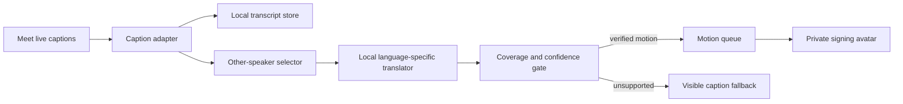

# Handsfree for Google Meet: complete implementation plan

Status: implementation plan, 11 October 2026. The requested features below are **not implemented by this document**. This plan describes one complete hackathon deliverable. The user reported a deadline about one hour away when this plan was requested; the minute-by-minute order near the end is a triage guide, not a claim that unverified sign-language interpretation can be completed in one hour.

## 1. Product outcome and confirmed decisions

A person using Handsfree joins Google Meet, controls the meeting with their existing voice, head and hand inputs, reads a locally retained transcript, and watches an avatar sign what **other participants** say. The avatar appears only for that person. The complete experience lives in the existing Chrome extension and website dashboard, with the Firefox fork handled separately.

The decisions in this section came from the user's latest answers:

| Decision | Required behavior |
| --- | --- |
| Signing language | Prefer Indian Sign Language (ISL). Use American Sign Language (ASL) only if an actually usable local ISL path cannot be verified in time. Label the selected language prominently. |
| Signing location | Text-to-sign translation, motion selection and animation run locally. Do not send captions or meeting audio to a signing service. |
| Speech input | Google Meet's own captions may supply the incoming text. Google produces those captions; the local-only requirement applies to the signing pipeline after caption text arrives. |
| Avatar audience | Only the person running Handsfree sees the avatar. Do not publish an avatar feed to the meeting. |
| Feature delivery | Plan and qualify a complete hackathon experience in one delivery. Internal build order is not a series of user-facing versions. |
| Work requested now | Finish this plan first. Runtime feature work is outside this planning turn. |

The user previously requested a Meet preferences tab, configurable face and finger gestures, voice actions for call control and chat, a downloaded transcript after the call, and a Signvrse-style signing avatar. The [Signvrse Meeting Capture listing](https://chromewebstore.google.com/detail/signvrse-meeting-capture/lmaponnefhhpkggllhbcfapmocbplgja) remains a visual and workflow reference. Its own audio streaming service cannot be the local signing implementation.

## 2. What exists today

The Chrome extension has a ten-action Meet adapter in [`extension/src/sites/meet.ts`](extension/src/sites/meet.ts). It recognizes join, leave, microphone, camera, captions, raised hand, people/chat panels, chat focus and guarded test messaging. [`extension/src/sites/group-b.ts`](extension/src/sites/group-b.ts) implements desired-state actions, so an already-muted microphone remains muted when asked to mute. Join, leave and sending have one-use confirmation. Screen presentation explicitly requires a browser-owned picker.

During an active Meet call, [`extension/src/background.ts`](extension/src/background.ts) requires each spoken command or dictation segment to begin with `Handsfree`. Open-ended requests still require `hey handsfree` in the original utterance. A spoken prefix is not speaker identification; someone else in a meeting could say it. Existing sender, revision and page checks must remain in force.

Five finger poses already exist in [`extension/src/gestures.ts`](extension/src/gestures.ts): one, two and three fingers, fist, and thumbs-up. [`extension/src/gesture-runtime.ts`](extension/src/gesture-runtime.ts) handles confidence, held frames, a neutral reset, pause and calibration. Gesture presets currently cover browsing actions, have one action per finger pose, and are saved separately in local extension storage. Meet-specific presets and actions need new types and validation.

The face tracker in [`shared/tracking/inference.ts`](shared/tracking/inference.ts) currently reduces landmarks to a pointer point. It does not publish a reliable head-pitch or head-roll signal. A moving cursor must not be mistaken for a deliberate Meet gesture. Camera capture, tracking and speech are owned by the extension offscreen document. The Next dashboard profile currently has Controls and Permissions; it has no Meet tab. The Firefox fork in `firefix/` is intentionally separate.

The previous `SUNO-Meet-withASL-main.zip` in ignored local notes includes a separate meeting application and an 18-word sign-recognition vocabulary. It does not provide a verified Meet-ready text-to-ISL animation library. Its source and assets cannot be treated as ready for redistribution without checking licensing and output quality.

## 3. User journey

1. During setup or later in Profile, open **Meet**. Choose whether to inherit normal voice/head/hand availability, then assign Meet-specific gestures. Each mapping has a preview, calibration check, enable switch and conflict warning.
2. Open a meeting and start Handsfree. The Meet tab reports whether microphone, camera, captions, transcript and local signing are ready. It never claims capture started while captions are unavailable.
3. Say `Handsfree mute my mic`, lean left, or use a configured finger pose. Handsfree checks the actual Meet state, performs the desired action once, then reports its observed result. `Look up` means a deliberate upward head movement, not eye-gaze detection.
4. To chat, say `Handsfree open chat`, dictate a draft, review it, and explicitly confirm sending. Commands heard from other participants must not silently send messages or leave the meeting.
5. Turn on transcript capture. Finalized Meet captions appear in a readable local transcript with timestamps, speaker labels when Meet supplies them, and visible gap markers if captions stop.
6. The local signing engine consumes finalized captions from other participants. The avatar stays in a draggable, resizable Handsfree panel over the user's Meet tab; spoken words remain visible beside it. Unsupported passages are shown as text instead of improvised signs.
7. On leave or call end, offer **Download transcript**. The last captured session remains reachable from the Meet tab until the user downloads or deletes it, subject to the chosen retention setting.

## 4. Meet preferences tab

Add a third Profile tab, **Meet**, beside Controls and Permissions in [`next/components/dashboard/dashboard.tsx`](next/components/dashboard/dashboard.tsx). It should use the same width, tab semantics, keyboard focus behavior and accessible form controls as the existing profile. The main website's public Docs can explain commands; the dashboard Meet tab contains actual settings and live state.

Group options by the decision a user can make:

| Group | Controls and feedback |
| --- | --- |
| Inputs | Voice, face and hand enable switches; inherit global input availability by default. A Meet switch cannot activate a globally disabled or unpermitted device without normal permission/setup. |
| Head gestures | Enabled mappings for lean left/right, look up/down and any additional pose that passes calibration; action picker; sensitivity, hold and cooldown; neutral preview; reset mapping. |
| Finger gestures | One/two/three fingers, fist and thumbs-up; action picker; existing calibration status; hold and cooldown; conflict feedback against global presets. |
| Voice | Command examples, active Meet addressing rule, feedback modality and chat readback preference. Keep current global pause/resume phrases. |
| Transcript | Opt-in capture, status, retention, download latest, delete latest, and clear indication that Meet captions are the source. |
| Signing | On/off, selected signed language, local model/asset readiness, avatar size and placement, playback speed, caption companion, replay last passage and plain-language error state. |

Persist a versioned `meetPreferences` object through extension storage and the existing dashboard bridge. Validate it in the background, not only in React. Keep normal browsing presets and calibration data intact. Reject unknown actions, duplicate active mappings on the same gesture, out-of-range times, invalid language IDs and unsupported renderer settings. If old saved settings have no Meet object, use explicit conservative defaults: Meet gestures off until assigned, transcript off until enabled, signing off until its local assets are ready. Switching tabs or reloading the dashboard must preserve the choices. Provide Reset Meet preferences without touching global controls.

The active view should report the *effective* setting: permission granted, global input enabled, Meet input enabled, model ready, meeting detected and Handsfree running. The switch alone cannot imply that detection is active. Voice navigation to `open Meet settings` should land on the tab; old profile hashes keep working. Account provider keys and raw transcript data never cross into ordinary page JavaScript or the Next server.

## 5. Input arbitration and face gestures

The same webcam should feed the pointer tracker, head-pose recognizer and finger recognizer without opening three competing camera streams. Process sampled frames through workers or a shared vision scheduler, measure frame latency, and reduce redundant inference. Keep the user's selected primary pointer and deliberate pointer switching. Meet gestures are **actions**, not a request to switch pointer control.

For head detection, extend the existing face inference result with a pose estimate and geometric quality measurement. A practical candidate is MediaPipe Face Landmarker transformation matrices, which are disabled by default and must be enabled and measured; Google's [web guide](https://developers.google.com/edge/mediapipe/solutions/vision/face_landmarker/web_js) documents these outputs. Define left/right relative to the user's mirrored preview and record that mapping during calibration. Use head roll for a lean and pitch for looking up/down. Do not label an eye movement as head movement.

The state machine for each gesture is `neutral → candidate → held → fired → cooldown → neutral`. A proposed calibration starts with 2 seconds of neutral pose, then a comfortable user-selected pose, saves a relative threshold and checks it on live preview. Action fires only after sustained quality and dwell; default starting values are 700 ms hold, 1.2 s cooldown and neutral rearm, then tune from actual hardware. Low confidence, face loss, camera occlusion, abrupt recalibration and pause clear the candidate without firing. A sustained lean fires once, including when the person stays leaned. No gesture executes during setup preview, permission recovery, another tab, or a stale meeting session.

Hand poses reuse the existing recognizer and calibration. Meeting mappings are scoped by an exact Meet tab and active call state. A finger action chosen for Meet may override that same finger's browsing action only during the active call; the dashboard must show this precedence. If hand input is globally disabled, the saved mapping remains visible but inactive. High-impact actions such as leave, join and send may start a confirmation prompt but never complete on a gesture alone. Mute/unmute and raise/lower can execute after their deliberate hold when Meet's current state is known.

Each trigger carries `tabId`, `meetingCode`, `documentId`, `pageRevision`, `sessionGeneration`, `inputKind`, `gestureId` and time. The background rechecks all context immediately before issuing a site action; it must not trust a bare preset ID received from a worker. Inputs arriving during pause, Stop, meeting switch or tab close are discarded. A simultaneous voice and gesture request for the same state is serialized and re-read after the first action.

## 6. Meeting action catalogue

Keep `ME01`–`ME10` and add well-scoped actions through the existing adapter/catalogue pattern. The IDs below are proposed implementation IDs; each gets a deterministic parser route, capability state, executor, verification rule and feedback string. If a control is hidden, ambiguous or unavailable for the current Meet layout, the extension reports that rather than clicking by coordinates.

| Action | Example voice phrase after `Handsfree` | Verification and guard |
| --- | --- | --- |
| ME01 join | `join this meeting` | Unique Join/Ask control, exact code, existing confirmation, then in-call evidence. |
| ME02 mute/unmute | `mute my mic`, `unmute my mic` | Read actual microphone state before and after; desired state only. |
| ME03 camera on/off | `turn my camera on`, `turn my camera off` | Read actual camera state before and after. |
| ME04 captions on/off | `turn captions on`, `turn captions off` | Verify button state; warn if transcript/signing lose their caption source. |
| ME05 hand up/down | `raise my hand`, `lower my hand` | Verify the resulting button state. |
| ME06 panels open | `open participants`, `open meeting chat` | Verify correct panel visible. |
| ME07 chat focus | `write a chat message` | Bind the unique in-call editor. |
| ME08 send chat | `send this to the meeting` | Keep recipient/code, draft, preview and one-use confirmation; verify one outgoing message. |
| ME09 present | `present this tab` | Keep the browser-owned picker as an assisted step; report its result honestly. |
| ME10 leave | `leave the meeting` | Existing confirmation and changed meeting state. |
| ME11/ME12 panels close | `close participants`, `close chat` | Close only the named panel, verify it disappears. |
| ME13 read chat | `read the last chat message` | Read visible in-call message text on request, avoid reading hidden or unrelated page text. |
| ME14 draft edit | `clear my chat draft`, `correct the last sentence` | Edit only bound draft; preserve confirmation invalidation after any change. |
| ME15 state report | `am I muted`, `is my camera on`, `are captions on` | Return state from current visible controls; `unknown` when uncertain. |
| ME16 participants | `who is in the meeting` | Summarize visible People panel list, with a bound choose flow for ambiguous names. |
| ME17/ME18 pin | `pin [participant]`, `unpin [participant]` | Resolve a unique participant/tile, verify pinned state; decline if layout has no stable control. |
| ME19 layout | `switch to tiled layout` | Use visible Meet layout controls and verify selection; do not invent layout names absent from the account. |
| ME20 caption comfort | `make captions larger` | Apply only Handsfree-owned caption presentation when supported; avoid changing Meet's shared UI unpredictably. |
| ME21/ME22 capture | `start transcript`, `stop transcript` | Visible capture status, independently of voice-command transcript overlay. |
| ME23/ME24 transcript | `download transcript`, `delete this transcript` | Act on current local session; deletion needs a direct deliberate confirmation. |
| ME25/ME26 signing | `start signing`, `stop signing` | Local asset readiness and playback status; never turn on a cloud signing route. |
| ME27/ME28 signing playback | `pause signing`, `resume signing` | Local queue only; state survives panel collapse. |
| ME29 signing replay | `repeat the last signed sentence` | Replay only the last verified signed segment with its caption text. |

These are voice-command and user-action targets, not promises that every Meet account exposes every UI control. The per-action capability state must say available, already satisfied, needs choice/confirmation or unavailable. User-facing Docs should list the supported commands after implementation and describe account/layout limits. Finite commands remain finite; `hey handsfree` remains the only prefix for arbitrary requests. The active-call `Handsfree` prefix applies to chat dictation segments too, as it does now.

The existing sending allowlist accepts only configured private test meetings. A hackathon demo can use a controlled meeting code and demonstrate the full guarded flow. General-public message sending is a separate product decision and must not silently bypass the present guard. A finger gesture or generic click/Enter cannot bypass the bound send preview. Stop/Pause cancel pending sends and joins/leaves.

## 7. Caption capture and transcript download

The live captions inside Meet are the source for both transcript and avatar. The existing Handsfree `TRANSCRIPT` event represents **the user's microphone recognition** and must never be reused as a meeting transcript. Create a separate caption adapter in the Meet content script, scoped to the active meeting document and caption region. Discover selectors against a current disposable meeting and prefer semantic roles or stable content patterns over brittle class names. A `MutationObserver` watches caption updates; it does not poll or scrape every page element.

Represent a line as `{meetingSessionId, sourceId?, speakerLabel?, text, firstSeenAt, finalizedAt, status}`. Captions often revise the same visible line: update a provisional line rather than appending every revision. Finalize on replacement, speaker change, disappearance or a bounded quiet period. Deduplicate repeated DOM paints by stable ID where available and normalized text plus time window otherwise. Preserve original text and timestamp. Never infer a speaker from the voice provider or facial tile if Meet supplies none; use `Speaker unknown`.

Support three explicit states: `capturing`, `waiting for captions`, `paused`. Show a live count and last-caption time. If captions are off, inaccessible or unsupported, say so and display an interruption interval. If the user turns captions back on, continue in the same local session with a gap marker. Caption collection begins only after opt-in or the saved auto-start choice and only on the current Meet tab. Detect joining/leaving, navigation to a different code, content-script reinjection, extension reload and call end; never combine two calls with the same displayed title.

Persist acknowledged finalized lines in an extension-owned IndexedDB store or another measured durable store. Do not rely on service-worker memory or a page unload callback for the final export. Each stored line is bound to a session ID and increasing sequence number. Cap the number of sessions, lines and bytes; show a quota error instead of silently dropping text. A proposed starting policy is the last session retained locally for 24 hours with Never, 24 hours and 7 days choices. The exact default is a product choice to settle in UI review; no automatic cloud sync. Raw frames and audio are not persisted. Clear all/individual session controls and age-out need the same scope checks as export.

After the call ends or the user leaves, the website/extension shows a review panel with line count, time range, source warning and **Download .txt**. The download can also be triggered while in a call. Format header includes meeting code masked or chosen title, local date/time and source `Google Meet captions`. Each line contains timestamp, available speaker and text; gap markers are explicit. Generate the file as a Blob from the extension-owned store and use a browser download path that works when the Meet tab has closed. A `.vtt` export is a useful additional option only after `.txt` is reliable. Filenames must be path-safe and must not include a participant's full name by default.

Acceptance: a 3-person disposable meeting with repeated caption corrections, late captions, off/on caption cycling, leaving, reload and rejoining produces one line per final utterance in order, with every gap marked. Reopening Handsfree after leaving still offers that session's download. A browser fixture proves cleanup, and a real Meet test proves selectors and timing. Do not claim that caption-based capture is a verbatim recording or complete transcript when Meet failed to display speech.

## 8. Local signing avatar: feasibility and output contract

**Yes, an avatar can be built.** A rigged human model, hands, face, animation queue, visible caption companion and local rendering can be implemented. The hard part is generating *linguistically correct* ISL or ASL motion for arbitrary incoming sentences. A random hand-animation sequence, word-for-word English gloss or finger spelling of everything is not a sign-language interpreter. The finished UI must never label unsupported output as a verified translation.

The signing unit receives *finalized caption segments*, not raw microphone audio. It skips recognized self-caption lines and signs lines from other participants. If Meet cannot identify which speaker is the user, show the text as unassigned and avoid falsely claiming it belongs to another person; provide a clear manual source choice if needed. Do not replay earlier context when a new meeting starts.

The local pipeline is:

The language selector identifies the actual signed language, not the spoken language. English speech can be input to ISL if the local translator supports that pair. Language-specific signs, order, facial grammar and motion are separate assets; ASL motions cannot be relabelled ISL. The avatar renderer may use a bundled glTF rig with explicit joints for both hands, arms, torso, head and face, driven through a renderer such as Three.js. Each motion clip must declare its signed language, phrase/gloss identity, source, license, reviewer status, duration, handedness and non-manual markers. Blend between compatible clips while retaining handshape and face detail; pause/replay does not rerun translation. Provide a plain caption beside the avatar at all times.

Translation priority for a one-hour hackathon is local, licensed, already authored motions with known language and independent validation. A local text-to-motion model may be added only if it runs offline on the target browser and improves verified sentence coverage within the time budget. ONNX Runtime Web documents WebGPU and WASM execution, but a runtime alone supplies no sign-language model or data. Bundle executable code, model and motion assets into the extension or an offline pack installed locally. No CDN, external inference endpoint or Signvrse service request at signing time. Enforce this in the network test as well as code review. [`ONNX Runtime Web`](https://onnxruntime.ai/docs/tutorials/web/) is a candidate, not a selected dependency.

The first feasibility gate is decisive: identify an ISL motion source with permission to use it, inspect actual files, run at least one sentence through the renderer locally, and have an ISL-fluent reviewer evaluate intelligibility and major meaning errors. If it fails, evaluate ASL assets using the same gate and label the output ASL. If both fail, the avatar feature is **blocked** and the product cannot be reported as meeting the requested signing requirement. A moving character plus captions is not a substitute. Preserve the rest of the Meet work and report this exact blocker before a demo claim.

### Evidence and asset constraints checked for this plan

| Candidate | What the public source establishes | Consequence |
| --- | --- | --- |
| [Signvrse Meeting Capture](https://chromewebstore.google.com/detail/signvrse-meeting-capture/lmaponnefhhpkggllhbcfapmocbplgja) | Streams audio to Signvrse and uses a separate Meet add-on for a live avatar. | Reference for layout and consent only; does not meet local-signing requirement. |
| [Signvrse TERP repository](https://github.com/signvrse/terp-360) | Public GPL-3.0 repository currently exposes README and LICENSE, without usable motion code/assets in its listed files. | Cannot assume it can be embedded. |
| [Signvrse TerpforWeb](https://github.com/signvrse/TerpforWeb) | Public repository exposes documentation/images; its README labels that product proprietary. | Public repository visibility does not grant code reuse. |
| [iSign dataset](https://huggingface.co/datasets/Exploration-Lab/iSign/blob/main/README.md) | ISL research benchmark with gated, noncommercial, no-redistribution terms. | Research evidence, not a freely bundled production motion pack; it also does not directly supply ready avatar clips. |
| [How2Sign](https://how2sign.github.io/) and [SignAvatars](https://github.com/ZhengdiYu/SignAvatars) | ASL research material exists; license/access limits apply. | ASL fallback still requires separate permissions, retargeting and signer review. |
| [BhashaSetu ISL](https://www.bhashasetuisl.in/) | Its own site says the installable SDK/model/avatar are goals and are not shipped yet. | Do not plan around its promised package. |
| [Signapse](https://www.signapse.ai/) / [Hand Talk](https://acessibilidade.handtalk.me/plugin-asl) | Commercial ASL/BSL or ASL avatar services. | Incompatible with the user's local-only signing decision as runtime providers. |

Check the license of the **specific files** actually copied, including model weights, rig, textures, sign clips, fonts and datasets. A public paper or README is not a license for assets. The old SUNO ZIP and outside sample avatars may be useful for understanding a pipeline, but no assets enter distributable builds until their provenance is clear.

## 9. Avatar user interface and playback

The private avatar panel should be large enough to see handshape, both hands, face and upper torso at once. Offer resize, drag, collapse, restore, playback speed, pause/resume, replay last segment and an accessible text caption. Place it away from Meet's chat and captions by default; remember its position per user, clamp it inside the viewport after resize and at 200% zoom, and restore focus correctly when closed. Do not cover the Meet leave button or trap pointer/dwell access.

State is visible: `Waiting for captions`, `Signing`, `Paused`, `Unsupported phrase` or `Unavailable`. A translated segment shows speaker label when known and the signed-language label. If queued captions arrive faster than playback, show queue age and choose a bounded policy: drop stale motion only after surfacing text and marking the gap, never silently pretend to keep up. Suggested initial guard is a queue capped to 10 seconds of pending caption time; tune through measurement. Signing stops on call switch, tab close, user Stop or explicit signing off. A paused global Handsfree session must not trigger any gesture/voice actions; whether visual caption/sign playback continues while paused should be consistently reflected in the UI and tested.

The panel runs in the user's Meet tab or an extension-owned companion panel, depending on actual renderer isolation and Meet layout tests. It must never create a virtual camera or publish a media track. Its source is data from the scoped caption adapter, not an injected script in the Meet page's main world. Use inert text rendering for captions and labels so participant-provided text cannot execute HTML or script.

## 10. Privacy, ownership and failure behavior

Meet caption text may be sensitive. Keep caption capture opt-in, with a visible recording/capture indicator. Local signing reads only the caption lines needed for playback. No audio/video recording is required when Meet captions suffice. The Next website is a control surface; the extension stores session text, and the server receives neither captions nor avatar inputs. If an offline pack must be downloaded once, show its file source, size, hash and license before installation, then run without network access to that pack.

Chrome's [`tabCapture` documentation](https://developer.chrome.com/docs/extensions/reference/api/tabCapture) says capture requires a user invocation and can interrupt ordinary tab audio unless replay is connected. The preferred caption path avoids this additional audio permission and the risk of muting the meeting. If a future implementation needs raw-audio capture because the user changes requirements, that is a separate design and permission decision; it is not hidden in this plan.

Raw caption strings are never inserted into action prompts or interpreted as user commands. Meet participants saying `Handsfree` remain a known voice isolation problem, so the user can disable Meet microphone commands and use head/hand controls or a push-to-talk control. Explicit one-use confirmations remain for send, join and leave. A missed model, uncertain UI state, lost tab, unsupported browser API, old meeting session or language mismatch results in a visible failure, not a fabricated success. Stop must release camera and speech resources as in the existing product; sign animation and transcript writes stop for that session as specified.

## 11. Architecture and file-level work

The exact file names are proposed so a developer can start without rediscovering the codebase. Keep the Chrome and Firefox implementations isolated and do not overwrite concurrent activity-mode edits.

| Area | Expected changes |
| --- | --- |
| Shared contracts | Extend `extension/src/shared.ts` with versioned Meet settings, scoped gesture actions, transcript/status messages and input validation. Mirror only needed types in `firefix/`. |
| Head pose | Extend `shared/tracking/inference.ts` and Chrome/Firefox worker transport to report pose quality and orientation alongside pointer samples; add a pose-state module and calibration tests. |
| Finger actions | Extend `extension/src/gestures.ts`, `gesture-runtime.ts` and `offscreen.ts` to support Meet-scoped mappings, neutral/cooldown policy and current session identity. Keep normal presets and calibration. |
| Routing | Extend `extension/src/background.ts` with bounded event routing, session epochs, command serialization, local storage operations and current-tab checks. Do not let gestures bypass existing guarded site actions. |
| Meet DOM | Extend `extension/src/sites/meet.ts`, `group-b.ts`, `context.ts`, `catalogue.ts` and add a caption observer module under `extension/src/sites/`. Confirm selectors in a live disposable Meet. |
| Transcript | Add extension-owned store, finalization/deduplication and export modules. Keep them distinct from the existing voice transcript overlay. |
| Signing | Add a local translator/coverage gate, motion manifest/asset pack, renderer and user panel. Build scripts copy only verified licensed local assets. |
| Dashboard | Add `next/components/dashboard/meet-config.tsx`, a Meet Profile tab and status controls, using the existing shadcn controls and extension bridge. Read `next/AGENTS.md` and its relevant packaged Next docs before editing Next code. |
| Chrome package | Update `extension/scripts/build.mjs` and only the permissions actually required. Verify credential-free release packaging. |
| Firefox package | Port logic into `firefix/` without importing Chrome's source at runtime. Verify its capture tab, event page, media and model behavior independently. |
| Public docs | Update the actual support catalogue, install notes, command list and demo script after behavior passes. |

Suggested message contracts are `GET_MEET_STATUS`, `SAVE_MEET_PREFERENCES`, `MEET_GESTURE_TRIGGER`, `MEET_CAPTION_UPSERT`, `MEET_CAPTION_FINAL`, `MEET_TRANSCRIPT_LIST`, `MEET_TRANSCRIPT_EXPORT`, `MEET_TRANSCRIPT_DELETE` and `MEET_SIGNING_CONTROL`. Each mutation validates the sender, tab URL, meeting code, session nonce and monotonically increasing revision. The dashboard bridge may request aggregate state or an authorized export, but must not receive provider keys or raw frames.

## 12. One-hour execution order

These are the order of work and evidence to seek if implementation is later authorized. The user asked for one finished hackathon deliverable. A deadline cannot make missing licensed sign motion data or human language validation appear; the plan's release gate remains the same.

| Time budget after implementation starts | Focus | Evidence before moving on |
| --- | --- | --- |
| 0–8 min | Audit a real Meet call and available ISL/ASL local motion packs; select the signed language only from working assets. | One local motion clip plays with full hands/face; provenance known. If not, escalate the signing blocker immediately. |
| 8–20 min | Add Meet preference schema/tab and scoped head/finger action pipeline, reusing camera and calibration. | Save/reload works; deliberate lean/finger fires once; pause and tab switch suppress it. |
| 20–30 min | Complete voice action catalogue and state feedback, while retaining send/join/leave guards. | Fixture plus disposable real meeting show desired-state mute/camera/hand/chat. |
| 30–42 min | Observe live Meet captions and persist/export an end-of-call transcript. | Caption correction deduplicates; leave/download works after tab closes. |
| 42–52 min | Wire verified local signing assets to incoming caption lines and private panel. | Network blocked, avatar signs verified lines, unknown lines show text, no audio leaves for signing. |
| 52–60 min | Run a complete connected demo and package checks. | 2-person call, gestures, voice, chat approval, transcript download, avatar, Pause/Stop, package integrity. |

This schedule is an aggressive triage order, **not an engineering estimate**. The existing 10 Meet actions reduce work, but new face pose, reliable caption collection and validated open-ended signing are substantial. If the one-hour deadline arrives before all acceptance checks pass, accurately report what passed and which requirements remain blocked; do not label a staged animation as an interpreter.

## 13. Verification matrix

Automated tests should focus on behavior that can fail in meaningful ways. Avoid unit tests that merely repeat each implementation branch; cover state transitions, context changes and invalid data.

| Scenario | Expected result |
| --- | --- |
| Gesture held/repeated | One action, neutral rearm, no rapid toggles. |
| Head movement used for pointer | No accidental mute while navigating or reading. |
| Mirrored camera/camera switch | Left/up labels match the user's chosen direction after recalibration. |
| Low light/occlusion/lost tracking | No action; visible recovery status. |
| Hand pose and face pose together | Deterministic priority; at most one effect for one request. |
| Pause/Stop/reload/meeting switch | All pending actions, sends, captions and signing work bound to the old session are cancelled or closed safely. |
| Mic/camera already desired state | `already satisfied`, no extra click. |
| Ambiguous people/chat tile | Ask for a choice or report unavailable, no arbitrary participant click. |
| Send draft changed after approval | Previous approval invalid; no send. |
| Other participant says wake phrase | Documented limitation; exercise mute-voice/push-to-talk recovery. |
| Caption interim corrections/repeats | One final transcript line; sign only finalized content once. |
| Caption off/reconnect/late join | Gap marker and status, no claim of completeness. |
| Meet ends and tab closes | Transcript remains downloadable locally. |
| Unknown speaker | No invented identity and no claim that the avatar is signing a specific participant. |
| Unsupported signed phrase | Original text remains visible; no fabricated motion. |
| Offline during signing | Local signing of supported captions/queued assets continues; no request to a signing server. |
| Firefox and Chrome | Same user outcomes where browser APIs permit; browser-specific limits shown and independently tested. |
| 320px, 200% zoom, keyboard, screen reader | All Meet settings and avatar controls remain operable and labeled. |

Run targeted TypeScript/unit tests and packaged browser scenarios in `extension/`, the Next typecheck/build and connected dashboard checks, and independent `firefix/` typecheck/tests/build/smoke. A fake Meet fixture proves deterministic transitions, but a signed-in disposable 2–3 participant meeting is required to qualify current selectors, real captions, own/other speaker handling and camera/microphone coexistence. Do not post to other people's meetings; configure an owned test code for message-send evidence. Qualify the avatar with at least one fluent reviewer of the selected signed language; measure comprehension and note unknown passages. If no reviewer is available before judging, describe the avatar as unvalidated rather than accurate interpretation.

## 14. Completion criteria

The Meet feature is complete only when a user can save mappings in the Meet tab; use calibrated head, finger and voice actions in one actual call without accidental repeats; control mute, camera, captions, hand and chat with verified feedback; finish a guarded chat send in an owned test meeting; leave and download the caption-derived transcript; and watch a private **locally generated, correctly labelled** avatar sign supported other-participant speech. Unsignable passages must remain readable as text. Both saved preferences and the last transcript survive a dashboard refresh. Pause, Stop and meeting switch must invalidate pending work. A real two-person call, appropriate automated checks and an ISL/ASL signer review are the evidence for the result.

The strongest unresolved dependency is a usable, licensed and reviewable local ISL motion/translation source. ASL is allowed by the user if ISL cannot be made to work, but it has the same local-runtime and review requirements. The exact user-facing claim about signing coverage must match the verified asset and language. The requested one-hour deadline may limit which of these requirements can be truthfully demonstrated; the plan does not silently reduce them.
